# Data Tables — Full Inventory (single PostgreSQL)

> Status: Filling | Last Updated: 2026-10-15
> 59 tables + 1 deferred footnote. Column detail lives in files 03–10 and
> 15; this file is the index, ending with the full relationship diagram.
> Conventions (UUIDv7, money, indexes): `01-Conventions.md`.

## Design rules (apply to every table below)

1. **One database, real FKs everywhere.** Every arrow below is a true
   foreign key (`ON DELETE CASCADE` for owned children, restrictive
   otherwise). Single migration history under `server/db/migrate/`.
2. **UUIDv7 PKs, `timestamptz` created/updated pair** on every table.
3. Money `DECIMAL(12,2)` + `CHECK >= 0`; statuses `varchar` + `CHECK IN`.

## Auth & RBAC (10) → detail: `03-Auth-RBAC.md`

| Table | Purpose | Key links |
|---|---|---|
| users | Accounts (admins + customers), status lifecycle | — |
| roles | `admin` / `customer` (+ future) referenced by `slug` | — |
| permissions | Granular grants (`product.create`, `order.refund`) | — |
| role_permissions | Grant map, composite PK (role, permission) | roles, permissions |
| user_roles | Multi-role map, composite PK (user, role) | users, roles |
| addresses | Shipping/billing book, one-default partial unique | users |
| refresh_tokens | Hashed rotation tokens, revocation, expiry cleanup | users |
| customer_notes | Staff notes with author + timestamp (tier stays computed, never stored) | users, users (author) |
| staff_invitations | Invite flow: email, role, token hash, expiry, status (members *are* users) | users (inviter) |
| audit_logs | Admin action trail: actor, action, entity, entity_id, diff jsonb | users (actor) |

The single-URL gate reads `users → user_roles → roles.slug`
(see `14-Single-URL-Gating.md`).

## Catalog (15) → detail: `04-Catalog.md`

| Table | Purpose | Key links |
|---|---|---|
| categories | Tree (`parent_id` self-FK), nav flags, slug, tsvector | self |
| brands | **Defined but unbuilt in v1** — no seed, no UI (see footnote) | — |
| products | Core row: sku/slug unique, price/compare, stock balance, status, tags, `attributes` jsonb, `photo_settings` jsonb, source/external import ids, soft-delete, tsvector | categories, brands (nullable) |
| product_variants | SKU-unique rows, price/stock override, active flag | products (cascade) |
| product_images | Gallery order, one-primary partial unique, optional variant scope | products, variants |
| product_options | Per-product definitions incl. `display_type` + `visible_on` (pill/swatch/radio; pdp/checkout/admin) | products |
| product_option_values | Values stored once, unique per option | options |
| product_variant_option_values | Junction, composite PK (variant, option) | variants, options, values |
| product_attributes | Compare/spec definitions (name/slug/type/unit) | — |
| product_attribute_values | One value per (product, attribute), unique pair | products, attributes |
| stock_movements | Ledger: signed delta, reason, balance snapshot | products, variants |
| product_discounts | Scheduled percent/fixed, active-range index | products |
| reviews | Optional; approval queue | products, users |
| collections | Storefront collection pages (name/slug/season/visibility) | — |
| collection_products | Junction, composite PK (collection, product) + position | collections, products |

Footnote — brands: table ships in the DDL from day one with
`products.brand_id` nullable, but v1 builds no seed, no UI, no queries.
Launch = seed + UI only, zero migration.

## Cart & wishlist (4) → detail: `05-Cart-Wishlist.md`

| Table | Purpose | Key links |
|---|---|---|
| carts | Guest (`session_id`) or user cart; one-active-per-user partial unique; ownership CHECK | users (nullable) |
| cart_items | Lines with price/display snapshots; unique (cart, product, variant) NULLS NOT DISTINCT | carts (cascade) |
| wishlists | One per user (unique) | users |
| wishlist_items | Unique (wishlist, product) | wishlists |

## Orders & money (9) → detail: `06-Orders-Payments.md`

| Table | Purpose | Key links |
|---|---|---|
| orders | Number-unique, dual status axes, stored totals, address snapshots | users, discount_codes |
| order_items | Immutable snapshots (name/sku/price/line, options jsonb) | orders (cascade) |
| order_status_history | Status timeline + actor | orders |
| payments | Provider lifecycle, unique transaction ref | orders |
| refunds | Refund records: amount, reason, method, status, actor (one open refund per order partial unique) | orders, users (actor) |
| returns | RMA stages (in_transit/inspected/restocked/disputed), carrier, tracking, reason | orders |
| return_items | Per-line qty + disposition | returns, order_items |
| discount_codes | Code-unique coupons, caps, expiry | — |
| shipments | Optional carrier/tracking/status | orders |

## Platform (3) → detail: `07-Import-Jobs.md`, `08-Notify.md`

| Table | Purpose | Key links |
|---|---|---|
| import_jobs | CSV pipeline: source/status/counters/row-errors | users (created_by) |
| email_logs | Delivery states, retry scans | — |
| notification_templates | Optional keyed `{{variable}}` bodies | — |

## CMS in PG, jsonb (8, no Mongo) → detail: `09-CMS-Media.md`

cms_sections · cms_settings · navigation_settings · pages · blogs ·
blog_categories · media (R2 URLs — provider-agnostic, see `11-Storage.md`).
Whole-document reads; app-layer Zod validation.

| Table | Purpose | Key links |
|---|---|---|
| store_settings | Operational config key-value (key UNIQUE, value jsonb): brand, payments, shipping, taxes, notifications tabs | — |

## Analytics, partitioned (7) → detail: `10-Analytics.md`

page_views · sessions · cart_events · abandoned_carts · daily_stats ·
product_views · search_terms.
Monthly partitions; raw events drop >30d, rollups kept forever.

| Table | Purpose | Key links |
|---|---|---|
| product_views | PDP views with product FK (top-viewed, viewed-but-OOS) — never parsed from URLs | products, users (nullable) |
| search_terms | Term, hits, result count (zero-result → import guidance) | — |

## Operations (3) → detail: `15-Operations.md`

| Table | Purpose | Key links |
|---|---|---|
| support_tickets | Threads: customer, subject, priority, status | users (nullable customer) |
| support_messages | Normalized replies with sender + timestamp | support_tickets |
| notifications | In-app bell: kind/title/body/link, read_at (email stays in `email_logs`) | users |

## Deferred, not dropped

- `search_documents` — `tsvector` + GIN on products/categories covers v1;
  revisit only if ranked cross-entity search outgrows it.
- `brands` UI/seed — schema ready (above), build deferred.

## Relationship diagram (full map; per-domain slices live in files 03–10, 15)

```mermaid
erDiagram
    users ||--o{ user_roles : has
    roles ||--o{ user_roles : grants
    roles ||--o{ role_permissions : defines
    permissions ||--o{ role_permissions : granted-by
    users ||--o{ addresses : owns
    users ||--o{ refresh_tokens : holds
    users ||--o{ customer_notes : annotated
    users ||--o{ staff_invitations : invited-by
    users ||--o{ notifications : receives
    users ||--o{ audit_logs : actors
    users ||--o{ carts : owns
    users ||--o{ orders : places
    users ||--o{ wishlists : keeps
    users ||--o{ reviews : writes
    categories ||--o{ categories : nests
    categories ||--o{ products : lists
    brands ||--o{ products : labels
    products ||--o{ product_variants : offers
    products ||--o{ product_images : shows
    products ||--o{ product_options : defines
    product_options ||--o{ product_option_values : contains
    product_variants ||--o{ product_variant_option_values : resolves
    products ||--o{ product_attribute_values : specifies
    product_attributes ||--o{ product_attribute_values : valued-by
    products ||--o{ product_views : viewed-in
    products ||--o{ stock_movements : tracks
    products ||--o{ product_discounts : prices
    products ||--o{ reviews : rated-by
    products ||--o{ collection_products : collected-in
    collections ||--o{ collection_products : groups
    carts ||--o{ cart_items : contains
    products ||--o{ cart_items : references
    wishlists ||--o{ wishlist_items : saves
    orders ||--o{ order_items : snapshots
    orders ||--o{ order_status_history : timelines
    orders ||--o{ payments : settles
    orders ||--o{ refunds : returns-money
    orders ||--o{ returns : takes-back
    returns ||--o{ return_items : inspects
    orders ||--o{ shipments : ships
    discount_codes ||--o{ orders : applied-to
    support_tickets ||--o{ support_messages : threads
    import_jobs ||--o{ products : creates
```

