# Data Tables — Full Inventory (single PostgreSQL)

> Status: Filling | Last Updated: 2026-10-21
> 75 tables (41 implemented DDL + 34 specified) + 1 deferred footnote (`search_documents`). Column detail lives in files 03–10,
> 15, 17, and 19; this file is the index, ending with the full relationship diagram.
> Conventions (UUIDv7, money, indexes): `01-Conventions.md`.
> Retired systems and controlled duplication: `20-Schema-Decisions.md`.

## Design rules (apply to every table below)

1. **One database, real FKs everywhere.** Every arrow below is a true
   foreign key (`ON DELETE CASCADE` for owned children, restrictive
   otherwise). Single migration history under `server/db/migrate/`.
2. **UUIDv7 PKs, `timestamptz` created/updated pair** on every table.
3. Money `DECIMAL(12,2)` + `CHECK >= 0`; statuses `varchar` + `CHECK IN`.

## Auth & RBAC (10) → detail: `03-Auth-RBAC.md`

| Table | Purpose | Key links |
|---|---|---|
| users | Login credentials only (email/password/status); person fields live on profiles | — |
| profiles | The person you shop for: names, phone, DOB; `user_id` NULL = managed member with no login (file 17) | users (nullable) |
| roles | `admin` / `customer` (+ future) referenced by `slug` | — |
| permissions | Granular grants (`product.create`, `order.refund`) | — |
| role_permissions | Grant map, composite PK (role, permission) | roles, permissions |
| user_roles | Multi-role map, composite PK (user, role) | users, roles |
| refresh_tokens | Hashed rotation tokens, revocation, expiry cleanup | users |
| customer_notes | Staff notes with author + timestamp (tier stays computed, never stored) | profiles, users (author) |
| staff_invitations | Invite flow: email, role, token hash, expiry, status (members *are* users) | users (inviter) |
| audit_logs | Stock-edit summaries only: one row per product per import job (qty inserted, job ref) — variant deltas live in stock_movements; nothing else is recorded here | users (actor) |

The single-URL gate reads `users → user_roles → roles.slug`
(see `14-Single-URL-Gating.md`).

## Household & family (5) → detail: `17-Household-Accounts.md`

| Table | Purpose | Key links |
|---|---|---|
| households | Family group; every signup auto-creates a solo one — uniform paths | — |
| household_members | Composite PK (household, profile) + UNIQUE(profile) = one household per profile; roles manager/member | households, profiles |
| profile_size_preferences | Per-person, per-category size (references Size library values, RESTRICT) | profiles, categories, attribute_values |
| household_invitations | Join (email) + claim (profile) modes, one table, `staff_invitations` grammar | households, profiles, users (inviter) |
| addresses | Family + personal book, household-level one-default partial uniques | households, profiles |

## Catalog (17) → detail: `04-Catalog.md`

| Table | Purpose | Key links |
|---|---|---|
| categories | Tree (`parent_id` self-FK), nav flags, slug, tsvector | self |
| brands | **Defined but unbuilt in v1** — no seed, no UI (see footnote) | — |
| products | Core row: sku/slug unique, style name/code, internal S.No + source group key, base_price anchor + materialized min price ("From"), compare, stock balance, status, tags, HSN, Clothing Specs, `photo_settings` jsonb, source/external import ids, soft-delete, tsvector | categories, brands (nullable), size_charts (nullable) |
| product_source_rows | One row per legacy workbook listing row: S.No, spreadsheet row number, raw snapshot; preserves rows that group into one product | products (cascade) |
| product_variants | SKU-unique rows, source row, variant key, materialized effective price + override flag, stock, variant shipping overrides, active flag | products (cascade), product_source_rows (set null) |
| product_images | Gallery order, one-primary partial unique, optional variant scope | products, variants |
| stock_movements | Ledger: signed delta, reason, balance snapshot | products, variants |
| product_discounts | Scheduled percent/fixed, active-range index | products |
| reviews | Optional; approval queue | products, users |
| collections | Storefront collection pages (name/slug/season/visibility) | — |
| collection_products | Junction, composite PK (collection, product) + position | collections, products |
| size_charts | Measurement sets by garment type (`rows` jsonb — columns vary: shirts need shoulder/sleeve, skirts waist/hip); linked from products | — |
| attribute_definitions | Global single-record definitions: name UNIQUE, display_type — the one place attributes are defined | — |
| attribute_values | Global values + swatch_hex, UNIQUE(definition, value) | definitions |
| product_attribute_links | Assignment: (product, definition) composite PK; variant-axis flag, order, optional display label | products, definitions |
| product_attribute_link_values | Chosen values as rows + optional per-value price adjustment (NULL/0 = no effect; additive upcharges); queryable, never arrays | products, definitions, values |
| product_variant_attribute_values | One value per variant axis; composite FKs guarantee variant/product/attribute/value consistency | variants, products, links, values |

Footnote — brands: table ships in the DDL from day one with
`products.brand_id` nullable, but v1 builds no seed, no UI, no queries.
Launch = seed + UI only, zero migration.

Note — variant resolution: `product_variant_attribute_values` is the
variant↔value junction. It references `product_attribute_link_values`
compositely, so a variant can only use a value already chosen for its product.
`product_variants.variant_key` is the sorted axis-value signature and is
unique per product. The admin draft matrix still carries combinations in
memory; the DB shape is ready for the API seam.

## Cart & wishlist (4) → detail: `05-Cart-Wishlist.md`

| Table | Purpose | Key links |
|---|---|---|
| carts | Guest (`session_id`) or user cart; one-active-per-user partial unique; ownership CHECK; `for_profile_id` recipient | users (nullable), profiles (nullable) |
| cart_items | Lines with price/display snapshots; unique (cart, product, variant) NULLS NOT DISTINCT | carts (cascade) |
| wishlists | One per user (unique) | users |
| wishlist_items | Unique (wishlist, product) | wishlists |

## Orders & money (9) → detail: `06-Orders-Payments.md`

| Table | Purpose | Key links |
|---|---|---|
| orders | Number-unique, dual status axes, stored totals, address snapshots; placed-by + for-profile | users (placed-by), profiles (for), discount_codes |
| order_items | Immutable snapshots (name/sku/price/line, options jsonb) | orders (cascade) |
| order_status_history | Status timeline + actor | orders |
| payments | Provider lifecycle, unique transaction ref | orders |
| refunds | Refund records: amount, reason, method, status, actor (one open refund per order partial unique) | orders, users (actor) |
| returns | RMA stages (in_transit/inspected/restocked/disputed), carrier, tracking, reason | orders |
| return_items | Per-line qty + disposition | returns, order_items |
| discount_codes | Code-unique coupons, caps, expiry | — |
| shipments | Optional carrier/tracking/status | orders |

## Platform (3) → detail: `07-Import-Jobs.md`, `08-Notify.md`

| Table | Purpose | Key links |
|---|---|---|
| import_jobs | CSV pipeline: source/status/counters/row-errors | users (created_by) |
| email_logs | Delivery states, retry scans | — |
| notification_templates | Optional keyed `{{variable}}` bodies | — |

## CMS in PG, jsonb (8, no Mongo) → detail: `09-CMS-Media.md`

cms_sections · cms_settings · navigation_settings · pages · blogs ·
blog_categories · media (R2 URLs — provider-agnostic, see `11-Storage.md`).
Whole-document reads; app-layer Zod validation.

| Table | Purpose | Key links |
|---|---|---|
| store_settings | Operational config key-value (key UNIQUE, value jsonb): brand, payments, shipping, taxes, notifications tabs | — |

## Analytics, partitioned (7) → detail: `10-Analytics.md`

page_views · sessions · cart_events · abandoned_carts · daily_stats ·
product_views · search_terms.
Monthly partitions; raw events drop >30d, rollups kept forever.

| Table | Purpose | Key links |
|---|---|---|
| product_views | PDP views with product FK (top-viewed, viewed-but-OOS) — never parsed from URLs | products, users (nullable) |
| search_terms | Term, hits, result count (zero-result → import guidance) | — |

## Operations (3) → detail: `15-Operations.md`

| Table | Purpose | Key links |
|---|---|---|
| support_tickets | Threads: customer, subject, priority, status | users (nullable customer) |
| support_messages | Normalized replies with sender + timestamp | support_tickets |
| notifications | In-app bell: kind/title/body/link, read_at (email stays in `email_logs`) | users |

## Partner seam (2) → detail: `16-Partner-Qikink.md`

| Table | Purpose | Key links |
|---|---|---|
| partner_orders | Our order ↔ Qikink order/AWB/courier/status/raw/synced_at — one per order (unique) | orders |
| partner_wallet_ledger | Credit debit/refund per order (Rs.1=1 trail) | orders |

## Styling — Complete the Look (7, module-owned) → detail: `19-Styling-Recommendations.md`

| Table | Purpose | Key links |
|---|---|---|
| styling_slots | The 6 outfit roles (top/bottom/outerwear/headwear/footwear/accessory) | — |
| styling_category_slots | Category → slot map with ancestor-walk inheritance (~10 rows) | categories, styling_slots |
| styling_slot_rules | Which roles complement which, with weights — the day-zero matrix | styling_slots |
| styling_value_affinity | Style↔style scores + manual color overrides (any axis, definition-scoped) | attribute_definitions, attribute_values |
| styling_overrides | Pin/block per product pair — the merchandiser's two buttons | products, users (author) |
| styling_co_purchase | Nightly co-purchase boosts (dormant until refinement stage 2) | products |
| styling_events | Impression/click/ATC telemetry (30-day raw; partitioned at build) | products, styling_slots |

Module-owned: **zero edits to any other table**, one-way dependency
(styling reads core, nothing reads styling). **Ships last** — after the
core e-commerce app (file 19 §1).

## Deferred, not dropped

- `search_documents` — `tsvector` + GIN on products/categories covers v1;
  revisit only if ranked cross-entity search outgrows it.
- `brands` UI/seed — schema ready (above), build deferred.

## Relationship diagram (full map; per-domain slices live in files 03–10, 15, 17, 19)

```mermaid
erDiagram
    users ||--o{ user_roles : has
    roles ||--o{ user_roles : grants
    roles ||--o{ role_permissions : defines
    permissions ||--o{ role_permissions : granted-by
    users ||--o| profiles : credential-of
    users ||--o{ refresh_tokens : holds
    profiles ||--o{ customer_notes : annotated
    users ||--o{ staff_invitations : invited-by
    users ||--o{ notifications : receives
    users ||--o{ audit_logs : imports-stock-for
    users ||--o{ carts : owns
    profiles ||--o{ carts : for
    users ||--o{ orders : placed-by
    profiles ||--o{ orders : for
    users ||--o{ wishlists : keeps
    users ||--o{ reviews : writes
    households ||--o{ household_members : groups
    profiles ||--o{ household_members : joins
    households ||--o{ household_invitations : invites
    profiles ||--o{ household_invitations : claims
    profiles ||--o{ profile_size_preferences : sizes
    categories ||--o{ profile_size_preferences : sized-in
    attribute_values ||--o{ profile_size_preferences : picks
    households ||--o{ addresses : owns
    profiles ||--o{ addresses : personal
    categories ||--o{ categories : nests
    categories ||--o{ products : lists
    brands ||--o{ products : labels
    products ||--o{ product_source_rows : imported-from
    products ||--o{ product_variants : offers
    product_source_rows ||--o{ product_variants : generates
    products ||--o{ product_images : shows
    attribute_definitions ||--o{ attribute_values : contains-once
    products ||--o{ product_attribute_links : assigns
    product_attribute_links ||--o{ product_attribute_link_values : chooses
    product_variants ||--o{ product_variant_attribute_values : selected-as
    attribute_values ||--o{ product_variant_attribute_values : chosen-value
    products ||--o{ product_views : viewed-in
    products ||--o{ stock_movements : tracks
    products ||--o{ product_discounts : prices
    products ||--o{ reviews : rated-by
    products ||--o{ collection_products : collected-in
    collections ||--o{ collection_products : groups
    size_charts ||--o{ products : sizes
    carts ||--o{ cart_items : contains
    products ||--o{ cart_items : references
    wishlists ||--o{ wishlist_items : saves
    orders ||--o{ order_items : snapshots
    orders ||--o{ order_status_history : timelines
    orders ||--o{ payments : settles
    orders ||--o{ refunds : returns-money
    orders ||--o{ returns : takes-back
    returns ||--o{ return_items : inspects
    orders ||--o{ shipments : ships
    discount_codes ||--o{ orders : applied-to
    support_tickets ||--o{ support_messages : threads
    orders ||--o{ partner_orders : synced-to
    orders ||--o{ partner_wallet_ledger : debits
    styling_slots ||--o{ styling_category_slots : role-of
    categories ||--o{ styling_category_slots : mapped-by
    styling_slots ||--o{ styling_slot_rules : complements
    attribute_definitions ||--o{ styling_value_affinity : scopes
    attribute_values ||--o{ styling_value_affinity : pairs-with
    products ||--o{ styling_overrides : override-pairs
    products ||--o{ styling_co_purchase : co-bought
    products ||--o{ styling_events : surfaced-in
    import_jobs ||--o{ products : creates
```

