# Data Tables — Full Inventory (single PostgreSQL)

> Status: Filling | Last Updated: 2026-10-30
> 99 tables (99 implemented DDL + 0 specified) + 1 deferred footnote (`search_documents`). Column detail lives in files 03–10,
> 15, 17, and 19; this file is the index, ending with the full relationship diagram.
> Conventions (UUIDv7, money, indexes): `01-Conventions.md`.
> Retired systems and controlled duplication: `20-Schema-Decisions.md`.
> Duplicate-proofing constraints: `21-Idempotency.md`.

## Design rules (apply to every table below)

1. **One database, real FKs everywhere.** Every arrow below is a true
   foreign key (`ON DELETE CASCADE` for owned children, restrictive
   otherwise). Single migration history under `db/migrate/` (repo root, shared by both apps).
2. **UUIDv7 PKs, `timestamptz` created/updated pair** on every table.
3. Money `DECIMAL(12,2)` + `CHECK >= 0`; statuses `varchar` + `CHECK IN`.

## Auth & RBAC (13) → detail: `03-Auth-RBAC.md`

| Table | Purpose | Key links |
|---|---|---|
| users | Login credentials only (email/password/status); `password_hash` NULL + status `pending` = invited customer who never set a password; `locked_until` for the lockout window | — |
| profiles | The person you shop for: names, phone, DOB; `user_id` NULL = managed member with no login (file 17) | users (nullable) |
| roles | `admin` / `support` / `warehouse` / `customer` referenced by `slug` | — |
| permissions | Granular grants (`product.create`, `order.refund`) | — |
| role_permissions | Grant map, composite PK (role, permission) | roles, permissions |
| user_roles | Multi-role map, composite PK (user, role) | users, roles |
| refresh_tokens | Hashed rotation tokens, revocation, expiry cleanup | users |
| password_reset_tokens | Hashed single-use reset tokens (also the "set your password" invite for a `pending` account) | users |
| email_verification_tokens | Hashed verify tokens; carries its own `email` so an invite can precede a profile | users |
| login_attempts | Append-only brute-force evidence: email, inet, success flag; read by the lockout policy, swept at 90d | users (nullable) |
| customer_notes | Staff notes with author + timestamp (tier stays computed, never stored) | profiles, users (author) |
| staff_invitations | Invite flow: email, role, token hash, expiry, status (members *are* users) | users (inviter) |
| audit_logs | Stock-edit summaries only: one row per product per import job (qty inserted, job ref) — variant deltas live in stock_movements; nothing else is recorded here | users (actor) |

Both deployments' access gates read `users → user_roles → roles.slug`
(see `14-Access-Gating.md`). Auth is **custom, in-app**:
`users.password_hash` holds a bcrypt hash, refresh tokens
are stored hashed, and the app owns rotation + reuse detection.

## Household & family (5) → detail: `17-Household-Accounts.md`

| Table | Purpose | Key links |
|---|---|---|
| households | Family group; every signup auto-creates a solo one — uniform paths | — |
| household_members | Composite PK (household, profile) + one-active-per-profile partial unique = one household per profile at a time; roles manager/member; `left_at` soft leave keeps order history valid | households, profiles |
| profile_size_preferences | Per-person, per-category size; `size_definition_id` + composite FK to `attribute_values (definition_id, id)` so a saved value can only belong to the definition it claims | profiles, categories, attribute_definitions, attribute_values |
| household_invitations | Join (email) + claim (profile) modes, one table, `staff_invitations` grammar | households, profiles, users (inviter) |
| addresses | **Private book, one owner per row** (`profile_id NOT NULL`): one default shipping + one default billing *per person*. Family membership shares sizes, never addresses | profiles |

## Catalog (17) → detail: `04-Catalog.md`

| Table | Purpose | Key links |
|---|---|---|
| categories | Tree (`parent_id` self-FK), nav flags, slug, tsvector | self |
| brands | **Table created** (v1). Seed data, admin UI and storefront queries are built in the backend phase | — |
| products | Core row: `product_kind` (physical / gift_card — gift cards are never sent to a provider), `low_stock_threshold`, sku/slug unique, style name/code, internal S.No + source group key, base_price anchor + materialized min price ("From"), compare, stock balance, status, tags, HSN, Clothing Specs, `photo_settings` jsonb, source/external import ids, `partner_provider` + `partner_availability` (who produces it and whether they can), soft-delete, tsvector | categories, brands (nullable), size_charts (nullable) |
| product_source_rows | One row per legacy workbook listing row: S.No, spreadsheet row number, raw snapshot; preserves rows that group into one product | products (cascade) |
| product_variants | SKU-unique rows, source row, variant key, materialized effective price + override flag, stock, variant shipping overrides, active flag | products (cascade), product_source_rows (set null) |
| product_images | Gallery order, one-primary partial unique, optional variant scope | products, variants |
| stock_movements | Ledger: signed delta, reason, balance snapshot | products, variants |
| product_discounts | Scheduled percent/fixed, active-range index | products |
| reviews | Optional; approval queue | products, users |
| collections | Storefront collection pages (name/slug/season/visibility) + `cover_image_url`, `tagline`, `published_at` (required when `visibility='scheduled'`) | — |
| collection_products | Junction, composite PK (collection, product) + position | collections, products |
| size_charts | Measurement sets by garment type (`rows` jsonb — columns vary: shirts need shoulder/sleeve, skirts waist/hip); linked from products | — |
| attribute_definitions | Global semantic definitions: name UNIQUE, slug UNIQUE, display_type — the one place attributes are defined; a new type is a data row, not DDL | — |
| attribute_values | Global values + swatch_hex, UNIQUE(definition, value) | definitions |
| product_attribute_links | Assignment: (product, definition) composite PK; variant-axis flag/order, optional per-product label, non-axis display order | products, definitions |
| product_attribute_link_values | Chosen values as rows + optional per-value price adjustment (NULL/0 = no effect; additive upcharges); queryable, never arrays | products, definitions, values |
| product_variant_attribute_values | One value per variant axis; composite FKs guarantee variant/product/attribute/value consistency | variants, products, links, values |

Footnote — brands: table ships in the DDL from day one with
`products.brand_id` nullable, but v1 builds no seed, no UI, no queries.
Launch = seed + UI only, zero migration.

Note — variant resolution: `product_variant_attribute_values` is the
variant↔value junction. It references `product_attribute_link_values`
compositely, so a variant can only use a value already chosen for its product.
`product_variants.variant_key` is the sorted axis-value signature and is
unique per product. The admin draft matrix still carries combinations in
memory; the DB shape is ready for the API seam.

Note — semantic labels: `attribute_definitions` is the type registry
(`Size`, `Model`, `Dimensions`, `Capacity`, `Shape`, `Style`);
`attribute_values` holds the shared spellings; `axis_label` is the
per-product shopper-facing label. New types are rows, not tables.

## Cart & wishlist (4) → detail: `05-Cart-Wishlist.md`

| Table | Purpose | Key links |
|---|---|---|
| carts | Guest (`session_id`) or user cart; one-active-per-user partial unique; ownership CHECK; `for_profile_id` recipient | users (nullable), profiles (nullable) |
| cart_items | Lines with price/display snapshots; unique (cart, product, variant) NULLS NOT DISTINCT | carts (cascade) |
| wishlists | One per user (unique) | users |
| wishlist_items | Unique (wishlist, product) | wishlists |

## Orders & money (11) → detail: `06-Orders-Payments.md`

| Table | Purpose | Key links |
|---|---|---|
| orders | Number-unique, dual status axes, stored totals, address snapshots; **account order**: placed-by + for-profile + `for_household_id` (composite FK proves the recipient is a household member); **guest order**: `guest_email` + `guest_name` (+ `guest_phone`) instead — CHECK `orders_buyer_identity` allows exactly one shape; `order_type` (standard/exchange/replacement); `gift_card_amount` (added by 008); `idempotency_key` + partial unique so a retried checkout returns the same order | users (placed-by), profiles (for), households (for), discount_codes |
| order_items | Immutable snapshots (name/sku/price/line, options jsonb) + `returned_qty` with `CHECK (returned_qty <= qty)` | orders (cascade) |
| order_status_history | Status timeline + actor | orders |
| payments | Provider lifecycle, `method` (upi/card/netbanking/wallet/cod), unique transaction ref | orders |
| refunds | Refund records: amount, reason, method (`source` gateway reversal, or `upi` / `bank_transfer` manual payout for COD — never store credit) + payout reference + masked destination, status, actor (one open refund per order partial unique) | orders, users (actor) |
| returns | Customer request → RMA: `rma_number` unique, requester, `type` (exchange/replacement — no money-back returns), `status` pipeline (requested…completed/cancelled/disputed), `resolution` axis (exchange/replacement/refund/none), signed `price_difference`, decision fields, `refund_id` 1:1, `replacement_order_id`; account required | orders, profiles, users, refunds |
| return_items | Per-line qty + `reason_code` + disposition + `exchange_variant_id` + agreed line `refund_amount`; unique (return, order_item) | returns, order_items, product_variants |
| return_status_history | Return timeline, written in the same TX as `returns.status` | returns (cascade) |
| discount_codes | Code-unique coupons, caps, expiry | — |
| shipments | Carrier/tracking/status + `pieces`, `shipped_at`, `estimated_delivery_at`, `delivered_at`; `fulfillment_order_id` (added by 009) | orders, fulfillment_orders |
| shipment_events | Tracking timeline rows (status/location/description/occurred_at); unique (shipment, occurred_at, status) so a repeated carrier sync cannot append the same scan twice | shipments (cascade) |

## Platform (5) → detail: `07-Import-Jobs.md`, `08-Notify.md`, `21-Idempotency.md`

| Table | Purpose | Key links |
|---|---|---|
| import_jobs | CSV pipeline: source/status/counters/row-errors | users (created_by) |
| email_logs | Delivery states, retry scans, `dedupe_key` (partial unique) so a retried producer sends once | — |
| notification_templates | Optional keyed `{{variable}}` bodies | — |
| idempotency_keys | One row per mutating request carrying `Idempotency-Key`; `UNIQUE (scope, key)` replays the stored response instead of re-executing | users (actor) |
| webhook_events | Provider delivery log + replay guard; `UNIQUE (provider, provider_event_id)` makes double-applied payments impossible | — |

## CMS in PG, jsonb (15, no Mongo) → detail: `09-CMS-Media.md`

`media` · `blog_categories` · `blog_authors` · `blog_tags` · `blogs` ·
`blog_post_tags` · `blog_revisions` · `blog_slug_history` ·
`blog_post_media` · `design_assets` (implemented in `006-cms.sql`) ·
`cms_sections` · `cms_settings` · `navigation_settings` · `pages` ·
`store_settings` (implemented in `007-cms-pages.sql`).
Whole-document reads; app-layer Zod validation. No `content_html`, no
`blog_statuses` lookup, no `views` column — analytics owns views.

| Table | Purpose | Key links |
|---|---|---|
| media | R2 asset metadata (+ `filename`, `size_bytes` for the library list); covers, OG images, avatars, inline images; `usage` ∈ product/section/blog/design | users (uploader) |
| design_assets | Print-artwork library: name, category (print_artwork/embroidery/typography/label_spec), designer, placement, dimensions, file format/size, status; optional `media_id` | media, users (uploader) |
| blog_categories | One primary category per post; editorial pillars | blogs |
| blog_authors | Public bylines; optional staff-user link | users, media (avatar), blogs |
| blog_tags | Cross-cutting editorial tags | blog_post_tags |
| blogs | Post metadata, JSON content, publish state, search vector | blog_categories, blog_authors, media, users |
| blog_post_tags | Post↔tag junction, composite PK | blogs, blog_tags |
| blog_revisions | Immutable revision snapshots | blogs, users (author) |
| blog_slug_history | Retired slugs → `301` redirect targets | blogs |
| blog_post_media | FK ledger for inline JSON media | blogs, media |
| cms_sections | Ordered page sections by `page_key` (hero, banner, featured_products, blog_teaser, brands, testimonial); `content` jsonb | users (updated_by) |
| cms_settings | Single-row theme document per `scope` with a `version` cache-buster | users |
| navigation_settings | Single-row navbar/megamenu document (`navbar` jsonb) | users |
| pages | Static pages (about, shipping, returns policy) as block documents + SEO, by unique `slug` | users |
| store_settings | Operational config key-value (key UNIQUE, value jsonb): brand, payments, shipping (incl. `shipping.free_threshold`), taxes, notifications, `exchange.window_days`, `inventory.low_stock_threshold` | — |

## Analytics, partitioned (7) → detail: `10-Analytics.md`

page_views · analytics_sessions · cart_events · abandoned_carts · daily_stats ·
product_views · search_terms.
Monthly partitions on the four raw event tables (`ts`), each with a
`_default` partition so inserts work before the monthly ones attach; raw
events drop >30d, rollups kept forever. The session table is
`analytics_sessions`, never plain `sessions`.

| Table | Purpose | Key links |
|---|---|---|
| page_views | Raw page-view events (partitioned monthly by `ts`, `_default` partition) — session, path, referrer | users (nullable) |
| cart_events | Raw cart events (item_added / item_removed / qty_changed / cart_viewed), partitioned monthly | carts, users (nullable) |
| abandoned_carts | One row per abandoned cart; exactly-once `reminded_at` | carts (unique), users (nullable) |
| daily_stats | Permanent daily rollups (never partitioned, never dropped) | — |
| analytics_sessions | One row per browsing session, upserted by unique `session_id` on heartbeat; embedded page path for funnels | users (nullable) |
| product_views | PDP views with product FK (top-viewed, viewed-but-OOS) — never parsed from URLs | products, users (nullable) |
| search_terms | Term, hits, result count (zero-result → import guidance) | — |

## Operations (3) → detail: `15-Operations.md`

| Table | Purpose | Key links |
|---|---|---|
| support_tickets | Threads: subject, priority, status, `source` (`contact_form` = storefront contact page), optional `order_id`; a guest thread carries `guest_name` + `guest_email` (CHECK: user *or* both guest fields) | users (nullable customer) |
| support_messages | Normalized replies with sender + timestamp; `UNIQUE (ticket_id, created_at, sender)` collapses a retried send | support_tickets (cascade) |
| notifications | In-app bell: `kind` ∈ order/cart/inventory/payment/system/marketing/refund, title/body/link, read_at; `dedupe_key` + partial unique so the same event never rings twice (email stays in `email_logs`) | users |

## Commerce extras (5) → detail: `22-Commerce-Extras.md`

Implemented in `008-commerce-extras.sql`.

| Table | Purpose | Key links |
|---|---|---|
| newsletter_subscribers | One row per email (unique `lower(email)`): status pending/subscribed/unsubscribed/bounced, source, double opt-in token hash, consent timestamps | users (nullable, linked on sign-up) |
| faqs | `/faq` and product/category FAQs: scope general/product/category, group label, question, answer, order, published flag | products, categories, users (author) |
| gift_cards | Hashed code + last 4, initial value, cached balance, status, expiry, recipient, buying order line or issuing staff member | order_items (nullable, unique), users (issuer) |
| gift_card_transactions | Append-only ledger: issue / redeem / reversal / adjust, amount, balance after; one redeem per (card, order) | gift_cards, orders (nullable) |
| stock_alert_subscriptions | Back-in-stock requests (guest email or customer) per product/variant; waiting → notified / cancelled | products, product_variants (nullable), users (nullable) |

## Integrations & fulfilment (7) → detail: `16-Fulfillment-Providers.md`

Implemented in `009-fulfillment.sql`. Provider-agnostic: Qikink is one
`integration_providers` row plus an adapter; a new partner, courier or
gateway is a new row, not a new table.

| Table | Purpose | Key links |
|---|---|---|
| integration_providers | Registry of payment / fulfilment / shipping / email / SMS providers: unique slug, category, sandbox/live, active flag, capabilities + non-secret settings jsonb. `products.partner_provider`, `payments.provider`, `webhook_events.provider` are FKs to its slug | — |
| provider_product_mappings | Variant → provider SKU + provider payload (Qikink print type, designs, placements, mockups) + unit cost; unique (provider, variant) | integration_providers, product_variants |
| provider_cod_remittances | COD money the provider collected and paid back (transfer ref, amount, fees, wallet/bank) | integration_providers |
| fulfillment_orders | One per order per provider send (split, re-ship): our external ref, provider order id, normalized status + raw provider status, gateway, COD amount, provider cost, courier, AWB, RTO storage deadline, remittance link, sync state | orders, integration_providers, provider_cod_remittances |
| fulfillment_order_items | Which order lines (qty, SKU snapshot) went in which provider order | fulfillment_orders, order_items |
| provider_wallet_ledger | Prepaid provider wallet: recharge, order debit, cancel/claim credit, COD-to-wallet, withdrawal, adjustment | integration_providers, fulfillment_orders, provider_cod_remittances |
| fulfillment_claims | Defect / damage / wrong item / lost-parcel claims to the provider with deadline, evidence media ids, ticket ref, resolution | fulfillment_orders, returns, users |

## Styling — Complete the Look (7, module-owned) → detail: `19-Styling-Recommendations.md`

| Table | Purpose | Key links |
|---|---|---|
| styling_slots | The 6 outfit roles (top/bottom/outerwear/headwear/footwear/accessory) | — |
| styling_category_slots | Category → slot map with ancestor-walk inheritance (~10 rows) | categories, styling_slots |
| styling_slot_rules | Which roles complement which, with weights — the day-zero matrix | styling_slots |
| styling_value_affinity | Style↔style scores + manual color overrides (any axis, definition-scoped) | attribute_definitions, attribute_values |
| styling_overrides | Pin/block per product pair — the merchandiser's two buttons | products, users (author) |
| styling_co_purchase | Nightly co-purchase boosts (dormant until refinement stage 2) | products |
| styling_events | Impression/click/ATC telemetry (30-day raw; partitioned at build) | products, styling_slots |

Module-owned: **zero edits to any other table**, one-way dependency
(styling reads core, nothing reads styling). **Ships last** — after the
core e-commerce app (file 19 §1).

## Deferred, not dropped

Every table the spec asked for is now in the DDL — the count is 99
implemented, 0 specified. What remains deferred is *behaviour*, not shape:

- `search_documents` — `tsvector` + GIN on `products` and `categories`
  covers v1 (one ranked query, two entity types); revisit only if
  cross-entity ranking outgrows it.
- `brands` UI/seed — schema ready (above), build deferred.
- Admin UI + mock rewiring — the tables and columns exist; screen work
  tracks separately (`state-for-agents/pending-component-work.md`).
- Lockout + analytics writers — `users.locked_until`, `login_attempts`
  and the event tables are DDL-only; the app code that writes them lands
  with the backend build.

## Relationship diagram (full map; per-domain slices live in files 03–10, 15, 17, 19)

```mermaid
erDiagram
    users ||--o{ user_roles : has
    roles ||--o{ user_roles : grants
    roles ||--o{ role_permissions : defines
    permissions ||--o{ role_permissions : granted-by
    users ||--o| profiles : credential-of
    users ||--o{ refresh_tokens : holds
    users ||--o{ password_reset_tokens : resets
    users ||--o{ email_verification_tokens : verifies
    users |o--o{ login_attempts : attempted-by
    profiles ||--o{ customer_notes : annotated
    users ||--o{ staff_invitations : invited-by
    users ||--o{ notifications : receives
    users ||--o{ audit_logs : imports-stock-for
    users ||--o{ carts : owns
    profiles ||--o{ carts : for
    users ||--o{ orders : placed-by
    profiles ||--o{ orders : for
    users ||--o{ wishlists : keeps
    users ||--o{ reviews : writes
    households ||--o{ household_members : groups
    profiles ||--o{ household_members : joins
    households ||--o{ household_invitations : invites
    profiles ||--o{ household_invitations : claims
    profiles ||--o{ profile_size_preferences : sizes
    categories ||--o{ profile_size_preferences : sized-in
    attribute_values ||--o{ profile_size_preferences : picks
    profiles ||--o{ addresses : owns
    categories ||--o{ categories : nests
    categories ||--o{ products : lists
    brands ||--o{ products : labels
    products ||--o{ product_source_rows : imported-from
    products ||--o{ product_variants : offers
    product_source_rows ||--o{ product_variants : generates
    products ||--o{ product_images : shows
    attribute_definitions ||--o{ attribute_values : contains-once
    products ||--o{ product_attribute_links : assigns
    product_attribute_links ||--o{ product_attribute_link_values : chooses
    product_variants ||--o{ product_variant_attribute_values : selected-as
    attribute_values ||--o{ product_variant_attribute_values : chosen-value
    users ||--o| blog_authors : staff-link
    media ||--o| blog_authors : avatars
    blog_categories ||--o{ blogs : groups
    blog_authors ||--o{ blogs : writes
    media ||--o{ blogs : covers
    blogs ||--o{ blog_post_tags : tags
    blog_tags ||--o{ blog_post_tags : used-by
    blogs ||--o{ blog_revisions : snapshots
    blogs ||--o{ blog_slug_history : retired-slugs
    blogs ||--o{ blog_post_media : inline-media
    media ||--o{ blog_post_media : used-by
    users ||--o{ design_assets : uploads
    media ||--o| design_assets : file-of
    users ||--o{ store_settings : edits
    products ||--o{ product_views : viewed-in
    carts ||--o{ cart_events : emits
    carts ||--o| abandoned_carts : flags
    users |o--o{ analytics_sessions : browses-in
    users |o--o{ page_views : seen-in
    users |o--o{ idempotency_keys : retries
    products ||--o{ stock_movements : tracks
    products ||--o{ product_discounts : prices
    products ||--o{ reviews : rated-by
    products ||--o{ collection_products : collected-in
    collections ||--o{ collection_products : groups
    size_charts ||--o{ products : sizes
    carts ||--o{ cart_items : contains
    products ||--o{ cart_items : references
    wishlists ||--o{ wishlist_items : saves
    orders ||--o{ order_items : snapshots
    orders ||--o{ order_status_history : timelines
    orders ||--o{ payments : settles
    orders ||--o{ refunds : returns-money
    orders ||--o{ returns : takes-back
    returns ||--o{ return_items : inspects
    returns ||--o{ return_status_history : timelines
    return_items }o--|| order_items : returns-one
    return_items }o--o| product_variants : exchanges-for
    refunds |o--o| returns : settles
    orders ||--o{ shipments : ships
    shipments ||--o{ shipment_events : reports
    discount_codes ||--o{ orders : applied-to
    users |o--o{ support_tickets : opens
    support_tickets ||--o{ support_messages : threads
    users |o--o{ support_messages : answers
    orders ||--o{ fulfillment_orders : sent-as
    fulfillment_orders ||--o{ fulfillment_order_items : contains
    fulfillment_orders ||--o{ fulfillment_claims : disputed-by
    integration_providers ||--o{ fulfillment_orders : fulfils
    integration_providers ||--o{ provider_wallet_ledger : wallet
    styling_slots ||--o{ styling_category_slots : role-of
    categories ||--o{ styling_category_slots : mapped-by
    styling_slots ||--o{ styling_slot_rules : complements
    attribute_definitions ||--o{ styling_value_affinity : scopes
    attribute_values ||--o{ styling_value_affinity : pairs-with
    products ||--o{ styling_overrides : override-pairs
    products ||--o{ styling_co_purchase : co-bought
    products ||--o{ styling_events : surfaced-in
    import_jobs ||--o{ products : creates
```

