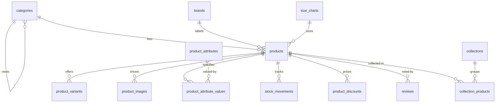

# Catalog — Columns, Constraints, Indexes

> Status: Filling | Last Updated: 2026-10-17
> 13 tables. Conventions: `01-Conventions.md`. Money semantics follow the
> open currency decision (`00-README.md` §7) — DECIMAL(12,2) shape is final.
> Mermaid slice for this domain sits at the end.

## categories

| Column | Type | Constraints | Reason |
|---|---|---|---|
| id | uuid | PK, UUIDv7 | |
| parent_id | uuid | NULL, FK → categories(id) ON DELETE RESTRICT | Tree; restricting delete protects children from orphans |
| name | varchar(150) | NOT NULL | |
| slug | varchar(180) | NOT NULL, UNIQUE | URL segment |
| description | text | NULL | |
| image_url | varchar(2048) | NULL | R2 URL |
| is_active | boolean | NOT NULL DEFAULT true | Publish switch |
| show_in_navbar | boolean | NOT NULL DEFAULT false | Storefront nav visibility |
| show_in_megamenu | boolean | NOT NULL DEFAULT false | |
| megamenu_show_images | boolean | NOT NULL DEFAULT false | |
| sort_order | integer | NOT NULL DEFAULT 0 | Nav ordering |
| settings | jsonb | NOT NULL DEFAULT '{}' | Per-category overrides (photo ratio, layout) |
| deleted_at | timestamptz | NULL | Soft-delete (catalog rule) |
| search_vector | tsvector | GENERATED ALWAYS AS (to_tsvector('english', name \|\| ' ' \|\| coalesce(description,''))) STORED | Always-consistent search, no triggers |
| created_at / updated_at | timestamptz | NOT NULL DEFAULT now() | |

Indexes: PK · unique slug (routing) · `idx_categories_parent_id` (tree) ·
GIN `idx_categories_search_vector` · partial
`idx_categories_navbar (is_active, show_in_navbar, sort_order)
WHERE is_active AND show_in_navbar` (nav render = one narrow read).

## brands (defined, unbuilt v1)

| Column | Type | Constraints | Reason |
|---|---|---|---|
| id | uuid | PK | |
| name | varchar(150) | NOT NULL | |
| slug | varchar(180) | NOT NULL, UNIQUE | Brands page route |
| logo_url | varchar(2048) | NULL | R2 URL |
| description | text | NULL | |
| is_active | boolean | NOT NULL DEFAULT true | |
| sort_order | integer | NOT NULL DEFAULT 0 | |
| deleted_at | timestamptz | NULL | Soft-delete |
| created_at / updated_at | timestamptz | NOT NULL | |

Indexes: PK · unique slug · partial `idx_brands_active WHERE is_active`.
No seed, no UI, no queries in v1 — launch is seed + UI only.

## products

| Column | Type | Constraints | Reason |
|---|---|---|---|
| id | uuid | PK | |
| sku | varchar(64) | NOT NULL, UNIQUE | External identity; import upsert key |
| name | varchar(255) | NOT NULL | PDP title (= listing Style name) |
| slug | varchar(280) | NOT NULL, UNIQUE | PDP route — hottest catalog query |
| style_code | varchar(50) | NULL | Listing Style code (`FC34`); shown in identity zone |
| short_description | varchar(500) | NULL | Card text |
| description | text | NULL | PDP rich text |
| category_id | uuid | NULL, FK → categories(id) ON DELETE SET NULL | Unassigned allowed; deleting a category must not delete products |
| brand_id | uuid | NULL, FK → brands(id) ON DELETE SET NULL | Brands deferred — always nullable |
| size_chart_id | uuid | NULL, FK → size_charts(id) ON DELETE SET NULL | Garment measuring (see size_charts) |
| price | DECIMAL(12,2) | NOT NULL, CHECK (price >= 0) | Base price (minor-unit presentation lives in UI) |
| compare_at_price | DECIMAL(12,2) | NULL, CHECK (compare_at_price >= 0) | "Was" price, not a discount engine |
| stock | integer | NOT NULL DEFAULT 0, CHECK (stock >= 0) | Balance; ledger in stock_movements |
| status | varchar(20) | NOT NULL DEFAULT 'draft', CHECK IN ('draft','active','archived') | Publish lifecycle |
| tags | varchar(50)[] | NULL | 1NF exception (documented): flat facet list, GIN-indexed; split to a junction if tag writes ever need history |
| attributes | jsonb | NOT NULL DEFAULT '{}' | Freeform specs ONLY (placement notes, MarCom flags) — structured attribute data lives in link tables, never here |
| photo_settings | jsonb | NOT NULL DEFAULT '{}' | Per-product gallery overrides (ratio, layout, blend) |
| source | varchar(20) | NOT NULL DEFAULT 'local', CHECK IN ('local','csv','shopify','bigcommerce','odoo') | Import provenance; idempotent re-syncs |
| external_id | varchar(255) | NULL | Source row id for re-import matching |
| weight_g | integer | NULL, CHECK (weight_g >= 0) | Grams — shipping math needs a number, not "180g" |
| shipping_weight_g | integer | NULL, CHECK (shipping_weight_g >= 0) | Packed weight; defaults to weight_g in logic |
| dimensions | varchar(50) | NULL | `LxBxH` package string (`18x20x2.3`) |
| gender | varchar(20) | NULL, CHECK IN ('Female','Male','Unisex','Kids') | Listing Gender column |
| tax_rate | DECIMAL(5,2) | NULL, CHECK (tax_rate >= 0) | Percent; applied at checkout, never on PDP |
| deleted_at | timestamptz | NULL | Soft-delete |
| search_vector | tsvector | GENERATED STORED (name + short_description + description) | |
| created_at / updated_at | timestamptz | NOT NULL | |

Indexes: PK · unique sku · unique slug · `idx_products_category_id` ·
`idx_products_brand_id` · GIN search_vector · partial
`idx_products_active WHERE status='active'` (all storefront lists) · GIN
tags · unique partial `products_source_external_key (source, external_id)
WHERE external_id IS NOT NULL` (idempotent re-imports) · partial
`idx_products_active_price (status, price) WHERE status='active'`.

## product_variants

| Column | Type | Constraints | Reason |
|---|---|---|---|
| id | uuid | PK | |
| product_id | uuid | NOT NULL, FK → products(id) ON DELETE CASCADE | Owned child |
| sku | varchar(64) | NOT NULL, UNIQUE | Variant inventory identity; import upsert |
| price | DECIMAL(12,2) | NOT NULL, CHECK (price >= 0) | Overrides base when set |
| stock | integer | NOT NULL DEFAULT 0, CHECK (stock >= 0) | Variant balance |
| image_url | varchar(2048) | NULL | Variant-scoped image |
| is_active | boolean | NOT NULL DEFAULT true | Hide without deleting (sold-out configs) |
| created_at / updated_at | timestamptz | NOT NULL | |

Indexes: PK · unique sku · `idx_product_variants_product_id` (PDP
selector) · partial `(product_id) WHERE is_active`.

## product_images

| Column | Type | Constraints | Reason |
|---|---|---|---|
| id | uuid | PK | |
| product_id | uuid | NOT NULL, FK → products(id) ON DELETE CASCADE | |
| variant_id | uuid | NULL, FK → product_variants(id) ON DELETE CASCADE | Optional variant scope |
| url | varchar(2048) | NOT NULL | R2 URL |
| alt | varchar(255) | NULL | SEO + a11y |
| sort_order | integer | NOT NULL DEFAULT 0 | Gallery order; hero = cover (index 0) |
| is_primary | boolean | NOT NULL DEFAULT false | Listing thumbnail flag |
| created_at | timestamptz | NOT NULL | |

Indexes: PK · `(product_id, sort_order)` (gallery read) ·
`idx_product_images_variant_id` · partial unique `one_primary_per_product
(product_id) WHERE is_primary`.

## attribute_definitions + attribute_values + links (library — the single source)

| Table | Column | Type | Constraints | Reason |
|---|---|---|---|---|
| attribute_definitions | id | uuid | PK | Single record per attribute — the normalized source |
| attribute_definitions | name | varchar(100) | NOT NULL, UNIQUE | One row per name, enforced (no duplicates by construction) |
| attribute_definitions | display_type | varchar(20) | NOT NULL DEFAULT 'pill', CHECK IN ('pill','swatch','radio') | PDP widget, owned once |
| attribute_definitions | show_on_pdp | boolean | NOT NULL DEFAULT true | Explicit booleans — indexable, no array operators in hot reads |
| attribute_definitions | show_on_checkout | boolean | NOT NULL DEFAULT false | |
| attribute_definitions | show_on_admin | boolean | NOT NULL DEFAULT true | |
| attribute_values | id | uuid | PK | |
| attribute_values | definition_id | uuid | NOT NULL, FK → attribute_definitions(id) ON DELETE CASCADE | |
| attribute_values | value | varchar(150) | NOT NULL | Stored once per definition |
| attribute_values | swatch_hex | varchar(7) | NULL, CHECK (swatch_hex ~ '^#[0-9A-Fa-f]{6}$') | Dot color owned once, inherited by every linked product |
| attribute_values | position | integer | NOT NULL DEFAULT 0 | Display order |
| product_attribute_links | product_id | uuid | NOT NULL, FK → products(id) ON DELETE CASCADE, composite PK (product_id, definition_id) | The assignment — reference, never copy |
| product_attribute_links | definition_id | uuid | NOT NULL, FK → attribute_definitions(id) ON DELETE RESTRICT | Restrict: deleting a referenced definition fails loudly |
| product_attribute_link_values | product_id | uuid | NOT NULL, composite PK (product_id, definition_id, value_id) | Chosen values as rows — queryable ("products using Onyx"), never arrays |
| product_attribute_link_values | definition_id | uuid | NOT NULL | Part of the composite PK (scoped lookup) |
| product_attribute_link_values | value_id | uuid | NOT NULL, FK → attribute_values(id) ON DELETE RESTRICT | Restrict: deleting a chosen value fails loudly |
| product_attribute_link_values | price | DECIMAL(12,2) | NULL, CHECK (price >= 0) | Per-value price for this product; NULL = base path (matches the draft sidecar 1:1) |

Indexes: PKs · unique `attribute_definitions.name` · unique
`(definition_id, value)` on values · composite link PKs serve both join
directions (product→definitions, definition→products).

In-use guard (R2): deletion refuses while any row references the value —
product links or family size preferences (`profile_size_preferences`,
file 17 §3); both FKs are RESTRICT, so the DB fails loudly either way.

**Assign vs register (write semantics — they are never conflated).**
*Assigning* an existing library value to a product inserts one row into
`product_attribute_link_values` (`ON CONFLICT DO NOTHING` — idempotent,
silent) and never touches `attribute_values`; *registering* a genuinely
new spelling inserts into `attribute_values` first (the
`UNIQUE(definition_id, value)` is the dedupe authority), then assigns.
The admin drawer picker only ever assigns — a picked value exists in the
library by definition, so no register call is issued and no duplicate
error can fire. Register-through happens only when a typed value's
spelling is absent from the library row.

## product_attributes + product_attribute_values (compare engine)

| Table | Column | Type | Constraints | Reason |
|---|---|---|---|---|
| product_attributes | id | uuid | PK | Compare-table headers |
| product_attributes | name | varchar(100) | NOT NULL | Material, Fit… |
| product_attributes | slug | varchar(120) | NOT NULL, UNIQUE | Code reference |
| product_attributes | type | varchar(20) | NOT NULL, CHECK IN ('text','number','boolean') | Compare column typing |
| product_attributes | unit | varchar(20) | NULL | in, kg, gsm |
| product_attribute_values | id | uuid | PK | |
| product_attribute_values | product_id | uuid | NOT NULL, FK → products(id) ON DELETE CASCADE | |
| product_attribute_values | attribute_id | uuid | NOT NULL, FK → product_attributes(id) ON DELETE CASCADE | |
| product_attribute_values | value | varchar(255) | NOT NULL | One value per (product, attribute) |

Indexes: PKs · unique slug · unique `(product_id, attribute_id)` ·
`idx_pav_attribute_id` (compare assembly).

## size_charts

| Column | Type | Constraints | Reason |
|---|---|---|---|
| id | uuid | PK | |
| name | varchar(150) | NOT NULL | "Men's Tees", "Women's Dresses" |
| rows | jsonb | NOT NULL DEFAULT '[]' | `[{size, chest, length, …}]` — 1NF exception (documented): measurement *columns vary by garment type*, so rigid columns would force NULLs per type; worse normalization, not better |
| created_at / updated_at | timestamptz | NOT NULL | |

Indexes: PK. Linked from `products.size_chart_id` (nullable SET NULL).

## collections + collection_products

| Table | Column | Type | Constraints | Reason |
|---|---|---|---|---|
| collections | id | uuid | PK | Storefront collection pages |
| collections | name | varchar(150) | NOT NULL | |
| collections | slug | varchar(180) | NOT NULL, UNIQUE | Route |
| collections | season | varchar(50) | NULL | Drop/season label |
| collections | visibility | varchar(20) | NOT NULL DEFAULT 'draft', CHECK IN ('published','draft','scheduled') | |
| collections | description | text | NULL | |
| collection_products | collection_id | uuid | NOT NULL, FK → collections(id) ON DELETE CASCADE, composite PK (collection_id, product_id) | |
| collection_products | product_id | uuid | NOT NULL, FK → products(id) ON DELETE CASCADE | |
| collection_products | position | integer | NOT NULL DEFAULT 0 | Manual ordering |

Indexes: PKs · unique slug · composite PK (serves both join directions).

## stock_movements (ledger)

| Column | Type | Constraints | Reason |
|---|---|---|---|
| id | uuid | PK | |
| product_id | uuid | NOT NULL, FK → products(id) ON DELETE CASCADE | |
| variant_id | uuid | NULL, FK → product_variants(id) ON DELETE CASCADE | Variant-level movement |
| qty_change | integer | NOT NULL | Signed delta (+ restock, − sale) |
| reason | varchar(30) | NOT NULL, CHECK IN ('sale','restock','import','admin_adjustment','return','cancel') | Audit classification |
| order_id | uuid | NULL, FK → orders(id) ON DELETE SET NULL | Real FK (monolith) — sale linkage without coupling deletes |
| qty_after | integer | NOT NULL | Balance snapshot — full audit trail |
| created_at | timestamptz | NOT NULL | |

Indexes: PK · `(product_id, created_at)` (timeline) · `created_at` (range
reports). Checkout decrements atomically (`UPDATE … WHERE stock >= qty`).

## product_discounts

| Column | Type | Constraints | Reason |
|---|---|---|---|
| id | uuid | PK | |
| product_id | uuid | NOT NULL, FK → products(id) ON DELETE CASCADE | |
| discount_type | varchar(10) | NOT NULL, CHECK IN ('percent','fixed') | |
| value | DECIMAL(12,2) | NOT NULL, CHECK (percent ≤ 100, fixed ≥ 0) | Percent bounds in-constraint |
| starts_at / ends_at | timestamptz | NOT NULL | Schedule window |
| is_active | boolean | NOT NULL DEFAULT true | Kill switch |
| created_at / updated_at | timestamptz | NOT NULL | |

Indexes: PK · partial `(product_id) WHERE is_active` (PDP price calc) ·
partial `(starts_at, ends_at) WHERE is_active` (scheduler).

## reviews (optional)

| Column | Type | Constraints | Reason |
|---|---|---|---|
| id | uuid | PK | |
| product_id | uuid | NOT NULL, FK → products(id) ON DELETE CASCADE | |
| user_id | uuid | NOT NULL, FK → users(id) ON DELETE CASCADE | Real FK (monolith) |
| rating | smallint | NOT NULL, CHECK (rating BETWEEN 1 AND 5) | |
| title | varchar(255) | NULL | |
| body | text | NULL | |
| is_approved | boolean | NOT NULL DEFAULT false | Moderation queue — ships with PDP stars, not before |
| created_at | timestamptz | NOT NULL | |

Indexes: PK · partial `(product_id) WHERE is_approved` (PDP read) ·
`idx_reviews_user_id`.

## Catalog relationship slice

