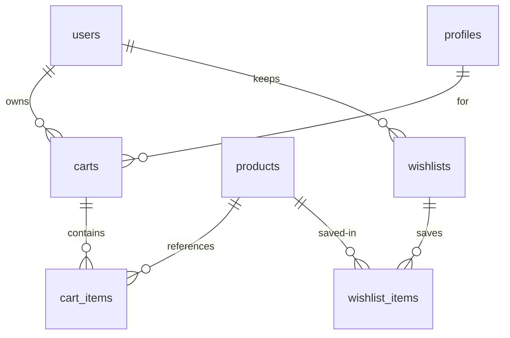

# Cart & Wishlist — Lines, Snapshots, Merge

> Status: Filling | Last Updated: 2026-10-30
> 4 tables. The cart is a hot path — every design choice below serves the
> P99 <100ms contract in §5. Conventions: `01-Conventions.md`.
> Duplicate-proofing (re-add, merge, retried checkout) is in
> `21-Idempotency.md`.

## carts

| Column | Type | Constraints | Reason |
|---|---|---|---|
| id | uuid | PK, UUIDv7 | |
| user_id | uuid | NULL, FK → users(id) ON DELETE CASCADE | Logged-in owner; account deletion clears the cart |
| session_id | varchar(64) | NULL | Guest owner (signed cookie) |
| for_profile_id | uuid | NULL, FK → profiles(id) ON DELETE SET NULL | Checkout recipient ("Order for") — NULL = the owner shops for themselves; set via `PATCH /cart/recipient`. SET NULL so member removal never blocks on a cart |
| status | varchar(20) | NOT NULL DEFAULT 'active', CHECK IN ('active','abandoned','converted') | Abandonment + conversion lifecycle |
| last_activity_at | timestamptz | NOT NULL DEFAULT now() | Idle >24h feeds the abandonment detector |
| created_at / updated_at | timestamptz | NOT NULL | |
| ownership | — | CHECK (user_id IS NOT NULL OR session_id IS NOT NULL) | A cart always belongs to someone |

Indexes: PK · partial unique `one_active_cart_per_user (user_id)
WHERE user_id IS NOT NULL AND status = 'active'` (merge target) ·
`idx_carts_session_id` (guest lookup) ·
`idx_carts_for_profile_id` (recipient lookups) · partial
`idx_carts_abandoned (status, last_activity_at) WHERE status = 'active'`
(detector scan — narrow by construction).

## cart_items (snapshots, not joins)

| Column | Type | Constraints | Reason |
|---|---|---|---|
| id | uuid | PK | Removal is `DELETE WHERE id` — O(1), size-independent |
| cart_id | uuid | NOT NULL, FK → carts(id) ON DELETE CASCADE | Owned child |
| product_id | uuid | NOT NULL, FK → products(id) ON DELETE RESTRICT | History guard; reverse lookup for inventory |
| variant_id | uuid | NULL, FK → product_variants(id) ON DELETE RESTRICT | |
| qty | integer | NOT NULL, CHECK (qty > 0) | |
| unit_price | DECIMAL(12,2) | NOT NULL, CHECK (>= 0) | Frozen at add-time — cart display never ripples on price changes |
| product_name | varchar(255) | NOT NULL | Frozen — survives renames |
| product_slug | varchar(280) | NULL | Frozen link target |
| image_url | varchar(2048) | NULL | Frozen thumb — survives media reorganization |
| variant_label | varchar(150) | NULL | `Size M / Onyx` — frozen display line |
| personalization | jsonb | NULL | Custom print / monogram choices (`{"monogram":"UK","placement":"chest"}`) |
| preview_image_url | varchar(2048) | NULL; required when `personalization` is set (CHECK) | Rendered print preview shown before adding to cart |
| preview_approved_at | timestamptz | NULL | When the customer approved the preview; checkout refuses a personalised line without it |
| added_at | timestamptz | NOT NULL DEFAULT now() | |

Snapshot doctrine (deliberate denormalization): the cart re-read is one
indexed scan with zero cross-table joins. Refresh rule: snapshots refresh
only on explicit re-add, never silently — what the shopper saw is what
they pay.

Indexes: PK · unique `cart_items_cart_product_unique
(cart_id, product_id, variant_id) NULLS NOT DISTINCT` (no dup lines —
NULL variant counts as equal; leading cart_id serves the cart-load read) ·
`idx_cart_items_product_id` ("carts containing X").

## wishlists + wishlist_items (operationally irrelevant, by design)

| Table | Column | Type | Constraints | Reason |
|---|---|---|---|---|
| wishlists | id | uuid | PK | |
| wishlists | user_id | uuid | NOT NULL, UNIQUE, FK → users(id) ON DELETE CASCADE | One list per user |
| wishlist_items | id | uuid | PK | |
| wishlist_items | wishlist_id | uuid | NOT NULL, FK → wishlists(id) ON DELETE CASCADE | |
| wishlist_items | product_id | uuid | NOT NULL, FK → products(id) ON DELETE CASCADE | Unlisted products leave lists (unlike order history) |
| wishlist_items | added_at | timestamptz | NOT NULL | |

Indexes: PKs · `idx_wishlist_items_wishlist_id` · unique
`(wishlist_id, product_id)`. No admin UI by design — wishlists inform
nothing operational; they surface only in recommendations later.

## Checkout recipient ("Order for")

Storefront contract (full doctrine: `17-Household-Accounts.md` §5): the
checkout shows a household member selector, an **Edit member** affordance
(explicit profile write — the only checkout path that saves sizes to a
profile), and per-line size chips that affect **that order only**. Line
edits never write `profile_size_preferences`; autofill only reads it.

## Guest cart and guest checkout

`carts.session_id` keeps anonymous browsing real: a visitor adds items and
keeps them in a signed-cookie session cart. **Guests can also check out**
(decided 2026-11-10): the order is written with `guest_email` +
`guest_name` (+ optional `guest_phone`) instead of a user/profile/household,
and the `orders_buyer_identity` CHECK makes "both or neither" impossible to
break (file 06). Logging in during checkout is optional; when a guest does
log in, the merge rule below runs and the order is placed as an account
order instead. Guest orders are tracked with order number + email. Exchanges and
replacements need an account: a guest signs up with the same email and
claims the order (file 06). The ownership
CHECK (`user_id IS NOT NULL OR session_id IS NOT NULL`) makes an ownerless
cart impossible, and the partial unique on active user carts makes the
merge target unambiguous.

## Merge rule (guest → user on login)

Additive qty per (product, variant), capped at live stock; loser guest
cart flips to `converted`, never deleted (abandonment math stays honest).
One-active-cart partial unique makes the target unambiguous.

## Performance contract (P99 <100ms @ 200 lines)

- Removal = PK delete (size-independent).
- Re-read = single indexed scan on the unique constraint (snapshots —
  no joins, Principle: hot paths never JOIN).
- Side effects (analytics events, abandonment touch) fire-and-forget
  after commit — never awaited in the response path.
- Batch remove (`ids[]`) = one round trip for N removals.
- Storefront renders optimistic UI first, reconciles on error.
- Budget: HTTP ~2ms + DELETE ~1ms + read ~5ms + driver ~2ms ≈ 10ms
  typical. Verified by seeded 200-item benchmark before launch claims.

## Cart relationship slice

## As built (TL-BE-07, 2026-11-12)

`packages/heart/src/modules/cart/` (`service.ts`, `wishlist.ts`). Tests:
`cart.int.test.ts`, `auth/guest-cookie.test.ts`. Migration
`021-cart-choices.sql` adds `cart_items.color` and `cart_items.size`, the
shopper's choice as separate values.

**Owners.** A signed-in shopper's bag belongs to their account. A guest gets
the `tuw_sid` cookie on their first add: a random id plus an HMAC of it, so a
cookie cannot be guessed or forged. An unsigned or altered cookie counts as no
guest.

**Rules.**

- The database sets the price. The add form has no price field, and a price
  sent by the client is dropped.
- A re-add joins its line and refreshes the snapshot. Nothing changes price
  silently.
- Quantities are capped at what can be bought: stock for in-house items, 100
  per line for print-to-order (`inventory.availableQty`). Lowering is always
  allowed. A bag holds at most 100 lines.
- Every write takes a per-owner advisory lock, so double clicks and parallel
  tabs make one cart and one line.
- Another person's line id is "not found"; in a batch removal it is ignored.
- `checkoutBlockers(cart)` lists the lines checkout must refuse: an
  unapproved personalised line, or an item no longer buyable in that quantity.
  Checkout (TL-BE-08) calls it.

**Sign-in merge.** Login and sign-up merge the guest bag into the account and
clear the guest cookie. A failed merge never fails sign-in. Quantities add up,
capped at what can be bought, and sold-out lines stay behind. The guest cart
becomes `converted` and keeps its lines for abandonment numbers, so a rerun
or a parallel merge changes nothing.

**Personalised lines.** Allowed only where the product offers a monogram, up
to its character limit. They need a preview URL (`/path` or https) and become
separate lines per monogram. `approvePreview` records the yes. A new preview
or a different variant clears it. The storefront has no personalisation form
yet (TL-WEB-BE-18), and real previews need uploads (TL-INT-R2).

**Wishlist.** Customers only: a guest's heart asks them to sign in. Saving
twice keeps one entry, products that go unlisted drop out, and a list holds
at most 500 pieces.

**Storefront.** The store context keeps its interface. `storefront/lib/bag.ts`
loads the bag and wishlist in one action, shows changes at once, sends them in
order, and replaces the guess with the server's answer (a refusal reloads the
truth and shows a toast). It reloads when sign-in or sign-out refreshes the
session. The bag and wishlist are no longer in localStorage, and Reset Demo no
longer touches them. Promo codes and orders are still demo until TL-BE-08/09.

