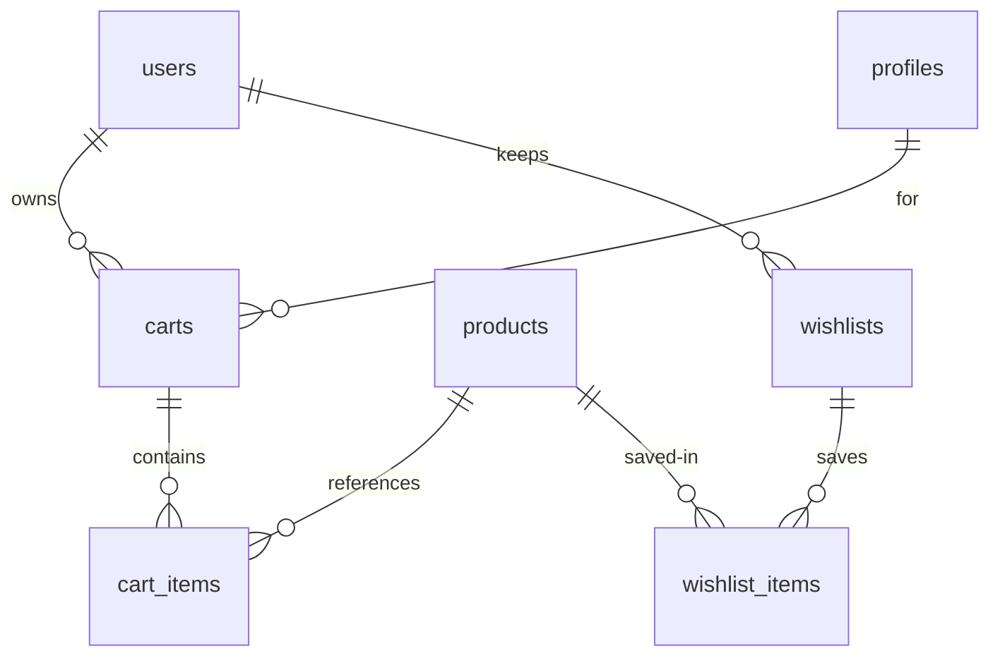

# Cart & Wishlist — Lines, Snapshots, Merge

> Status: Filling | Last Updated: 2026-10-17
> 4 tables. The cart is a hot path — every design choice below serves the
> P99 <100ms contract in §5. Conventions: `01-Conventions.md`.

## carts

| Column | Type | Constraints | Reason |
|---|---|---|---|
| id | uuid | PK, UUIDv7 | |
| user_id | uuid | NULL, FK → users(id) ON DELETE CASCADE | Logged-in owner; account deletion clears the cart |
| session_id | varchar(64) | NULL | Guest owner (signed cookie) |
| for_profile_id | uuid | NULL, FK → profiles(id) ON DELETE SET NULL | Checkout recipient ("Order for") — NULL = the owner shops for themselves; set via `PATCH /cart/recipient`. SET NULL so member removal never blocks on a cart |
| status | varchar(20) | NOT NULL DEFAULT 'active', CHECK IN ('active','abandoned','converted') | Abandonment + conversion lifecycle |
| last_activity_at | timestamptz | NOT NULL DEFAULT now() | Idle >24h feeds the abandonment detector |
| created_at / updated_at | timestamptz | NOT NULL | |
| ownership | — | CHECK (user_id IS NOT NULL OR session_id IS NOT NULL) | A cart always belongs to someone |

Indexes: PK · partial unique `one_active_cart_per_user (user_id)
WHERE user_id IS NOT NULL AND status = 'active'` (merge target) ·
`idx_carts_session_id` (guest lookup) ·
`idx_carts_for_profile_id` (recipient lookups) · partial
`idx_carts_abandoned (status, last_activity_at) WHERE status = 'active'`
(detector scan — narrow by construction).

## cart_items (snapshots, not joins)

| Column | Type | Constraints | Reason |
|---|---|---|---|
| id | uuid | PK | Removal is `DELETE WHERE id` — O(1), size-independent |
| cart_id | uuid | NOT NULL, FK → carts(id) ON DELETE CASCADE | Owned child |
| product_id | uuid | NOT NULL, FK → products(id) ON DELETE RESTRICT | History guard; reverse lookup for inventory |
| variant_id | uuid | NULL, FK → product_variants(id) ON DELETE RESTRICT | |
| qty | integer | NOT NULL, CHECK (qty > 0) | |
| unit_price | DECIMAL(12,2) | NOT NULL, CHECK (>= 0) | Frozen at add-time — cart display never ripples on price changes |
| product_name | varchar(255) | NOT NULL | Frozen — survives renames |
| product_slug | varchar(280) | NULL | Frozen link target |
| image_url | varchar(2048) | NULL | Frozen thumb — survives media reorganization |
| variant_label | varchar(150) | NULL | `Size M / Onyx` — frozen display line |
| added_at | timestamptz | NOT NULL DEFAULT now() | |

Snapshot doctrine (deliberate denormalization): the cart re-read is one
indexed scan with zero cross-table joins. Refresh rule: snapshots refresh
only on explicit re-add, never silently — what the shopper saw is what
they pay.

Indexes: PK · unique `cart_items_cart_product_unique
(cart_id, product_id, variant_id) NULLS NOT DISTINCT` (no dup lines —
NULL variant counts as equal; leading cart_id serves the cart-load read) ·
`idx_cart_items_product_id` ("carts containing X").

## wishlists + wishlist_items (operationally irrelevant, by design)

| Table | Column | Type | Constraints | Reason |
|---|---|---|---|---|
| wishlists | id | uuid | PK | |
| wishlists | user_id | uuid | NOT NULL, UNIQUE, FK → users(id) ON DELETE CASCADE | One list per user |
| wishlist_items | id | uuid | PK | |
| wishlist_items | wishlist_id | uuid | NOT NULL, FK → wishlists(id) ON DELETE CASCADE | |
| wishlist_items | product_id | uuid | NOT NULL, FK → products(id) ON DELETE CASCADE | Unlisted products leave lists (unlike order history) |
| wishlist_items | added_at | timestamptz | NOT NULL | |

Indexes: PKs · `idx_wishlist_items_wishlist_id` · unique
`(wishlist_id, product_id)`. No admin UI by design — wishlists inform
nothing operational; they surface only in recommendations later (file 18).

## Checkout recipient ("Order for")

Storefront contract (full doctrine: `17-Household-Accounts.md` §5): the
checkout shows a household member selector, an **Edit member** affordance
(explicit profile write — the only checkout path that saves sizes to a
profile), and per-line size chips that affect **that order only**. Line
edits never write `profile_size_preferences`; autofill only reads it.

## Merge rule (guest → user on login)

Additive qty per (product, variant), capped at live stock; loser guest
cart flips to `converted`, never deleted (abandonment math stays honest).
One-active-cart partial unique makes the target unambiguous.

## Performance contract (P99 <100ms @ 200 lines)

- Removal = PK delete (size-independent).
- Re-read = single indexed scan on the unique constraint (snapshots —
  no joins, Principle: hot paths never JOIN).
- Side effects (analytics events, abandonment touch) fire-and-forget
  after commit — never awaited in the response path.
- Batch remove (`ids[]`) = one round trip for N removals.
- Storefront renders optimistic UI first, reconciles on error.
- Budget: HTTP ~2ms + DELETE ~1ms + read ~5ms + driver ~2ms ≈ 10ms
  typical. Verified by seeded 200-item benchmark before launch claims.

## Cart relationship slice

