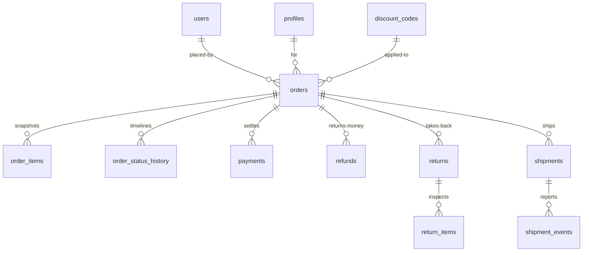

# Orders & Money — Columns, Scopes, Guards

> Status: Filling | Last Updated: 2026-10-30
> 10 tables. Money is DECIMAL(12,2); totals are **stored, not derived** —
> a financial record must be immutable, not recomputed. Conventions:
> `01-Conventions.md`. Currency default: `INR` (IN localization applied;
> file 00 keeps the display-formatting question open, storage is decided).
> A retried checkout or a replayed provider webhook must resolve to the
> same row: `21-Idempotency.md`.

## orders

| Column | Type | Constraints | Reason |
|---|---|---|---|
| id | uuid | PK, UUIDv7 | |
| placed_by_user_id | uuid | NOT NULL, FK → users(id) ON DELETE RESTRICT | Payer of record — receipts, refunds, and visibility start here; RESTRICT keeps history |
| for_profile_id | uuid | NOT NULL, FK → profiles(id) ON DELETE RESTRICT | Recipient — the person the clothes are for (self by default). Sizes prefilled from their profile, never written back (file 17 §6) |
| order_number | varchar(30) | NOT NULL, UNIQUE | Human key (`#2026-000123`); support lookup |
| status | varchar(20) | NOT NULL DEFAULT 'pending', CHECK IN ('pending','confirmed','processing','shipped','delivered','cancelled','failed','refunded') | Fulfillment axis — independent from payment |
| subtotal | DECIMAL(12,2) | NOT NULL, CHECK (>= 0) | Sum of line totals at purchase |
| shipping_fee | DECIMAL(12,2) | NOT NULL DEFAULT 0, CHECK (>= 0) | |
| tax | DECIMAL(12,2) | NOT NULL DEFAULT 0, CHECK (>= 0) | Computed from `products.tax_rate` at checkout |
| discount | DECIMAL(12,2) | NOT NULL DEFAULT 0, CHECK (>= 0) | Coupon value applied |
| grand_total | DECIMAL(12,2) | NOT NULL, CHECK (>= 0) | subtotal + shipping + tax − discount. Stored (audit-immutable); reconciliation jobs recompute-and-compare, never overwrite |
| currency | char(3) | NOT NULL DEFAULT 'INR' | ISO 4217; single currency v1 |
| payment_status | varchar(20) | NOT NULL DEFAULT 'pending', CHECK IN ('pending','paid','failed','refunded') | Payment axis — independent from fulfillment |
| shipping_address | jsonb | NOT NULL | Snapshot at order time (survives address-book edits) |
| billing_address | jsonb | NOT NULL | Snapshot |
| discount_code_id | uuid | NULL, FK → discount_codes(id) ON DELETE SET NULL | Which coupon applied; history survives code deletion |
| idempotency_key | varchar(255) | NULL | The client's `Idempotency-Key` at checkout. Duplicated here **on purpose**: `idempotency_keys` rows expire in 24h, this one never does, so a retry a week later still cannot fork the order |
| notes | text | NULL | Admin/customer notes |
| created_at / updated_at | timestamptz | NOT NULL | |

Indexes: PK · unique order_number · `(placed_by_user_id, created_at DESC)`
(placed history) · `(for_profile_id, created_at DESC)` (for-me history —
household reads, file 17 §4) · `idx_orders_status` · `idx_orders_created_at`
(date ranges) · `idx_orders_payment_status` (reconciliation) · partial
unique `one_order_per_idempotency_key (placed_by_user_id, idempotency_key)
WHERE idempotency_key IS NOT NULL` (retried checkout → same order).

## order_items

| Column | Type | Constraints | Reason |
|---|---|---|---|
| id | uuid | PK | |
| order_id | uuid | NOT NULL, FK → orders(id) ON DELETE CASCADE | Owned child |
| product_id | uuid | NOT NULL, FK → products(id) ON DELETE RESTRICT | "Buy again" + analytics; never cascade-delete history |
| variant_id | uuid | NULL, FK → product_variants(id) ON DELETE RESTRICT | |
| product_name | varchar(255) | NOT NULL | Snapshot — history survives renames (deliberate denormalization, write-once) |
| sku | varchar(64) | NOT NULL | Snapshot |
| unit_price | DECIMAL(12,2) | NOT NULL, CHECK (>= 0) | Price actually paid |
| qty | integer | NOT NULL, CHECK (qty > 0) | |
| line_total | DECIMAL(12,2) | NOT NULL, CHECK (>= 0) | unit_price × qty — immutable |
| options | jsonb | NULL | Variant combination snapshot (`{"Size":"M","Color":"Onyx"}`) |

Indexes: PK · `idx_order_items_order_id` (order load).

## order_status_history

| Column | Type | Constraints | Reason |
|---|---|---|---|
| id | uuid | PK | |
| order_id | uuid | NOT NULL, FK → orders(id) ON DELETE CASCADE | |
| from_status | varchar(20) | NULL | NULL on the creation entry |
| to_status | varchar(20) | NOT NULL | |
| note | varchar(500) | NULL | "Out of stock, cancelled" |
| actor | varchar(50) | NOT NULL | user id or 'system' — accountability |
| created_at | timestamptz | NOT NULL | |

Indexes: PK · `idx_osh_order_id` (timeline).

## payments

| Column | Type | Constraints | Reason |
|---|---|---|---|
| id | uuid | PK | |
| order_id | uuid | NOT NULL, FK → orders(id) ON DELETE CASCADE | |
| provider | varchar(30) | NOT NULL DEFAULT 'mock', CHECK IN ('mock','razorpay','stripe') | v1 mock; Razorpay first (IN), Stripe later |
| method | varchar(20) | NOT NULL DEFAULT 'upi', CHECK IN ('upi','card','netbanking','wallet','cod') | **How** the customer paid — the admin payments column and the checkout summary. Orthogonal to `provider` (who processed it); `cod` is a real method, not a missing provider |
| amount | DECIMAL(12,2) | NOT NULL, CHECK (>= 0) | |
| status | varchar(20) | NOT NULL DEFAULT 'pending', CHECK IN ('pending','authorized','captured','failed','refunded') | Provider lifecycle |
| transaction_id | varchar(100) | NULL, UNIQUE | Provider ref — idempotent capture |
| paid_at | timestamptz | NULL | |
| created_at / updated_at | timestamptz | NOT NULL | |

Indexes: PK · `idx_payments_order_id` · unique transaction_id.

## refunds

| Column | Type | Constraints | Reason |
|---|---|---|---|
| id | uuid | PK | |
| order_id | uuid | NOT NULL, FK → orders(id) ON DELETE RESTRICT | Refund history is audit — never cascade |
| payment_id | uuid | NULL, FK → payments(id) ON DELETE SET NULL | Source payment link |
| amount | DECIMAL(12,2) | NOT NULL, CHECK (amount > 0 AND amount <= order grand_total — enforced in app, floor in DB) | Partial refunds allowed; never above paid total |
| reason | varchar(255) | NOT NULL | Feed the Refund Volume KPI honestly |
| method | varchar(30) | NOT NULL DEFAULT 'source', CHECK IN ('source','store_credit') | Back to source or store credit |
| status | varchar(20) | NOT NULL DEFAULT 'processing', CHECK IN ('processing','completed','rejected') | Ops pipeline |
| actor | uuid | NOT NULL, FK → users(id) ON DELETE RESTRICT | Who approved — accountability |
| created_at / updated_at | timestamptz | NOT NULL | |

Indexes: PK · `idx_refunds_order_id` · partial unique
`one_open_refund (order_id) WHERE status = 'processing'` (concurrency
guard — no double-processing the same order).

## returns + return_items (RMA)

| Table | Column | Type | Constraints | Reason |
|---|---|---|---|---|
| returns | id | uuid | PK | |
| returns | order_id | uuid | NOT NULL, FK → orders(id) ON DELETE RESTRICT | |
| returns | stage | varchar(20) | NOT NULL DEFAULT 'in_transit', CHECK IN ('in_transit','inspected','restocked','disputed') | The admin stage machine |
| returns | carrier | varchar(50) | NULL | |
| returns | tracking_number | varchar(100) | NULL | |
| returns | reason | varchar(255) | NOT NULL | Sizing, quality, wrong item… |
| return_items | id | uuid | PK | |
| return_items | return_id | uuid | NOT NULL, FK → returns(id) ON DELETE CASCADE | Owned child |
| return_items | order_item_id | uuid | NOT NULL, FK → order_items(id) ON DELETE RESTRICT | History guard |
| return_items | qty | integer | NOT NULL, CHECK (qty > 0) | |
| return_items | disposition | varchar(20) | NOT NULL DEFAULT 'pending', CHECK IN ('pending','restock','scrap','exchange') | Restock writes `stock_movements` reason `return` |

Indexes: PKs · `idx_returns_order_id` · `idx_returns_stage`
(stage queues) · `idx_return_items_return_id`.

## discount_codes

| Column | Type | Constraints | Reason |
|---|---|---|---|
| id | uuid | PK | |
| code | varchar(50) | NOT NULL, UNIQUE | Uppercased in app (`UNPLUGGED10`) |
| discount_type | varchar(10) | NOT NULL, CHECK IN ('percent','fixed') | |
| value | DECIMAL(12,2) | NOT NULL, CHECK (percent ≤ 100, fixed ≥ 0) | Bounds in-constraint |
| min_order_amount | DECIMAL(12,2) | NULL, CHECK (>= 0) | Threshold campaigns |
| max_uses | integer | NULL, CHECK (max_uses > 0) | Global cap |
| uses_count | integer | NOT NULL DEFAULT 0 | Atomic `+1` on redemption — never read-modify-write |
| starts_at / ends_at | timestamptz | NULL | Expiry presets (24h/2d/5d/1w) are UI shortcuts writing these |
| is_active | boolean | NOT NULL DEFAULT true | Kill switch |
| created_at / updated_at | timestamptz | NOT NULL | |

Indexes: PK · unique code (checkout validation) · partial
`(is_active, ends_at) WHERE is_active` (expiry-aware validation).

## shipments

| Column | Type | Constraints | Reason |
|---|---|---|---|
| id | uuid | PK | |
| order_id | uuid | NOT NULL, FK → orders(id) ON DELETE CASCADE | |
| carrier | varchar(50) | NULL | Delhivery, Shiprocket… |
| tracking_number | varchar(100) | NULL | AWB; the drawer's tracking lookup |
| status | varchar(20) | NOT NULL DEFAULT 'pending', CHECK IN ('pending','shipped','in_transit','out_for_delivery','delivered','exception','returned') | Customer-facing projection of the carrier state — wider than `orders.status` because "out for delivery" and "exception" are real scan states |
| pieces | smallint | NOT NULL DEFAULT 1, CHECK (pieces > 0) | Parcel count on the label; the drawer shows "2 pieces" |
| shipped_at | timestamptz | NULL | The admin **Dispatch date** and the storefront "shipped on" |
| estimated_delivery_at | date | NULL | Promised date shown to the customer — a `date`, not a timestamp: it is a promise, not an event |
| delivered_at | timestamptz | NULL | |
| created_at / updated_at | timestamptz | NOT NULL | |

Indexes: PK · `idx_shipments_order_id` · `idx_shipments_tracking_number` ·
`idx_shipments_status`.

## shipment_events (tracking timeline)

| Column | Type | Constraints | Reason |
|---|---|---|---|
| id | uuid | PK | |
| shipment_id | uuid | NOT NULL, FK → shipments(id) ON DELETE CASCADE | Owned child |
| status | varchar(20) | NOT NULL, CHECK (same seven values as `shipments.status`) | The scan's state at that moment |
| location | varchar(255) | NULL | Hub/city as the carrier reports it |
| description | varchar(255) | NULL | Carrier's own copy |
| occurred_at | timestamptz | NOT NULL | When the carrier says it happened (not when we synced) |
| created_at | timestamptz | NOT NULL | When we stored it |

Unique `(shipment_id, occurred_at, status)` — a repeated carrier/Qikink
sync cannot append the same scan twice. Feeds both the admin drawer
(`ShipmentItem.events[]`) and the storefront `Order.trackingEvents[]`; the
timeline is a child table, never a jsonb array on `shipments`
(`20-Schema-Decisions.md` §8).

## Transaction scopes (ACID — no broker in monolith)

| Transaction | Writes (single TX) | Guard |
|---|---|---|
| Checkout | orders (carrying `placed_by_user_id` + `for_profile_id` from the cart) + order_items + payments + stock decrement + cart→converted + discount uses_count+1 | Atomic `UPDATE … WHERE stock >= qty` (oversell impossible); `idempotency_keys (scope='checkout', key)` returns the stored response for 24h, and `one_order_per_idempotency_key` blocks a second order forever — a retried submit resolves to the same row |
| Refund | payments.status + refunds row + orders.payment_status | One-open-refund partial unique; amount ≤ grand_total |
| Return restock | return_items.disposition + stock_movements (`return`) + variant/product balance | Same atomic path as checkout decrement |
| Status change | orders.status + order_status_history row | History row written in-TX — timeline can never skip |

Isolation: READ COMMITTED + the atomic guards above; `SELECT … FOR
UPDATE` reserved for the checkout serialization point if contention ever
appears in metrics.

## Orders relationship slice

`stock_movements.order_id` is a real FK to `orders` in `002`'s ledger. The
column is declared at the end of `004` because `002` applies first — the
one file-order exception in the whole build, and it is a from-scratch
column, not a forward migration (`migrate/README.md`).
