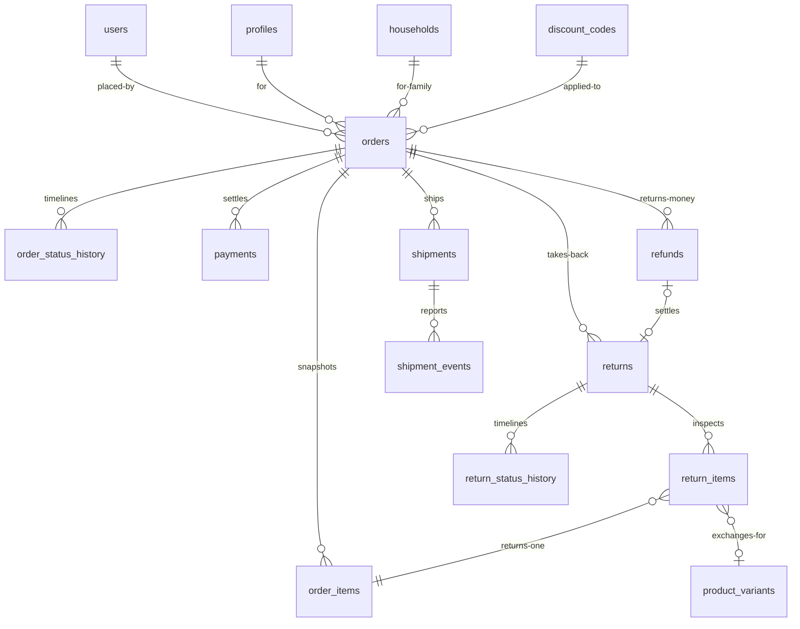

# Orders & Money — Columns, Scopes, Guards

> Status: Filling | Last Updated: 2026-10-30
> 11 tables. Money is DECIMAL(12,2); totals are **stored, not derived** —
> a financial record must be immutable, not recomputed. Conventions:
> `01-Conventions.md`. Currency default: `INR` (IN localization applied;
> file 00 keeps the display-formatting question open, storage is decided).
> A retried checkout or a replayed provider webhook must resolve to the
> same row: `21-Idempotency.md`.

## orders

| Column | Type | Constraints | Reason |
|---|---|---|---|
| id | uuid | PK, UUIDv7 | |
| placed_by_user_id | uuid | NULL (guest orders only), FK → users(id) ON DELETE RESTRICT | Payer of record for account orders — receipts, refunds, and visibility start here; RESTRICT keeps history |
| for_profile_id | uuid | NULL (guest orders only), FK → profiles(id) ON DELETE RESTRICT | Recipient — the person the clothes are for (self by default). Sizes prefilled from their profile, never written back (file 17 §6) |
| for_household_id | uuid | NULL (guest orders only), FK → household_members(household_id, profile_id) ON DELETE RESTRICT (added by 011) | Proxy-order guard: the pair proves the recipient is an **active** member of that household, so "buy for my family" is a database rule, not a service promise. CHECK: NULL exactly when `placed_by_user_id` is NULL |
| guest_email | varchar(255) | NULL | Guest checkout contact of record; track-order looks up `order_number` + `lower(guest_email)` |
| guest_name | varchar(150) | NULL | Guest's name (required when `guest_email` is set) |
| guest_phone | varchar(20) | NULL | Optional guest phone for delivery |
| order_number | varchar(30) | NOT NULL, UNIQUE | Human key (`#2026-000123`); support lookup |
| order_type | varchar(20) | NOT NULL DEFAULT 'standard', CHECK IN ('standard','exchange','replacement') | Follow-up orders created from a returns row (`returns.replacement_order_id`): `exchange` charges only the price difference, `replacement` is free |
| gift_card_amount | DECIMAL(12,2) | NOT NULL DEFAULT 0, CHECK (>= 0) (added by 008) | Portion of `grand_total` paid by gift card; payments cover the rest (file 22) |
| status | varchar(20) | NOT NULL DEFAULT 'pending', CHECK IN ('pending','confirmed','processing','shipped','delivered','cancelled','failed','refunded') | Fulfillment axis — independent from payment |
| subtotal | DECIMAL(12,2) | NOT NULL, CHECK (>= 0) | Sum of line totals at purchase |
| shipping_fee | DECIMAL(12,2) | NOT NULL DEFAULT 0, CHECK (>= 0) | |
| tax | DECIMAL(12,2) | NOT NULL DEFAULT 0, CHECK (>= 0) | Computed from `products.tax_rate` at checkout |
| discount | DECIMAL(12,2) | NOT NULL DEFAULT 0, CHECK (>= 0) | Coupon value applied |
| grand_total | DECIMAL(12,2) | NOT NULL, CHECK (>= 0) | subtotal + shipping + tax − discount. Stored (audit-immutable); reconciliation jobs recompute-and-compare, never overwrite |
| currency | char(3) | NOT NULL DEFAULT 'INR' | ISO 4217; single currency v1 |
| payment_status | varchar(20) | NOT NULL DEFAULT 'pending', CHECK IN ('pending','paid','failed','refunded') | Payment axis — independent from fulfillment |
| shipping_address | jsonb | NOT NULL | Snapshot at order time (survives address-book edits) |
| billing_address | jsonb | NOT NULL | Snapshot |
| discount_code_id | uuid | NULL, FK → discount_codes(id) ON DELETE SET NULL | Which coupon applied; history survives code deletion |
| idempotency_key | varchar(255) | NULL | The client's `Idempotency-Key` at checkout. Duplicated here **on purpose**: `idempotency_keys` rows expire in 24h, this one never does, so a retry a week later still cannot fork the order |
| cancellable_until | timestamptz | NULL | End of the free-cancel window (payment time + 60 min); the submit worker sends the order to the partner after it |
| notes | text | NULL | Admin/customer notes |
| created_at / updated_at | timestamptz | NOT NULL | |

Indexes: PK · unique order_number · `(placed_by_user_id, created_at DESC)`
(placed history) · `(for_profile_id, created_at DESC)` (for-me history —
household reads, file 17 §4) · `(for_household_id)` (family order history,
single table) · `idx_orders_status` · `idx_orders_created_at`
(date ranges) · `idx_orders_payment_status` (reconciliation) ·
`idx_orders_guest_email (lower(guest_email))` (guest track-order) · partial
unique `one_order_per_idempotency_key (COALESCE(placed_by_user_id,
'guest:'||lower(guest_email)), idempotency_key) WHERE idempotency_key IS NOT
NULL` (retried checkout → same order, for account and guest buyers alike).

**Buyer identity (CHECK `orders_buyer_identity`):** an account order has
`placed_by_user_id` + `for_profile_id` (+ `for_household_id`) and no guest
fields; a guest order has `guest_email` + `guest_name` and no account
columns. Nothing in between can be stored.

## Order lifecycle rules (customer actions)

Statuses are the SQL vocabulary above. The storefront's older demo words
map onto it: `queued` → `confirmed`, `printing` → `processing`,
`submission_failed` → `failed` (the raw provider state stays on
`fulfillment_orders.provider_status`, file 16).

- **Cancel window:** a paid (or COD) order stays `pending` for
  `store_settings.orders.cancel_window_minutes` (60) — stored per order as
  `orders.cancellable_until`. During that window the customer can cancel
  for free; nothing has been sent to the print partner. When the window
  ends the submit worker sends it and the order becomes `confirmed`, after
  which the customer cannot cancel.
- **Print preview:** personalised / custom-print lines carry the approved
  preview (`order_items.personalization`, `preview_image_url`,
  `preview_approved_at`); a CHECK makes an unapproved custom print
  unstorable. The approved preview is what the partner prints.
- **Exchange policy per product:** `products.exchange_policy` (default
  `defects_only`) is copied onto each order line. Only `exchangeable` lines
  can be exchanged; every line can request a defect replacement.
- **Abuse limits:** one exchange per order line, ever (partial unique on
  `return_items`); exchanges only for `size_fit` / `wrong_variant`;
  replacements only for `damaged` / `misprint` / `wrong_item` / `quality`
  (CHECKs); at least one photo on every request (`returns.evidence_media_ids`);
  replacement-order lines are written with `exchange_policy = 'none'`, so an
  exchanged item cannot be exchanged again. Customer mistakes on
  `defects_only` items are not compensated.
- **Exchange (size / variant swap):** allowed only when the order is
  `delivered`, only within `store_settings.exchange.window_days` (7) of
  `shipments.delivered_at`, and only for **another variant of the same
  product** (`return_items.exchange_variant_id` must belong to the same
  `product_id`). Swapping for a different product is not offered. A
  customer who ordered the wrong item and whose order has not been
  delivered yet has no exchange path: they cancel (only while `pending`)
  and reorder. After the window closes the request is refused.
- **Exchange pricing:** `returns.price_difference` = new variant price −
  original line price. **> 0:** the replacement order's `grand_total` is the
  difference and the customer pays it (same checkout/payment flow) before
  it is sent to the fulfilment partner. **< 0:** the difference is refunded
  (`refunds` row linked by `returns.refund_id`). **0:** free swap.
- **Exchange fulfilment:** approval creates a replacement order
  (`order_type = 'exchange'`) linked by `returns.replacement_order_id`; it
  ships through the normal `shipments` + `fulfillment_orders` path. With a
  print-on-demand partner this is a **new partner order paid by us** —
  Qikink does not do size exchanges itself.
- **Defects (replacement):** damaged / misprinted / wrong / missing item
  reported within the partner's claim window (Qikink: 7 days from delivery).
  Evidence (Qikink, 2026-11-10): **wrong or missing item → unboxing video
  required**; damage / misprint / quality → details + photos → `returns.type = 'replacement'` + a
  `fulfillment_claims` row to the partner. Approved → free replacement
  order (`order_type = 'replacement'`), or a refund when a reprint is not
  possible.
- **No money-back returns.** The fulfilment partner (Qikink) offers no
  customer returns for refund, so the storefront offers exchanges and
  defect replacements only.
- **Accounts required:** exchanges and replacements need a customer
  account. A guest first signs up with the order's email; after the email
  is verified, `POST /api/me/orders/claim` converts their guest orders to
  account orders (guest fields cleared, user/profile/household set).
- **Refunds** go back to the original payment source; COD orders are paid
  out by UPI or bank transfer (`refunds.method`). There is no store credit.

## order_items

| Column | Type | Constraints | Reason |
|---|---|---|---|
| id | uuid | PK | |
| order_id | uuid | NOT NULL, FK → orders(id) ON DELETE CASCADE | Owned child |
| product_id | uuid | NOT NULL, FK → products(id) ON DELETE RESTRICT | "Buy again" + analytics; never cascade-delete history |
| variant_id | uuid | NULL, FK → product_variants(id) ON DELETE RESTRICT | |
| product_name | varchar(255) | NOT NULL | Snapshot — history survives renames (deliberate denormalization, write-once) |
| sku | varchar(64) | NOT NULL | Snapshot |
| unit_price | DECIMAL(12,2) | NOT NULL, CHECK (>= 0) | Price actually paid |
| qty | integer | NOT NULL, CHECK (qty > 0) | |
| returned_qty | integer | NOT NULL DEFAULT 0, CHECK (returned_qty >= 0), table CHECK `returned_qty <= qty` | The only mutable column: the restock TX increments it, so "more returned than bought" cannot be stored. A row CHECK is the only place the per-line aggregate can be structural |
| line_total | DECIMAL(12,2) | NOT NULL, CHECK (>= 0) | unit_price × qty — immutable |
| options | jsonb | NULL | Variant combination snapshot (`{"Size":"M","Color":"Onyx"}`) |
| exchange_policy | varchar(20) | NOT NULL DEFAULT 'defects_only' | Snapshot of `products.exchange_policy` at purchase |
| personalization / preview_image_url / preview_approved_at | jsonb / varchar(2048) / timestamptz | NULL; CHECK: personalisation requires an approved preview | Custom print copied from the cart |

Indexes: PK · `idx_order_items_order_id` (order load).

## order_status_history

| Column | Type | Constraints | Reason |
|---|---|---|---|
| id | uuid | PK | |
| order_id | uuid | NOT NULL, FK → orders(id) ON DELETE CASCADE | |
| from_status | varchar(20) | NULL | NULL on the creation entry |
| to_status | varchar(20) | NOT NULL | |
| note | varchar(500) | NULL | "Out of stock, cancelled" |
| actor | varchar(50) | NOT NULL | user id or 'system' — accountability |
| created_at | timestamptz | NOT NULL | |

Indexes: PK · `idx_osh_order_id` (timeline).

## payments

| Column | Type | Constraints | Reason |
|---|---|---|---|
| id | uuid | PK | |
| order_id | uuid | NOT NULL, FK → orders(id) ON DELETE CASCADE | |
| provider | varchar(30) | NOT NULL DEFAULT 'mock', CHECK IN ('mock','razorpay','stripe') | v1 mock; Razorpay first (IN), Stripe later |
| method | varchar(20) | NOT NULL DEFAULT 'upi', CHECK IN ('upi','card','netbanking','wallet','cod') | **How** the customer paid — the admin payments column and the checkout summary. Orthogonal to `provider` (who processed it); `cod` is a real method, not a missing provider |
| amount | DECIMAL(12,2) | NOT NULL, CHECK (>= 0) | |
| status | varchar(20) | NOT NULL DEFAULT 'pending', CHECK IN ('pending','authorized','captured','failed','refunded') | Provider lifecycle |
| transaction_id | varchar(100) | NULL, UNIQUE | Provider ref — idempotent capture |
| paid_at | timestamptz | NULL | |
| created_at / updated_at | timestamptz | NOT NULL | |

Indexes: PK · `idx_payments_order_id` · unique transaction_id.

## refunds

| Column | Type | Constraints | Reason |
|---|---|---|---|
| id | uuid | PK | |
| order_id | uuid | NOT NULL, FK → orders(id) ON DELETE RESTRICT | Refund history is audit — never cascade |
| payment_id | uuid | NULL, FK → payments(id) ON DELETE SET NULL | Source payment link |
| amount | DECIMAL(12,2) | NOT NULL, CHECK (amount > 0 AND amount <= order grand_total — enforced in app, floor in DB) | Partial refunds allowed; never above paid total |
| reason | varchar(255) | NOT NULL | Feed the Refund Volume KPI honestly |
| method | varchar(30) | NOT NULL DEFAULT 'source', CHECK IN ('source','upi','bank_transfer') | `source` = gateway reversal (prepaid). COD orders have no gateway, so staff pay out by `upi` (preferred) or `bank_transfer`. Never store credit |
| payout_reference | varchar(100) | NULL; required when a `upi`/`bank_transfer` refund is `completed` (CHECK) | Gateway refund id or bank UTR — proof the money left |
| payout_destination_masked | varchar(100) | NULL | Masked destination only (`name@okaxis`, `HDFC ••••1234`); full account numbers are never stored |
| idempotency_key | varchar(255) | NULL; unique per order | Retried refund action returns the same row; `(method, payout_reference)` is unique too |
| status | varchar(20) | NOT NULL DEFAULT 'processing', CHECK IN ('processing','completed','rejected') | Ops pipeline |
| actor | uuid | NOT NULL, FK → users(id) ON DELETE RESTRICT | Who approved — accountability |
| created_at / updated_at | timestamptz | NOT NULL | |

Indexes: PK · `idx_refunds_order_id` · partial unique
`one_open_refund (order_id) WHERE status = 'processing'` (concurrency
guard — no double-processing the same order).

## returns + return_items + return_status_history (RMA)

Two independent axes, and this is the whole design decision: **`status` is the
request pipeline** (who asked, where the parcel is) and **`resolution` is what
the customer gets back**. The admin board's four old stages
(`in_transit / inspected / restocked / disputed`) remain valid `status` words,
so the existing admin mock stays a subset — `restocked` is expressed as
`status = 'completed'` plus per-line dispositions instead of a header stage.

| Table | Column | Type | Constraints | Reason |
|---|---|---|---|---|
| returns | id | uuid | PK | |
| returns | rma_number | varchar(30) | NOT NULL, UNIQUE | Human key (`RMA-2026-000123`); support + courier reference |
| returns | order_id | uuid | NOT NULL, FK → orders(id) ON DELETE RESTRICT | |
| returns | requested_by_profile_id | uuid | NOT NULL, FK → profiles(id) ON DELETE RESTRICT | Who asked — the customer, or the member a proxy order was placed for (an account is required) |
| returns | requested_by_user_id | uuid | NULL, FK → users(id) ON DELETE SET NULL | The login that submitted it; NULL = logged by staff |
| returns | type | varchar(12) | NOT NULL DEFAULT 'exchange', CHECK IN ('exchange','replacement') | Size/variant swap vs defect replacement. No money-back returns |
| returns | status | varchar(20) | NOT NULL DEFAULT 'requested', CHECK IN ('requested','approved','rejected','pickup_scheduled','in_transit','received','inspected','completed','cancelled','disputed') | The request pipeline. `requested` is the state the old machine could not express (nothing has shipped yet) |
| returns | resolution | varchar(20) | NOT NULL DEFAULT 'pending', CHECK IN ('pending','exchange','replacement','refund','none') | What the customer gets; `refund` only for a negative exchange difference or an unfixable defect |
| returns | price_difference | DECIMAL(12,2) | NULL, signed; exchange only (CHECK) | > 0 customer pays on the replacement order; < 0 refunded |
| returns | customer_note | varchar(500) | NULL | Their words |
| returns | evidence_media_ids | uuid[] | NOT NULL DEFAULT '{}', CHECK (at least 1) | Photos (and, for defects, the unboxing video) — required on every request |
| returns | rejection_reason | varchar(255) | NULL | Required by the app when `status = 'rejected'` |
| returns | carrier / tracking_number | varchar(50) / varchar(100) | NULL | Reverse pickup |
| returns | pickup_address | jsonb | NULL | Snapshot taken at approval — the address book may change before pickup |
| returns | pickup_scheduled_at / received_at | timestamptz | NULL | Pickup and warehouse-receipt stamps |
| returns | decided_by / decided_at | uuid / timestamptz | NULL, FK → users(id) ON DELETE SET NULL | Accountability for approve/reject |
| returns | refund_id | uuid | NULL, UNIQUE, FK → refunds(id) ON DELETE RESTRICT | 1:1. UNIQUE supplies the FK index; one refund record per return, never a second refund table |
| returns | replacement_order_id | uuid | NULL, UNIQUE, FK → orders(id) ON DELETE RESTRICT | The exchange's replacement order; CHECK allows it only when `type = 'exchange'` |
| return_items | id | uuid | PK | |
| return_items | return_id | uuid | NOT NULL, FK → returns(id) ON DELETE CASCADE | Owned child |
| return_items | order_item_id | uuid | NOT NULL, FK → order_items(id) ON DELETE RESTRICT | History guard; partial unique `one_exchange_per_order_item` WHERE `request_type = 'exchange'` |
| return_items | request_type | varchar(12) | NOT NULL, CHECK IN ('exchange','replacement') | Copy of `returns.type` so reason rules are CHECKs |
| return_items | qty | integer | NOT NULL, CHECK (qty > 0) | |
| return_items | reason_code | varchar(30) | NOT NULL, CHECK IN ('size_fit','wrong_variant','damaged','misprint','wrong_item','quality','other') | The reason is **per garment** — "the tee fits, the pant does not" is normal, so a header-only reason loses information |
| return_items | condition_note | varchar(500) | NULL | Inspector's note |
| return_items | disposition | varchar(20) | NOT NULL DEFAULT 'pending', CHECK IN ('pending','restock','scrap','return_to_customer','exchange','replacement') | Restock writes `stock_movements` reason `return` |
| return_items | exchange_variant_id | uuid | NULL, FK → product_variants(id) ON DELETE RESTRICT | The replacement; CHECK forces it when `disposition = 'exchange'` |
| return_items | refund_amount | DECIMAL(12,2) | NULL, CHECK (>= 0) | Agreed line refund; the header refund is the sum |
| return_status_history | id | uuid | PK | |
| return_status_history | return_id | uuid | NOT NULL, FK → returns(id) ON DELETE CASCADE | |
| return_status_history | from_status / to_status | varchar(20) | NULL / NOT NULL | NULL `from_status` on creation |
| return_status_history | note | varchar(500) | NULL | |
| return_status_history | actor | varchar(50) | NOT NULL | user id or 'system' |
| return_status_history | created_at | timestamptz | NOT NULL | |

Constraints beyond the columns: `UNIQUE (return_id, order_item_id)` (one line
per order item; `qty` says how many of it come back, and it doubles as the
`return_id` FK index) and `CHECK (disposition <> 'exchange' OR
exchange_variant_id IS NOT NULL)`.

Indexes: PKs · `idx_returns_order_id` · `idx_returns_status` (status queues) ·
`(requested_by_profile_id, created_at DESC)` (customer's own returns) ·
partial `idx_returns_tracking_number WHERE tracking_number IS NOT NULL` ·
`idx_returns_decided_by` · `idx_return_items_order_item_id` ·
`idx_return_items_exchange_variant_id` · `idx_rsh_return_id (return_id,
created_at)`.

## discount_codes

| Column | Type | Constraints | Reason |
|---|---|---|---|
| id | uuid | PK | |
| code | varchar(50) | NOT NULL, UNIQUE | Uppercased in app (`UNPLUGGED10`) |
| discount_type | varchar(10) | NOT NULL, CHECK IN ('percent','fixed') | |
| value | DECIMAL(12,2) | NOT NULL, CHECK (percent ≤ 100, fixed ≥ 0) | Bounds in-constraint |
| min_order_amount | DECIMAL(12,2) | NULL, CHECK (>= 0) | Threshold campaigns |
| max_uses | integer | NULL, CHECK (max_uses > 0) | Global cap |
| uses_count | integer | NOT NULL DEFAULT 0 | Atomic `+1` on redemption — never read-modify-write |
| starts_at / ends_at | timestamptz | NULL | Expiry presets (24h/2d/5d/1w) are UI shortcuts writing these |
| is_active | boolean | NOT NULL DEFAULT true | Kill switch |
| created_at / updated_at | timestamptz | NOT NULL | |

Indexes: PK · unique code (checkout validation) · partial
`(is_active, ends_at) WHERE is_active` (expiry-aware validation).

## shipments

| Column | Type | Constraints | Reason |
|---|---|---|---|
| id | uuid | PK | |
| order_id | uuid | NOT NULL, FK → orders(id) ON DELETE CASCADE | |
| carrier | varchar(50) | NULL | Delhivery, Shiprocket… |
| tracking_number | varchar(100) | NULL | AWB; the drawer's tracking lookup |
| status | varchar(20) | NOT NULL DEFAULT 'pending', CHECK IN ('pending','shipped','in_transit','out_for_delivery','delivered','exception','returned') | Customer-facing projection of the carrier state — wider than `orders.status` because "out for delivery" and "exception" are real scan states |
| pieces | smallint | NOT NULL DEFAULT 1, CHECK (pieces > 0) | Parcel count on the label; the drawer shows "2 pieces" |
| shipped_at | timestamptz | NULL | The admin **Dispatch date** and the storefront "shipped on" |
| estimated_delivery_at | date | NULL | Promised date shown to the customer — a `date`, not a timestamp: it is a promise, not an event |
| delivered_at | timestamptz | NULL | |
| created_at / updated_at | timestamptz | NOT NULL | |

Indexes: PK · `idx_shipments_order_id` · `idx_shipments_tracking_number` ·
`idx_shipments_status`.

## shipment_events (tracking timeline)

| Column | Type | Constraints | Reason |
|---|---|---|---|
| id | uuid | PK | |
| shipment_id | uuid | NOT NULL, FK → shipments(id) ON DELETE CASCADE | Owned child |
| status | varchar(20) | NOT NULL, CHECK (same seven values as `shipments.status`) | The scan's state at that moment |
| location | varchar(255) | NULL | Hub/city as the carrier reports it |
| description | varchar(255) | NULL | Carrier's own copy |
| occurred_at | timestamptz | NOT NULL | When the carrier says it happened (not when we synced) |
| created_at | timestamptz | NOT NULL | When we stored it |

Unique `(shipment_id, occurred_at, status)` — a repeated carrier/Qikink
sync cannot append the same scan twice. Feeds both the admin drawer
(`ShipmentItem.events[]`) and the storefront `Order.trackingEvents[]`; the
timeline is a child table, never a jsonb array on `shipments`
(`20-Schema-Decisions.md` §8).

## Transaction scopes (ACID — one shared database, no broker)

| Transaction | Writes (single TX) | Guard |
|---|---|---|
| Checkout | orders (account: `placed_by_user_id` + `for_profile_id` + `for_household_id` from the cart; guest: `guest_email` + `guest_name`) + order_items + payments + stock decrement + cart→converted + discount uses_count+1 | Atomic `UPDATE … WHERE stock >= qty` (oversell impossible); the composite FK to `household_members` rejects a recipient outside the buyer's household; `idempotency_keys (scope='checkout', key)` returns the stored response for 24h, and `one_order_per_idempotency_key` blocks a second order forever — a retried submit resolves to the same row |
| Refund | payments.status + refunds row + orders.payment_status (+ `returns.refund_id` when refund-driven) | One-open-refund partial unique; amount ≤ grand_total; `returns.refund_id` UNIQUE makes the link 1:1 |
| Return request | returns (`status='requested'`) + return_items + return_status_history row | Stop at zero: the pipeline starts at `requested`, so no delivery is implied |
| Return decision | returns.status + decided_by/decided_at + resolution + return_status_history row | History row written in-TX; `rejection_reason` required by the app when rejected |
| Return restock | return_items.disposition + order_items.returned_qty + stock_movements (`return`) + variant/product balance | `CHECK (returned_qty <= qty)` makes an over-return unstorable; same atomic path as checkout decrement |
| Status change | orders.status + order_status_history row | History row written in-TX — timeline can never skip |

Isolation: READ COMMITTED + the atomic guards above; `SELECT … FOR
UPDATE` reserved for the checkout serialization point if contention ever
appears in metrics.

## Orders relationship slice

`stock_movements.order_id` is a real FK to `orders` in `002`'s ledger. The
column is declared at the end of `004` because `002` applies first — one of the
two file-order exceptions in the build (`orders.for_household_id` is the
other, added at the end of `011`). Both are from-scratch columns, not forward
migrations (`migrate/README.md`).
