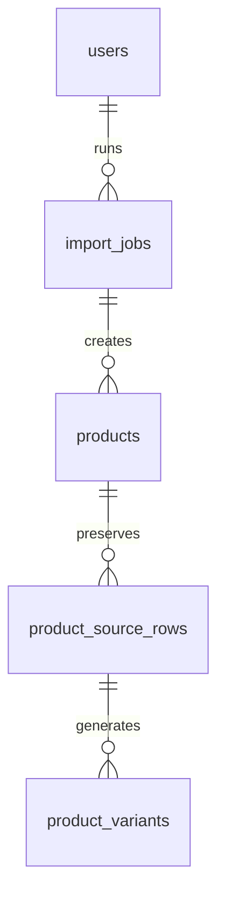

# Import Jobs — CSV Pipeline, Row Errors

> Status: Filling | Last Updated: 2026-10-22
> 1 table + the pipeline contract. Imports create **drafts**, never live
> products — a human publishes. Conventions: `01-Conventions.md`.

## import_jobs

| Column | Type | Constraints | Reason |
|---|---|---|---|
| id | uuid | PK, UUIDv7 | Job identity (admin polls this) |
| source | varchar(20) | NOT NULL DEFAULT 'csv', CHECK IN ('csv','json','shopify','odoo') | Import channel; Shopify/Odoo are phase-2 syncs |
| file_key | varchar(500) | NULL | R2 key of the uploaded sheet (see `11-Storage.md`) |
| status | varchar(20) | NOT NULL DEFAULT 'pending', CHECK IN ('pending','processing','completed','failed','partial') | `partial` = some rows failed — the honest middle state, not a silent 200 |
| total_rows | integer | NOT NULL DEFAULT 0, CHECK (>= 0) | |
| success_count | integer | NOT NULL DEFAULT 0, CHECK (>= 0) | |
| failed_count | integer | NOT NULL DEFAULT 0, CHECK (>= 0) | success + failed = total (invariant, checked by report job) |
| errors | jsonb | NOT NULL DEFAULT '[]' | `[{row, field, message}]` — the admin report reads this, not server logs |
| created_by | uuid | NULL, FK → users(id) ON DELETE SET NULL | Which admin ran it; survives account deletion |
| created_at / updated_at | timestamptz | NOT NULL | updated_at = last row processed (progress signal) |

Indexes: PK · `idx_import_jobs_status` (admin list filter) ·
`idx_import_jobs_created_at` (recent jobs).

## Canonical column contract (Final Listing)

ID (ignored) · S.No · Gender · Style (`name | code`) · sizes · Colors
(comma lists) · Weight · Shipping Weight · Base Price · Placements
(comma list) · Package Dimensions (`LxBxH`) · Tax Rate · HSN.
Mapping: name→products.name, code→products.style_code, S.No→
products.internal_serial_no + product_source_rows.source_serial_no,
Base Price→variant price override (product base_price = anchor),
sizes→one semantic option axis per group (Size / Model / Dimensions /
Capacity / Shape / Style, human-confirmed), Colors→Color axis,
Placements→attribute values,
Dimensions/Weight/Shipping Weight→product defaults + variant overrides,
Tax→tax_rate, HSN→products.hsn_code. Unknown columns are ignored with
notice (forward-compatible sheets).

## Semantic label mapping (planned with the generic-axis UI)

The workbook's `sizes` column is a generic option column, not apparel-only.
At preview, each product group gets an editable **variant label**; the
importer suggests `Size`, `Model`, `Dimensions`, `Capacity`, `Shape`, or
`Style` from the token patterns. Values are registered under the chosen
definition in `attribute_values`. A label absent from the library can be
created in the preview — definitions and values are data rows, so no schema
change is required. Mixed cells (for example capacity + colour in one token)
are flagged for a human choice; the importer never silently classifies them.
The chosen type is attached to the product through `product_attribute_links`
(`is_variant_axis`, `variant_axis_position`, optional `axis_label`), and
search/facets scope by that definition.

## Grouping and variant generation

A product is one style group, not one spreadsheet row:

1. Group by style code when present.
2. Otherwise group by style name + gender, so no-code rows such as
   `Classic Crew T-Shirt` do not merge Boy/Girl/Female/Male listings.
3. Split a group when non-empty HSN values conflict; flag the split.
4. Preserve every source row in `product_source_rows`.
5. Create variants from the group's axis values (Color plus the group's
   `sizes`-column semantic axis: Size, Model, Dimensions, Capacity, Shape,
   or Style; arbitrary axes remain supported) and link each variant to its
   source row.
6. Set variant price/weight/shipping/dimensions from the row; fall back to
   product defaults only where the row is blank.
7. Generate product and variant SKUs/slugs deterministically; the workbook
   has neither.

Category is an explicit import column. The supplied workbook predates it, so
rows without a Category value stage as `Uncategorized`, never `T-Shirts`.
A later mapping can assign groups before publish; the importer does not guess
a category from the style name.

## Row pipeline (one bad row never aborts the batch)

1. Upload → job row (`pending`), file to R2, IB1 stub hands off here.
2. `processing`: parse header row (skip the workbook title row), validate
   Style + Base Price, numerics, HSN digits, gender values, and axis values.
3. Valid rows group into **draft** products; the same seam the drawer uses
   builds attributes, axes and variants — import and UI cannot disagree.
4. Per applied product, exactly **one** `audit_logs` row
   (`action='stock.import'`, diff = qty inserted + job id) — the import
   summary. Per-variant deltas go to `stock_movements` as usual.
5. Counters + `errors[]` accumulate live; terminal status
   (`completed` / `failed` / `partial`) closes the job.

## Idempotency

Re-import matches on `products.source_group_key` (style code, else name +
gender, plus HSN when split): same file twice = updates + fresh report, never
duplicates. `product_source_rows` preserves the row-level S.No history.
`.xls` binaries get the Save-as-CSV guidance (recorded limitation — binary
BIFF parsing would buy a dependency for one legacy format).

## Import relationship slice

