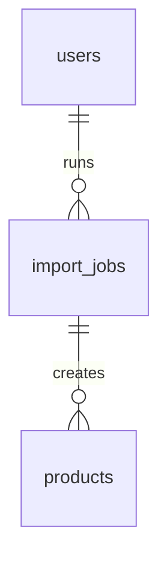

# Import Jobs — CSV Pipeline, Row Errors

> Status: Filling | Last Updated: 2026-10-15
> 1 table + the pipeline contract. Imports create **drafts**, never live
> products — a human publishes. Conventions: `01-Conventions.md`.

## import_jobs

| Column | Type | Constraints | Reason |
|---|---|---|---|
| id | uuid | PK, UUIDv7 | Job identity (admin polls this) |
| source | varchar(20) | NOT NULL DEFAULT 'csv', CHECK IN ('csv','json','shopify','odoo') | Import channel; Shopify/Odoo are phase-2 syncs |
| file_key | varchar(500) | NULL | R2 key of the uploaded sheet (see `11-Storage.md`) |
| status | varchar(20) | NOT NULL DEFAULT 'pending', CHECK IN ('pending','processing','completed','failed','partial') | `partial` = some rows failed — the honest middle state, not a silent 200 |
| total_rows | integer | NOT NULL DEFAULT 0, CHECK (>= 0) | |
| success_count | integer | NOT NULL DEFAULT 0, CHECK (>= 0) | |
| failed_count | integer | NOT NULL DEFAULT 0, CHECK (>= 0) | success + failed = total (invariant, checked by report job) |
| errors | jsonb | NOT NULL DEFAULT '[]' | `[{row, field, message}]` — the admin report reads this, not server logs |
| created_by | uuid | NULL, FK → users(id) ON DELETE SET NULL | Which admin ran it; survives account deletion |
| created_at / updated_at | timestamptz | NOT NULL | updated_at = last row processed (progress signal) |

Indexes: PK · `idx_import_jobs_status` (admin list filter) ·
`idx_import_jobs_created_at` (recent jobs).

## Canonical column contract (Final Listing)

Style (`name | code`) · sizes · Colors (comma lists) · Weight ·
Shipping Weight · Base Price · Placements (comma list) · Package
Dimensions (`LxBxH`) · Tax Rate. Mapping: name→products.name,
code→products.style_code, Base Price→base_price (derived cells follow
the ladder), sizes/Colors→option values, Placements→attribute values,
Dimensions/Weight→scalars, Tax→tax_rate.
Unknown columns are ignored with notice (forward-compatible sheets).

## Row pipeline (one bad row never aborts the batch)

1. Upload → job row (`pending`), file to R2, IB1 stub hands off here.
2. `processing`: per-row validate — Style + Base Price required, numerics
   guarded, duplicate codes flagged against `products.sku`.
3. Valid rows create **draft** products with `attributes[]` prebuilt
   (colors/sizes + customs with visibility defaults) via the same seam
   the drawer uses — import and UI can never disagree on shape.
4. Per applied product, exactly **one** `audit_logs` row
   (`action='stock.import'`, diff = qty inserted + job id) — the import
   summary. Per-variant deltas go to `stock_movements` as usual.
5. Counters + `errors[]` accumulate live; terminal status
   (`completed` / `failed` / `partial`) closes the job.

## Idempotency

Re-import matches on `(source, external_id)` / `sku`: same file twice =
updates + fresh report, never duplicates. `.xls` binaries get the
Save-as-CSV guidance (recorded limitation — binary BIFF parsing would
buy a dependency for one legacy format).

## Import relationship slice

