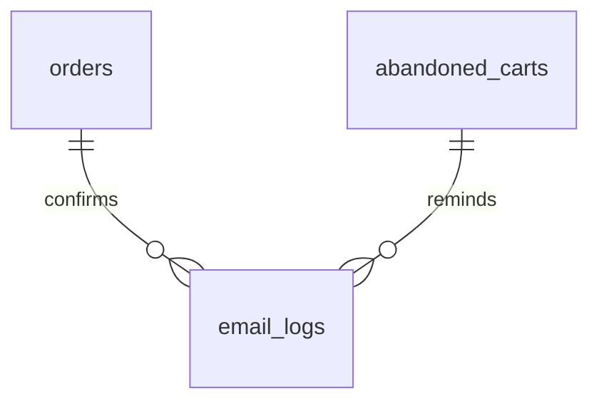

# Notify — Email Delivery, Templates

> Status: Filling | Last Updated: 2026-10-30
> 2 tables, email channel only. In-app lives in `notifications`
> (`15-Operations.md`) — shared producer events, never shared tables:
> email needs delivery states + retries, in-app needs read states.
> **No `sms_logs`:** nothing in the product sends SMS or WhatsApp yet, so the
> provider decision is deliberately not pre-made. When OTP/WhatsApp is
> scoped, `sms_logs` mirrors this table exactly.
> Conventions: `01-Conventions.md`; send-once guarantees in
> `21-Idempotency.md`.

## email_logs

| Column | Type | Constraints | Reason |
|---|---|---|---|
| id | uuid | PK, UUIDv7 | |
| recipient | varchar(255) | NOT NULL | Delivery target (denormalized — logs survive account deletion) |
| subject | varchar(255) | NULL | Rendered subject (audit what was actually sent) |
| template | varchar(100) | NULL | Template key used (joins intent, not FK — templates are editable) |
| status | varchar(20) | NOT NULL DEFAULT 'queued', CHECK IN ('queued','sent','failed') | Delivery state |
| error | text | NULL | Failure reason — a flag without a reason is unactionable |
| dedupe_key | varchar(255) | NULL | `order.confirmation:<order_id>`, `cart.abandoned:<cart_id>` — the producer's idempotency token. A retried job cannot send twice |
| created_at | timestamptz | NOT NULL | |

Indexes: PK · `idx_email_logs_status` (retry sweeps) ·
`idx_email_logs_recipient` (per-user history) ·
`idx_email_logs_created_at` (ranges) · unique
`one_email_per_dedupe_key (dedupe_key) WHERE dedupe_key IS NOT NULL`
(partial — most rows carry no key). Retrying a *failed* send reuses the
same key, so the replier updates the row instead of inserting another.

## notification_templates (optional table, defined in DDL)

| Column | Type | Constraints | Reason |
|---|---|---|---|
| id | uuid | PK | |
| key | varchar(100) | NOT NULL, UNIQUE | `order.confirmation`, `cart.abandoned` — code reference |
| subject | varchar(255) | NOT NULL | |
| body | text | NOT NULL | `{{variable}}` tokens, rendered server-side |
| variables | jsonb | NOT NULL DEFAULT '[]' | Declared variable list — powers the admin template editor later |
| created_at / updated_at | timestamptz | NOT NULL | |

Indexes: PK · unique key (send-path lookup).

## Send rule (rows before attempts)

Render template + variables → write the log row (`queued`, carrying its
`dedupe_key`) → attempt send → update to `sent` / `failed` + error. A
`dedupe_key` collision means the work is already recorded: skip the send,
do not insert. Failed rows are picked up by the status-index sweep —
retries live in the database, never in process memory. Test sends write
rows flagged by recipient, not by a separate table.

## Producer events (what triggers what)

| Event | Template key | Channel |
|---|---|---|
| order created | `order.confirmation` | email |
| order shipped / delivered / refunded | `order.shipped` / `order.delivered` / `order.refunded` | email + in-app |
| cart idle >24h, email known | `cart.abandoned` | email |
| cart idle >24h, email unknown | — | in-app only (file 15) |
| welcome | `user.welcome` | email |

## Notify relationship slice

