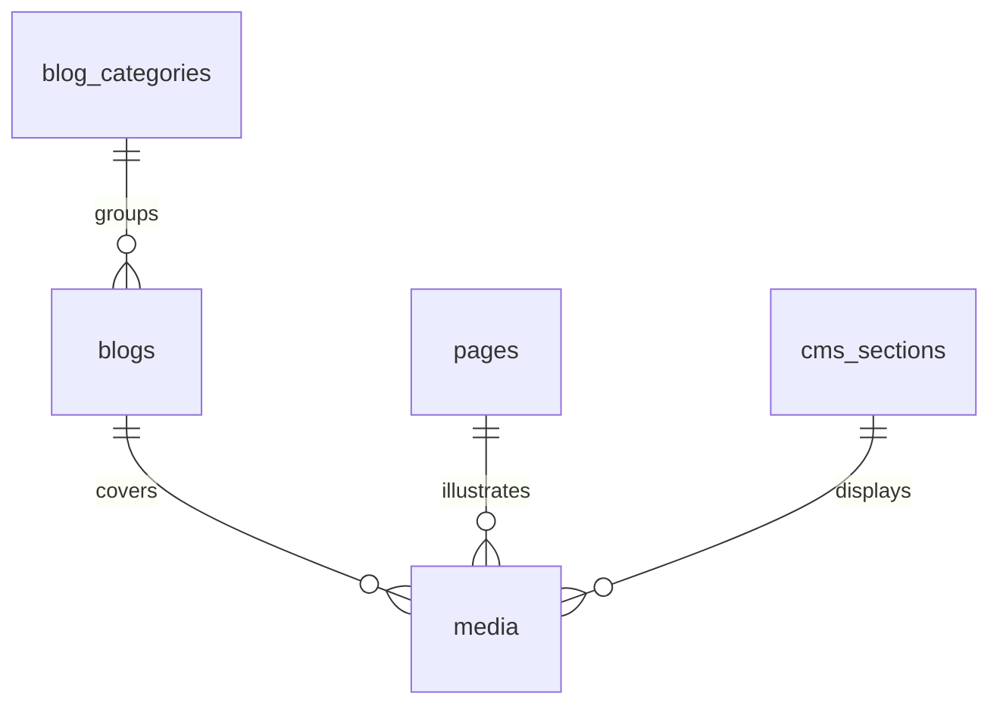

# CMS & Media — Content Tables, R2 URLs, Store Settings

> Status: Filling | Last Updated: 2026-10-15
> 8 tables. Content is documents, not rows — `jsonb` with app-layer Zod
> validation, no migrations for new settings. No Mongo: whole-document
> reads work identically in PG. Conventions: `01-Conventions.md`.

## cms_sections

| Column | Type | Constraints | Reason |
|---|---|---|---|
| id | uuid | PK, UUIDv7 | |
| key | varchar(150) | NOT NULL, UNIQUE | Stable identity (`home-hero`) — React keys + drag reorder |
| page_key | varchar(100) | NOT NULL | `homepage`, `shop`… — which page owns it |
| type | varchar(50) | NOT NULL, CHECK IN ('hero','banner','featured_products','blog_teaser','brands','testimonial') | Renderer dispatch |
| title | varchar(255) | NULL | Admin-facing name |
| content | jsonb | NOT NULL DEFAULT '{}' | Varies by type; hero holds `slides[]`, each slide `ctas[0..3]` (max 3 enforced in Zod, 400 on breach) |
| settings | jsonb | NOT NULL DEFAULT '{}' | Per-section overrides (ratio, blendMode, gutter, showPhotos) |
| sort_order | integer | NOT NULL DEFAULT 0 | Page order |
| is_active | boolean | NOT NULL DEFAULT true | Show/hide without delete |
| created_at / updated_at | timestamptz | NOT NULL | |

Indexes: PK · unique key · `(page_key, sort_order)` (page render = one
ordered read).

## cms_settings (single-row theme)

| Column | Type | Constraints | Reason |
|---|---|---|---|
| id | uuid | PK | |
| scope | varchar(50) | NOT NULL, UNIQUE | `global` — exactly one row |
| theme | jsonb | NOT NULL DEFAULT '{}' | colors, radii, ratios, typography — arbitrary nesting, never migrated |
| version | integer | NOT NULL DEFAULT 1 | Cache-buster: storefront compares cached version, re-fetches on change |
| created_at / updated_at | timestamptz | NOT NULL | |

Indexes: PK · unique scope.

## navigation_settings (single-row nav)

| Column | Type | Constraints | Reason |
|---|---|---|---|
| id | uuid | PK | |
| navbar | jsonb | NOT NULL DEFAULT '{}' | `{categoryIds[], megamenuEnabled, megamenuShowImages, megamenuColumns}` — references catalog category ids |
| updated_at | timestamptz | NOT NULL | Invalidation signal (bumped on every write) |

Single row, read whole, no index beyond PK.

## pages / blogs / blog_categories

| Table | Column | Type | Constraints | Reason |
|---|---|---|---|---|
| pages | id | uuid | PK | |
| pages | slug | varchar(180) | NOT NULL, UNIQUE | Route (`about`, `shipping`) |
| pages | title | varchar(255) | NOT NULL | |
| pages | blocks | jsonb | NOT NULL DEFAULT '[]' | Content blocks, shapes vary per block type |
| pages | seo | jsonb | NULL | `{title, description}` |
| pages | is_active | boolean | NOT NULL DEFAULT true | |
| blogs | id | uuid | PK | |
| blogs | slug | varchar(180) | NOT NULL, UNIQUE | |
| blogs | title | varchar(255) | NOT NULL | |
| blogs | cover_url | varchar(2048) | NULL | R2 URL |
| blogs | excerpt | varchar(500) | NULL | Listing teaser |
| blogs | content | jsonb | NOT NULL DEFAULT '[]' | heading/paragraph/image/quote blocks |
| blogs | category_id | uuid | NULL, FK → blog_categories(id) ON DELETE SET NULL | |
| blogs | author | varchar(150) | NULL | Display name |
| blogs | status | varchar(20) | NOT NULL DEFAULT 'draft', CHECK IN ('draft','published') | |
| blogs | published_at | timestamptz | NULL | Sort key for the published list |
| blogs | seo | jsonb | NULL | |
| blog_categories | id | uuid | PK | |
| blog_categories | name | varchar(150) | NOT NULL | |
| blog_categories | slug | varchar(180) | NOT NULL, UNIQUE | |
| blog_categories | description | text | NULL | |

Indexes: PKs · unique slugs · `(status, published_at DESC)` partial
`WHERE status='published'` · `idx_blogs_category_id` · timestamps.

## media (R2 URLs, provider-agnostic)

| Column | Type | Constraints | Reason |
|---|---|---|---|
| id | uuid | PK | |
| url | varchar(2048) | NOT NULL, UNIQUE | R2 object URL — swapping providers never touches this schema (file 11) |
| alt | varchar(255) | NULL | SEO + a11y, required by upload UI for product images |
| width / height | integer | NULL, CHECK (> 0) | CMS ratio math |
| mime_type | varchar(100) | NULL | |
| usage | varchar(20) | NOT NULL, CHECK IN ('product','section','blog') | Asset-browser filter |
| uploaded_by | uuid | NULL, FK → users(id) ON DELETE SET NULL | Uploader audit |
| created_at / updated_at | timestamptz | NOT NULL | |

Indexes: PK · unique url · `idx_media_usage`.

## store_settings (operational config, not content)

| Column | Type | Constraints | Reason |
|---|---|---|---|
| key | varchar(150) | PK (text key, not UUID — config is looked up by name) | `brand.tagline`, `shipping.domestic`, `tax.provider`, `payments.gateway_flags`… |
| value | jsonb | NOT NULL | Structured per key (rates, thresholds, flags) |
| updated_at | timestamptz | NOT NULL | Change signal |
| updated_by | uuid | NULL, FK → users(id) ON DELETE SET NULL | Who changed config — accountability |

Rule, not hope: **secrets never land here** (gateway keys, webhook
secrets live in env). Any value matching secret shape is rejected in app
validation. All seven settings tabs (brand/fulfillment/general/
notifications/payments/shipping/taxes) persist through this one table.

## CMS relationship slice

