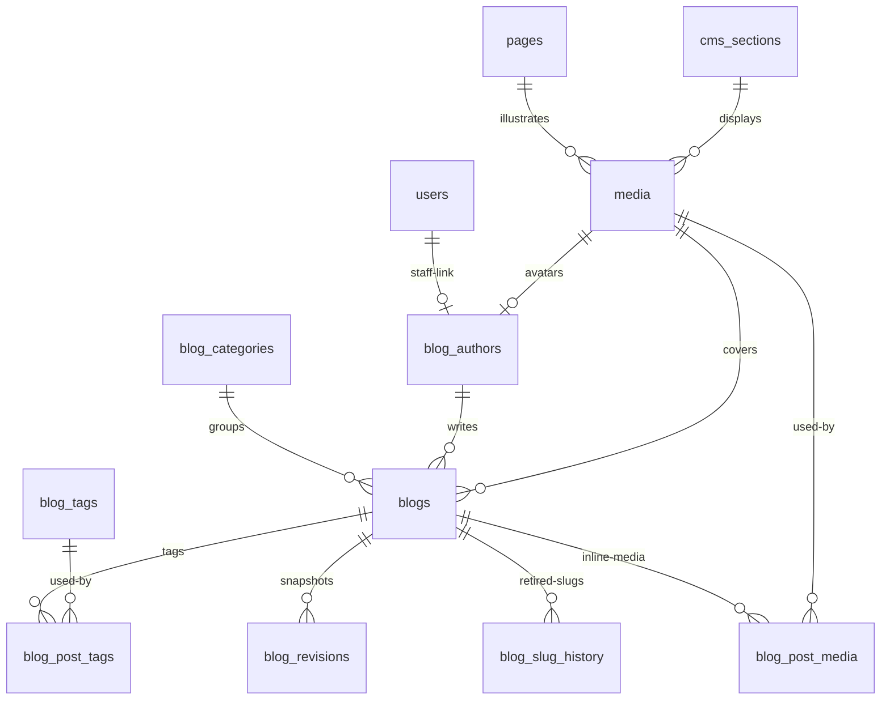

# CMS & Media — Content Tables, R2 URLs, Store Settings

> Status: Filling | Last Updated: 2026-10-26
> 14 tables. The blog slice (9 tables: `media`, `blog_categories`,
> `blog_authors`, `blog_tags`, `blogs`, `blog_post_tags`, `blog_revisions`,
> `blog_slug_history`, `blog_post_media`) is implemented in
> `006-cms.sql`; the remaining five CMS tables stay specified until their
> pages/settings phase. Content is documents, not rows — `jsonb` with
> app-layer Zod validation, no migrations for new settings. No Mongo:
> whole-document reads work identically in PG. Conventions:
> `01-Conventions.md`.

## Blog model decisions (binding)

- **One primary category per post**, not many. Categories are editorial
  pillars (`Craft`, `Slow Living`, `Sustainability`, `Design`, `Culture`).
  Cross-cutting concerns such as `lookbook` are tags, not categories.
- **Many tags per post** through `blog_post_tags`; tags are the only
  many-to-many relation in the blog model.
- **One primary author per post** (`blog_authors.id`). A future co-author
  feature adds a `blog_post_authors` junction; it does not retrofit the
  existing column.
- **No `blog_statuses` lookup table.** Status is a finite scalar state
  (`draft | scheduled | published | archived`), not an entity. It stays
  `varchar + CHECK`. Status labels, colors and legal transitions live in
  the service layer. Seed rows would add a join to every list/read query
  without adding integrity.
- **No `content_html` column.** `blogs.content` is the single editable
  ProseMirror/Tiptap-compatible JSON document. Sanitized HTML for RSS or
  email is generated on demand, never stored as a second editable source.
- **Derived caches are owned by the save transaction.** `content_text`,
  `reading_time_minutes`, and the generated `search_vector` are extracted
  from the validated document on every write. They are never independently
  editable.
- **No `views` column.** Views come from the analytics `page_views`
  domain; a blog counter would be fabricated, non-auditable data.
- **Cover and OG images are first-class FKs** (`cover_media_id`,
  `og_media_id`). Inline images live inside JSON where PostgreSQL cannot
  enforce an FK, so `blog_post_media` is the FK ledger for them.
- **Slug changes are history events.** Published posts that rename get a
  `301` redirect from `blog_slug_history`; the service checks current and
  historical slugs in one transaction.
- **Revisions are immutable snapshots**, not live content. They are not
  full-text-searched or edited in place.

## media (R2 URLs, provider-agnostic)

| Column | Type | Constraints | Reason |
|---|---|---|---|
| id | uuid | PK, UUIDv7 | |
| url | varchar(2048) | NOT NULL, UNIQUE | R2 object URL — swapping providers never touches this schema (file 11) |
| alt | varchar(255) | NULL | SEO + a11y; upload UI requires it for blog/product images |
| width / height | integer | NULL, CHECK (> 0) | CMS ratio math |
| mime_type | varchar(100) | NULL | Upload validation |
| usage | varchar(20) | NOT NULL, CHECK IN ('product','section','blog') | Asset-browser filter |
| uploaded_by | uuid | NULL, FK → users(id) ON DELETE SET NULL | Uploader audit |
| created_at / updated_at | timestamptz | NOT NULL | |

Indexes: PK · unique url · `idx_media_usage` · `idx_media_uploaded_by`.

## blog_categories

| Column | Type | Constraints | Reason |
|---|---|---|---|
| id | uuid | PK, UUIDv7 | |
| name | varchar(150) | NOT NULL | Display name |
| slug | varchar(180) | NOT NULL, UNIQUE, CHECK (`^[a-z0-9]+(?:-[a-z0-9]+)*$`) | URL key |
| description | text | NULL | Archive intro |
| sort_order | integer | NOT NULL DEFAULT 0 | Stable nav order |
| is_active | boolean | NOT NULL DEFAULT true | Retire without breaking FKs |
| created_at / updated_at | timestamptz | NOT NULL | |

Indexes: PK · unique slug · unique `lower(name)` ·
`idx_blog_categories_active_sort` · `idx_blog_categories_slug` (explicit
FK index).

Rule: categories referenced by posts are `RESTRICT`-protected — deactivate
instead of deleting.

## blog_authors

| Column | Type | Constraints | Reason |
|---|---|---|---|
| id | uuid | PK, UUIDv7 | |
| user_id | uuid | NULL, UNIQUE, FK → users(id) ON DELETE SET NULL | Staff link; guest authors have none |
| name | varchar(150) | NOT NULL | Public byline |
| slug | varchar(180) | NOT NULL, UNIQUE, CHECK (slug pattern) | Author filter URL |
| role_title | varchar(150) | NULL | e.g. "Textile Design Lead" |
| bio | text | NULL | Author card |
| avatar_media_id | uuid | NULL, FK → media(id) ON DELETE SET NULL | Author avatar |
| is_active | boolean | NOT NULL DEFAULT true | Retire without breaking FKs |
| created_at / updated_at | timestamptz | NOT NULL | |

Indexes: PK · unique slug · unique `user_id` ·
`idx_blog_authors_avatar_media_id` · `idx_blog_authors_is_active`.

Authors referenced by posts are `RESTRICT`-protected.

## blog_tags

| Column | Type | Constraints | Reason |
|---|---|---|---|
| id | uuid | PK, UUIDv7 | |
| name | varchar(80) | NOT NULL | Display name |
| slug | varchar(100) | NOT NULL, UNIQUE, CHECK (slug pattern) | URL key |
| created_at / updated_at | timestamptz | NOT NULL | |

Indexes: PK · unique slug · unique `lower(name)`.

Unused tags may be deleted; `blog_post_tags` cascades.

## blogs

| Column | Type | Constraints | Reason |
|---|---|---|---|
| id | uuid | PK, UUIDv7 | |
| slug | varchar(180) | NOT NULL, UNIQUE, CHECK (slug pattern) | Article URL |
| title | varchar(255) | NOT NULL | H1 / search title |
| subtitle | varchar(255) | NULL | Editorial deck |
| excerpt | varchar(500) | NULL | Listing teaser; falls back to `content_text` |
| category_id | uuid | NULL, FK → blog_categories(id) ON DELETE RESTRICT | One primary category; required at publish by the service |
| author_id | uuid | NOT NULL, FK → blog_authors(id) ON DELETE RESTRICT | Public byline |
| cover_media_id | uuid | NULL, FK → media(id) ON DELETE RESTRICT | Card/archive cover |
| og_media_id | uuid | NULL, FK → media(id) ON DELETE RESTRICT | Falls back to cover in the renderer |
| content | jsonb | NOT NULL DEFAULT '[]', CHECK (`jsonb_typeof(content) = 'array'`) | ProseMirror/Tiptap-compatible block document |
| content_schema_version | smallint | NOT NULL DEFAULT 1, CHECK (> 0) | Future block migrations |
| content_text | text | NOT NULL DEFAULT '' | Derived plain text for search/reading time |
| reading_time_minutes | smallint | NOT NULL DEFAULT 0, CHECK (>= 0) | Derived cache |
| status | varchar(20) | NOT NULL DEFAULT 'draft', CHECK IN ('draft','scheduled','published','archived') | Editorial state |
| is_featured | boolean | NOT NULL DEFAULT false | Hero/teaser selection |
| published_at | timestamptz | NULL | Actual or scheduled go-live |
| seo_title | varchar(255) | NULL | Falls back to title |
| seo_description | varchar(320) | NULL | Falls back to excerpt |
| canonical_url | varchar(2048) | NULL | Syndication/override |
| noindex | boolean | NOT NULL DEFAULT false | Draft/filtered archive control |
| version | integer | NOT NULL DEFAULT 1, CHECK (> 0) | Optimistic concurrency |
| created_by / updated_by | uuid | NULL, FK → users(id) ON DELETE SET NULL | Staff audit |
| created_at / updated_at | timestamptz | NOT NULL | |
| search_vector | tsvector | GENERATED ALWAYS AS weighted A/B/B/C vector, STORED | Full-text search |

Checks:

- `CHECK (status NOT IN ('scheduled','published') OR published_at IS NOT NULL)`
- slug pattern check above

Generated vector:

```sql
search_vector tsvector GENERATED ALWAYS AS (
  setweight(to_tsvector('english', coalesce(title, '')), 'A') ||
  setweight(to_tsvector('english', coalesce(subtitle, '')), 'B') ||
  setweight(to_tsvector('english', coalesce(excerpt, '')), 'B') ||
  setweight(to_tsvector('english', coalesce(content_text, '')), 'C')
) STORED
```

Indexes:

- PK · unique slug
- FKs: `idx_blogs_category_id`, `idx_blogs_author_id`,
  `idx_blogs_cover_media_id`, `idx_blogs_og_media_id`,
  `idx_blogs_created_by`, `idx_blogs_updated_by`
- `idx_blogs_public_feed` on `(published_at DESC, id DESC)`
  `WHERE status='published'`
- `idx_blogs_public_category` on
  `(category_id, published_at DESC, id DESC) WHERE status='published'`
- `idx_blogs_public_author` on
  `(author_id, published_at DESC, id DESC) WHERE status='published'`
- `idx_blogs_public_featured` on `(published_at DESC, id DESC)`
  `WHERE status='published' AND is_featured`
- `idx_blogs_admin_status_updated` on `(status, updated_at DESC)`
- `idx_blogs_scheduled` on `published_at WHERE status='scheduled'`
- `idx_blogs_search` GIN on `search_vector`

Listings select metadata only — never `content` or `content_text`. Article
detail fetches the document once. Filters are appended dynamically; no
`($1 IS NULL OR …)` patterns that defeat partial indexes.

## blog_post_tags

| Column | Type | Constraints | Reason |
|---|---|---|---|
| blog_id | uuid | NOT NULL, PK part, FK → blogs(id) ON DELETE CASCADE | |
| tag_id | uuid | NOT NULL, PK part, FK → blog_tags(id) ON DELETE CASCADE | |

Indexes: composite PK (the dedupe constraint) ·
`idx_blog_post_tags_tag_id` on `(tag_id, blog_id)`.

No timestamps: immutable junction rows carry only the keys they need.

## blog_revisions

| Column | Type | Constraints | Reason |
|---|---|---|---|
| id | uuid | PK, UUIDv7 | |
| blog_id | uuid | NOT NULL, FK → blogs(id) ON DELETE CASCADE | Owner post |
| revision_no | integer | NOT NULL, CHECK (> 0) | Per-post counter |
| title | varchar(255) | NOT NULL | History list display |
| snapshot | jsonb | NOT NULL, CHECK (`jsonb_typeof(snapshot) = 'object'`) | Full editable state (content, subtitle, excerpt, category, author, cover/OG, tag ids, SEO) |
| created_by | uuid | NULL, FK → users(id) ON DELETE SET NULL | Who saved |
| created_at | timestamptz | NOT NULL DEFAULT now() | |

Indexes: PK · `UNIQUE (blog_id, revision_no)` ·
`idx_blog_revisions_blog_created` on `(blog_id, created_at DESC)` ·
`idx_blog_revisions_created_by`.

Retention: latest 20 per post (or 90 days) via cleanup job. Restore copies
a snapshot into a draft; it never mutates a published row directly.

## blog_slug_history

| Column | Type | Constraints | Reason |
|---|---|---|---|
| slug | varchar(180) | PK, CHECK (slug pattern) | Historical URL |
| blog_id | uuid | NOT NULL, FK → blogs(id) ON DELETE CASCADE | Redirect target |
| created_at | timestamptz | NOT NULL DEFAULT now() | When retired |

Indexes: PK · `idx_blog_slug_history_blog_id`.

On rename: verify the new slug is free in both `blogs.slug` and
`blog_slug_history.slug`, insert the old slug, update the post, and redirect
historical hits with `301`.

## blog_post_media (inline-media FK ledger)

| Column | Type | Constraints | Reason |
|---|---|---|---|
| blog_id | uuid | NOT NULL, PK part, FK → blogs(id) ON DELETE CASCADE | Owner post |
| media_id | uuid | NOT NULL, PK part, FK → media(id) ON DELETE RESTRICT | Inline asset |
| sort_order | integer | NOT NULL DEFAULT 0 | First occurrence order in the document |

Indexes: composite PK · `idx_blog_post_media_media_id` on
`(media_id, blog_id)`.

The save transaction walks `content`, extracts every image `mediaId`,
validates each against `media(usage='blog')`, and syncs this table. It is
a usage ledger, not a second editable document. Cover and OG media are
**not** duplicated here — they are direct FKs on `blogs`. Media deletion is
therefore blocked by FK while any current post still uses it.

## Remaining CMS tables (specified, pending)

The following five tables keep their existing definitions and are not part
of the blog slice: `cms_sections`, `cms_settings`, `navigation_settings`,
`pages`, `store_settings`. See their original sections below.

## cms_sections

| Column | Type | Constraints | Reason |
|---|---|---|---|
| id | uuid | PK, UUIDv7 | |
| key | varchar(150) | NOT NULL, UNIQUE | Stable identity (`home-hero`) — React keys + drag reorder |
| page_key | varchar(100) | NOT NULL | `homepage`, `shop`… — which page owns it |
| type | varchar(50) | NOT NULL, CHECK IN ('hero','banner','featured_products','blog_teaser','brands','testimonial') | Renderer dispatch |
| title | varchar(255) | NULL | Admin-facing name |
| content | jsonb | NOT NULL DEFAULT '{}' | Varies by type; hero holds `slides[]`, each slide `ctas[0..3]` (max 3 enforced in Zod, 400 on breach) |
| settings | jsonb | NOT NULL DEFAULT '{}' | Per-section overrides (ratio, blendMode, gutter, showPhotos) |
| sort_order | integer | NOT NULL DEFAULT 0 | Page order |
| is_active | boolean | NOT NULL DEFAULT true | Show/hide without delete |
| created_at / updated_at | timestamptz | NOT NULL | |

Indexes: PK · unique key · `(page_key, sort_order)` (page render = one
ordered read).

## cms_settings (single-row theme)

| Column | Type | Constraints | Reason |
|---|---|---|---|
| id | uuid | PK | |
| scope | varchar(50) | NOT NULL, UNIQUE | `global` — exactly one row |
| theme | jsonb | NOT NULL DEFAULT '{}' | colors, radii, ratios, typography — arbitrary nesting, never migrated |
| version | integer | NOT NULL DEFAULT 1 | Cache-buster: storefront compares cached version, re-fetches on change |
| created_at / updated_at | timestamptz | NOT NULL | |

Indexes: PK · unique scope.

## navigation_settings (single-row nav)

| Column | Type | Constraints | Reason |
|---|---|---|---|
| id | uuid | PK | |
| navbar | jsonb | NOT NULL DEFAULT '{}' | `{categoryIds[], megamenuEnabled, megamenuShowImages, megamenuColumns}` — references catalog category ids |
| updated_at | timestamptz | NOT NULL | Invalidation signal (bumped on every write) |

Single row, read whole, no index beyond PK.

## pages

| Column | Type | Constraints | Reason |
|---|---|---|---|
| id | uuid | PK | |
| slug | varchar(180) | NOT NULL, UNIQUE | Route (`about`, `shipping`) |
| title | varchar(255) | NOT NULL | |
| blocks | jsonb | NOT NULL DEFAULT '[]' | Content blocks, shapes vary per block type |
| seo | jsonb | NULL | `{title, description}` |
| is_active | boolean | NOT NULL DEFAULT true | |

## store_settings (operational config, not content)

| Column | Type | Constraints | Reason |
|---|---|---|---|
| key | varchar(150) | PK (text key, not UUID — config is looked up by name) | `brand.tagline`, `shipping.domestic`, `tax.provider`, `payments.gateway_flags`… |
| value | jsonb | NOT NULL | Structured per key (rates, thresholds, flags) |
| updated_at | timestamptz | NOT NULL | Change signal |
| updated_by | uuid | NULL, FK → users(id) ON DELETE SET NULL | Who changed config — accountability |

Rule, not hope: **secrets never land here** (gateway keys, webhook
secrets live in env). Any value matching secret shape is rejected in app
validation. All seven settings tabs (brand/fulfillment/general/
notifications/payments/shipping/taxes) persist through this one table.

## CMS relationship slice


