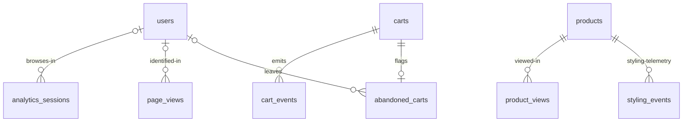

# Analytics — Events, Partitions, Retention, Views

> Status: Filling | Last Updated: 2026-10-30
> 7 tables. Raw events are **transient evidence**, rollups are the record.
> Free-tier survival is a DDL policy here, not advice. Conventions:
> `01-Conventions.md`; duplicate-proofing of event flushes is in
> `21-Idempotency.md`.

## page_views

| Column | Type | Constraints | Reason |
|---|---|---|---|
| id | uuid | **PK part**, UUIDv7 generated client-side | Time-ordered — the PK *is* the timeline index prefix |
| session_id | varchar(64) | NOT NULL | Anonymous session key (cookie) |
| user_id | uuid | NULL, FK → users(id) ON DELETE SET NULL | Logged-in stitching; nulls survive account deletion |
| page | varchar(500) | NOT NULL | Route path (`/products/hoodie-x`) |
| referrer | varchar(2048) | NULL | Entry source (Google, Instagram, direct) |
| device | jsonb | NULL | `{ua, mobile}` — responsive-behavior analysis |
| duration_ms | integer | NULL, CHECK (>= 0) | Heartbeat-derived time on page |
| exited | boolean | NOT NULL DEFAULT false | Left the site from this page |
| event_kind | varchar(20) | NOT NULL DEFAULT 'pageview', CHECK IN ('pageview','heartbeat') | |
| ts | timestamptz | NOT NULL DEFAULT now(), **PK part** | Event time — partition key |

`PRIMARY KEY (id, ts)` + `PARTITION BY RANGE (ts)`: PostgreSQL requires
the partition key in the PK, which is exactly the dedupe shape we want —
the client stamps `id` and `ts` once, so `ON CONFLICT (id, ts) DO NOTHING`
makes an offline/retried flush harmless.

Indexes: PK · `(session_id, ts)` (session timeline) ·
`(page, ts DESC)` (popular pages) · partial `(user_id) WHERE user_id IS
NOT NULL` · monthly RANGE partitions on `ts`, drop partitions >30d.

## analytics_sessions (never plain `sessions`)

Renamed from the spec's `sessions`: the word collides with every session
middleware, and the auth domain already owns token tables. Plain table —
funnels read it whole, not by time range.

| Column | Type | Constraints | Reason |
|---|---|---|---|
| id | uuid | PK | |
| session_id | varchar(64) | NOT NULL, UNIQUE | Session key; the UNIQUE makes heartbeat **upserts** idempotent |
| user_id | uuid | NULL, FK → users(id) ON DELETE SET NULL | Cohort stitching |
| started_at / last_seen_at | timestamptz | NOT NULL | Idle + session length |
| pages | varchar(500)[] | NOT NULL DEFAULT '{}' | Embedded path (no join for funnels) |
| exit_page | varchar(500) | NULL | Where the user left |
| ended_at | timestamptz | NULL | |
| device | jsonb | NULL | |

Indexes: unique session_id · `idx_analytics_sessions_user_id` ·
`last_seen_at` (stale cleanup). Retention: 90d. Raw event tables link to
this row by `session_id` **value**, not by FK — an expired session row
must not delete the evidence.

## cart_events

| Column | Type | Constraints | Reason |
|---|---|---|---|
| id | uuid | **PK part** | Client-generated; a re-flushed event is the same row |
| cart_id | uuid | NOT NULL, FK → carts(id) ON DELETE CASCADE | Dies with the cart |
| user_id | uuid | NULL, FK → users(id) ON DELETE SET NULL | |
| event_type | varchar(20) | NOT NULL, CHECK IN ('item_added','item_removed','qty_changed','cart_viewed') | |
| payload | jsonb | NOT NULL DEFAULT '{}' | `{productId, variantId, qty}` |
| ts | timestamptz | NOT NULL DEFAULT now(), **PK part** | Partition key |

`PRIMARY KEY (id, ts)`, partitioned. Indexes: `(cart_id, ts)` (cart
timeline) · `(user_id, ts)` partial `WHERE user_id IS NOT NULL`. Monthly
partitions, drop >30d.

## abandoned_carts

| Column | Type | Constraints | Reason |
|---|---|---|---|
| id | uuid | PK | |
| cart_id | uuid | NOT NULL, UNIQUE, FK → carts(id) ON DELETE CASCADE | One record per cart |
| user_id | uuid | NULL, FK → users(id) ON DELETE SET NULL | |
| email | varchar(255) | NULL | Reminder target (guests who typed it) |
| items | jsonb | NOT NULL DEFAULT '[]' | Snapshot at abandonment |
| cart_total | DECIMAL(12,2) | NOT NULL DEFAULT 0, CHECK (>= 0) | Snapshot |
| abandoned_at | timestamptz | NOT NULL | Idle >24h detector writes this row |
| reminded_at | timestamptz | NULL | Reminder sent (exactly-once per cart) |
| status | varchar(20) | NOT NULL DEFAULT 'detected', CHECK IN ('detected','reminded','converted','recovered') | Recovery pipeline |
| created_at | timestamptz | NOT NULL | |

Indexes: PK · unique cart_id · `(status, abandoned_at)` (detector +
admin list). Retention: 1yr (recovery math needs history).

## daily_stats (the permanent record)

| Column | Type | Constraints | Reason |
|---|---|---|---|
| id | uuid | PK | |
| date | date | NOT NULL, UNIQUE | `2026-10-15` — one row per day, forever |
| page_views | integer | NOT NULL DEFAULT 0 | |
| unique_visitors | integer | NOT NULL DEFAULT 0 | |
| exits_by_page | jsonb | NOT NULL DEFAULT '{}' | `{page: count}` rollup |
| conversions | integer | NOT NULL DEFAULT 0 | Orders that day |
| revenue | DECIMAL(12,2) | NOT NULL DEFAULT 0, CHECK (>= 0) | |
| created_at | timestamptz | NOT NULL | |

Indexes: PK · unique date (dashboard reads one row). Never partitioned,
never dropped — this is what survives when raw events age out.

## product_views

| Column | Type | Constraints | Reason |
|---|---|---|---|
| id | uuid | **PK part** | Client-generated |
| product_id | uuid | NOT NULL, FK → products(id) ON DELETE CASCADE | Explicit FK — never parsed from URLs (routing must not shape analytics) |
| session_id | varchar(64) | NOT NULL | Funnel stitching without login |
| user_id | uuid | NULL, FK → users(id) ON DELETE SET NULL | |
| ts | timestamptz | NOT NULL DEFAULT now(), **PK part** | Partition key |

Indexes: `(product_id, ts DESC)` (top-viewed, stock-out hits) ·
`(session_id, ts)`. Monthly partitions, drop >30d. Joined against
`products.stock = 0` it yields the viewed-but-OOS lost-sale proxy.

## search_terms (demand intelligence)

| Column | Type | Constraints | Reason |
|---|---|---|---|
| id | uuid | **PK part** | Client-generated |
| term | varchar(255) | NOT NULL | Normalized lowercase, trimmed |
| hits | integer | NOT NULL DEFAULT 0, CHECK (>= 0) | Result count **at query time** — unknowable later, hence its own table |
| results_clicked | integer | NOT NULL DEFAULT 0 | Click-through (tuning signal) |
| session_id | varchar(64) | NULL | Dedupe bursts from one typer |
| ts | timestamptz | NOT NULL DEFAULT now(), **PK part** | Partition key |

Indexes: `(term, ts DESC)` (term trend) · `(hits, ts DESC)` partial
`WHERE hits = 0` (zero-result leaderboard — the import-guidance query).
Monthly partitions, drop >90d (terms aggregate slower than views).

## Partitioning is operational, not a type

| Table | Partitioned? | Retention |
|---|---|---|
| page_views | yes — RANGE (`ts`) | 30d |
| cart_events | yes — RANGE (`ts`) | 30d |
| product_views | yes — RANGE (`ts`) | 30d |
| search_terms | yes — RANGE (`ts`) | 90d |
| analytics_sessions | no (plain) | 90d |
| abandoned_carts | no (plain) | 1yr |
| daily_stats | no (plain) | forever |

Every partitioned table ships with its `_default` partition
(`page_views_default`, `cart_events_default`, `product_views_default`,
`search_terms_default`), so inserts work on day one; monthly partitions
attach later and the default drains into them:

```sql
CREATE TABLE page_views_2026_11 PARTITION OF page_views
  FOR VALUES FROM ('2026-11-01') TO ('2026-12-01');
DROP TABLE page_views_2026_08;   -- raw events age out
```

The `_default` partition is a **safety net, not a home** — rows landing
there are invisible to partition pruning, so the monthly attach job is
part of the analytics release, not an afterthought.

## The 8 dashboard views → queries

| # | View | Source tables | Cadence |
|---|---|---|---|
| 1 | Funnel: visits → cart → checkout → order | analytics_sessions, cart_events, orders | daily rollup into `daily_stats` + live drill-down |
| 2 | Abandoned carts + recovery | abandoned_carts (+ email_logs on remind) | live list + detector job |
| 3 | Exit pages + referrers | page_views (exit flag, referrer) | daily rollup (`exits_by_page`) |
| 4 | Zero-result search | search_terms WHERE hits = 0 | live leaderboard |
| 5 | Stock-out views | product_views JOIN products (stock = 0) | daily |
| 6 | Discount redemption | discount_codes.uses_count + orders | live ratio |
| 7 | Repeat purchase / cohorts | orders by user over time | weekly |
| 8 | Attribute performance | order_items options jsonb × products | weekly (drives import mix) |

## Honesty rule (UI law, recorded here so it binds)

Until event collection ships, every analytics surface renders an **empty
state** ("tracking connects at launch") — never demo numbers without the
demo label. The current dashboard's demo-computed KPIs keep their labels
until the events flow, then swap sources without layout changes.

## Styling events (module-owned)

`styling_events` (file 19) joins this lifecycle: append-only, monthly
RANGE partitions on `ts` attach with the analytics build, raw rows drop
>30 days. It is owned by the styling module — dropping the module drops
its events and nothing else. Refinement-stage rollups live in the
Styling report.

## Analytics relationship slice



Only these arrows are real foreign keys. `page_views.session_id`,
`product_views.session_id` and `search_terms.session_id` are **values**,
joined to `analytics_sessions.session_id` when a funnel needs them — a
session row expiring at 90 days must never take the raw evidence with it.
