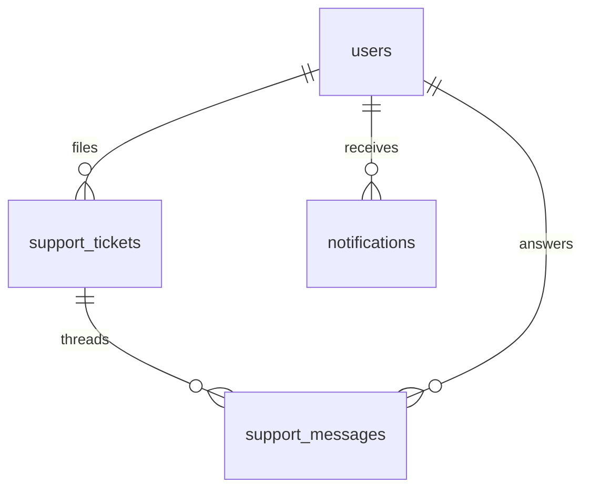

# Operations — Support, Notifications

> Status: Filling | Last Updated: 2026-10-30
> Human-facing ops: threads staff actually answer, bells customers actually
> read. Email delivery stays in `08-Notify.md` — different lifecycle,
> different table. Conventions: `01-Conventions.md`; send-once rules in
> `21-Idempotency.md`.

## support_tickets

| Column | Type | Constraints | Reason |
|---|---|---|---|
| id | uuid | PK, UUIDv7 | Queue identity |
| user_id | uuid | NULL, FK → users(id) ON DELETE SET NULL | Logged-in writer; nulls survive account deletion |
| guest_name | varchar(150) | NULL | Non-logged-in writers have no row to point at (one honest exception) |
| guest_email | varchar(255) | NULL | Reply target for guests |
| subject | varchar(255) | NOT NULL | Queue-scanning readability |
| priority | varchar(20) | NOT NULL DEFAULT 'medium', CHECK IN ('high','medium','low') | Triage order |
| status | varchar(20) | NOT NULL DEFAULT 'open', CHECK IN ('open','pending','resolved') | Thread lifecycle (see reply rule) |
| assigned_to | uuid | NULL, FK → users(id) ON DELETE SET NULL | Staff owner; null = unassigned pool |
| created_at / updated_at | timestamptz | NOT NULL | updated_at = last activity (list sort key) |

Indexes: PK · `(status, updated_at DESC)` (the queue itself) ·
`idx_support_tickets_assignee` · `idx_support_tickets_user_id` (customer
history) · partial `(guest_email) WHERE guest_email IS NOT NULL` (guest
lookup). **CHECK, not app-enforced:**
`user_id IS NOT NULL OR (guest_name IS NOT NULL AND guest_email IS NOT
NULL)` — a thread always has someone to answer.

## support_messages (normalized — the embedded array dies here)

| Column | Type | Constraints | Reason |
|---|---|---|---|
| id | uuid | PK | |
| ticket_id | uuid | NOT NULL, FK → support_tickets(id) ON DELETE CASCADE | Thread owns its messages |
| sender | varchar(20) | NOT NULL, CHECK IN ('customer','staff') | Side rendering + SLA math |
| staff_id | uuid | NULL, FK → users(id) ON DELETE SET NULL | Which agent answered (customer rows stay NULL) |
| body | text | NOT NULL | |
| created_at | timestamptz | NOT NULL | Per-message times — multi-agent safe |

Indexes: PK · `(ticket_id, created_at)` (thread read, chronological) ·
partial `(staff_id) WHERE staff_id IS NOT NULL`. Unique
`(ticket_id, created_at, sender)` — a double-clicked or retried reply
posts once.

## Reply flow rule (state machine, stated not assumed)

- Staff reply writes the message **and** touches `tickets.updated_at`
  in one TX; status `open → pending` (awaiting customer).
- Customer reply (or new guest mail on the thread) sets `pending → open`.
- Resolve is explicit staff action only — never auto, never by reply.
- Reopen writes a message (reason required in app) + `resolved → open`.

## notifications (in-app bell — email never shares this table)

| Column | Type | Constraints | Reason |
|---|---|---|---|
| id | uuid | PK | |
| user_id | uuid | NOT NULL, FK → users(id) ON DELETE CASCADE | Bell dies with the account |
| kind | varchar(20) | NOT NULL, CHECK IN ('order','cart','inventory','payment','system','marketing','refund') | The bell's own vocabulary — the admin filter chips map 1:1; `cart` = abandonment, `refund` = money back, `inventory` = low stock |
| title | varchar(150) | NOT NULL | Badge-line text |
| body | text | NULL | Expanded text |
| link | varchar(500) | NULL | Deep link (`/account/orders/…`) — nullable, never broken-window |
| read_at | timestamptz | NULL | NULL = unread. No boolean + timestamp dual-source, ever |
| dedupe_key | varchar(255) | NULL | `order.shipped:<order_id>`, `cart.abandoned:<cart_id>` — one ring per event, even if the producer job retries |
| created_at | timestamptz | NOT NULL | |

Indexes: PK · `(user_id, read_at)` (unread badge count = one narrow
index read) · `idx_notifications_kind` (admin broadcast lists) · partial
unique `one_notification_per_dedupe_key (dedupe_key) WHERE dedupe_key IS
NOT NULL`. Producing code inserts with `ON CONFLICT DO NOTHING` and treats
"0 rows" as "already rang".

## Producers (tables never sit empty by accident)

| Producer | Writes | Trigger |
|---|---|---|
| Contact form | support_tickets (open, priority by form topic) | submit |
| Order flow | notifications kind=order | shipped / delivered / refunded |
| Abandonment detector | notifications kind=cart (email unknown) or email via `email_logs` (known) | idle >24h, once per cart |
| Staff replies | support_messages + ticket touch | send |
| Admin broadcasts | notifications kind=system | manual (kill switch per send) |

## Operations relationship slice

