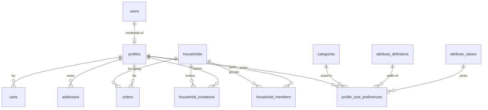

# Household Accounts — Profiles, Family Groups, Proxy Ordering

> Status: Filling | Last Updated: 2026-10-17
> 5 tables here (`households`, `household_members`, `profile_size_preferences`,
> `household_invitations`, `addresses`) + `profiles`, which lives in
> `03-Auth-RBAC.md` §2 because it *is* identity. Conventions:
> `01-Conventions.md`.

## 1. Why this exists (requirements, verbatim-shaped)

1. A father sees his family group and can order for anyone in it — wife,
   children, parents — from his own account.
2. A 10-year-old has **no email**: family members exist without any login
   and without accepting any invite.
3. Each member's sizes autofill at checkout from their saved profile.
4. A size edited during checkout applies to **that order only** — the
   member's saved size never changes as a side effect.
5. Cart/checkout carries an explicit **Edit member** affordance so a stale
   profile can be corrected in context — a deliberate, labeled write,
   never a silent one.
6. **Addresses stay private.** Grouping shares sizes and order visibility,
   never address books — one member's saved address must never appear in
   another member's account, manager included.

## 2. The three layers (identity model)

| Layer | Table | Meaning | Login? |
|---|---|---|---|
| Credential | `users` (03 §1) | can authenticate | required |
| Person | `profiles` (03 §2) | can be shopped for; owns sizes | **optional** — `user_id` NULL = managed member |
| Group | `households` (here) | shared ordering + visibility | — |

Every signup creates all three in one TX: user + profile + solo household
(creator = `manager`). Staff users get profiles and solo households too —
one uniform path, zero branching. A household starts solo and unnamed; it
becomes a family only as members join.

## 3. Tables

### households

| Column | Type | Constraints | Reason |
|---|---|---|---|
| id | uuid | PK, UUIDv7 | |
| name | varchar(100) | NULL | "Sharma Family" — optional; solo households stay unnamed |
| created_at / updated_at | timestamptz | NOT NULL DEFAULT now() | Convention |

Indexes: PK only — reads always arrive through `household_members`.

### household_members

| Column | Type | Constraints | Reason |
|---|---|---|---|
| household_id | uuid | NOT NULL, FK → households(id) ON DELETE CASCADE, PK (household_id, profile_id) | |
| profile_id | uuid | NOT NULL, FK → profiles(id) ON DELETE CASCADE, **one active membership** (partial unique `WHERE left_at IS NULL`) | One household at a time — a move is leave + join, never dual membership. The partial unique (not a plain `UNIQUE`) is what makes soft leave possible |
| role | varchar(10) | NOT NULL DEFAULT 'member', CHECK IN ('manager','member') | `manager` ≠ RBAC `admin` (staff-only); multiple managers allowed (both parents) |
| joined_at | timestamptz | NOT NULL DEFAULT now() | |
| left_at | timestamptz | NULL | **Soft leave.** NULL = active. Orders keep pointing at this row, so "who was this order for" survives a member leaving |
| updated_at | timestamptz | NOT NULL DEFAULT now() | Convention |

Indexes: composite PK (household → member list) · partial unique
`one_active_household_per_profile (profile_id) WHERE left_at IS NULL` (the
one-household rule + my-household lookup) · `(profile_id)` for the FK
delete-guard across *all* rows, including left ones.

Re-joining the same household reactivates the existing row (the PK is
`(household_id, profile_id)`), so leaving and returning never forks history.
"Household retains ≥1 manager" is an **app-level guard** — a CHECK cannot
express it.

### profile_size_preferences

| Column | Type | Constraints | Reason |
|---|---|---|---|
| profile_id | uuid | NOT NULL, FK → profiles(id) ON DELETE CASCADE, PK (profile_id, category_id) | Per person, per garment type — "Rohan wears M in T-Shirts" |
| category_id | uuid | NOT NULL, FK → categories(id) ON DELETE RESTRICT | RESTRICT: a category people sized against fails loudly if deleted |
| size_definition_id | uuid | NOT NULL, FK → attribute_definitions(id) ON DELETE RESTRICT | Which Size definition this value comes from. Stored, not derived — it is what makes the composite FK below possible |
| size_value_id | uuid | NOT NULL, composite FK `(size_definition_id, size_value_id) → attribute_values (definition_id, id)` ON DELETE RESTRICT | A **reference** to the Size library value — never a copied string. The composite FK proves the value actually belongs to that definition, so "a saved size that points at a Color" is now unstorable |
| created_at / updated_at | timestamptz | NOT NULL DEFAULT now() | Convention |

Indexes: PK · FK indexes `category_id`, `size_value_id`,
`size_definition_id` (delete-guard scans). `attribute_values` gained
`UNIQUE (definition_id, id)` in `010` to make the composite FK legal. What
remains app-validated is only the *semantic* part — that the definition is
the Size type rather than Color — which no FK can know.

Upsert key is (profile_id, category_id) — setting a size is
`INSERT … ON CONFLICT … DO UPDATE`, never read-modify-write. This is the
one table checkout may write, and only through the explicit member panel
(§6); order-scoped line edits never touch it.

### household_invitations

| Column | Type | Constraints | Reason |
|---|---|---|---|
| id | uuid | PK | |
| household_id | uuid | NOT NULL, FK → households(id) ON DELETE CASCADE | |
| email | varchar(255) | NULL | **Join mode** target — existing account's email (lowercased in app) |
| profile_id | uuid | NULL, FK → profiles(id) ON DELETE CASCADE | **Claim mode** target — a managed member gains a login |
| token_hash | varchar(255) | NOT NULL, UNIQUE | Hash only — raw tokens never touch the DB (mirrors `staff_invitations`) |
| status | varchar(20) | NOT NULL DEFAULT 'pending', CHECK IN ('pending','accepted','expired','revoked') | |
| expires_at | timestamptz | NOT NULL | 7-day family window |
| invited_by | uuid | NULL, FK → users(id) ON DELETE SET NULL | The logged-in manager who issued it; SET NULL — invite record survives offboarding |
| created_at | timestamptz | NOT NULL DEFAULT now() | |
| CHECK | — | `(email IS NOT NULL OR profile_id IS NOT NULL)` | An invitation always targets an email or a managed profile |

Indexes: PK · unique `token_hash` (accept lookup) ·
`idx_household_invitations_household_id` (manager's pending list) ·
partial `idx_household_invitations_email` WHERE email IS NOT NULL ·
partial unique `one_pending_join_per_email (household_id, email)
WHERE status = 'pending' AND email IS NOT NULL` · partial unique
`one_pending_claim_per_profile (profile_id) WHERE status = 'pending'
AND profile_id IS NOT NULL`.

### addresses (moved from 03 — reshaped as a private book)

The book belongs to **one person**, not to the home. Household membership
shares *sizes*; it never shares addresses, so a query cannot return another
member's rows even if the caller is the manager.

| Column | Type | Constraints | Reason |
|---|---|---|---|
| id | uuid | PK | |
| profile_id | uuid | **NOT NULL**, FK → profiles(id) ON DELETE CASCADE | The owner. No `household_id` and no shared rows — that is the privacy rule, not a missing feature |
| type | varchar(10) | NOT NULL DEFAULT 'shipping', CHECK IN ('shipping','billing') | |
| label | varchar(50) | NULL | "Home", "Office" |
| recipient_name | varchar(120) | NOT NULL | The parcel label; survives a profile rename |
| phone | varchar(30) | NULL | Courier contact, stored as entered |
| line1 | varchar(255) | NOT NULL | |
| line2 | varchar(255) | NULL | |
| city | varchar(100) | NOT NULL | |
| state | varchar(100) | NULL | Required for IN pincodes in practice (app validates) |
| postal_code | varchar(20) | NOT NULL | 6-digit pincode validated in app |
| country | varchar(2) | NOT NULL DEFAULT 'IN' | ISO-3166 alpha-2; IN-first per localization decision |
| is_default | boolean | NOT NULL DEFAULT false | |
| created_at / updated_at | timestamptz | NOT NULL DEFAULT now() | |

Indexes: PK · `idx_addresses_profile_id` (book load) · partial unique
`one_default_shipping_per_profile (profile_id) WHERE is_default AND type =
'shipping'` · partial unique `one_default_billing_per_profile (profile_id)
WHERE is_default AND type = 'billing'`.

Two members can therefore each hold their own default address, and neither
can see the other's. Checkout lists **only the signed-in user's own rows**
(`WHERE profile_id = me`); the recipient chosen in the "Order for" block
changes whom the garment fits, never where it ships.

### Proxy-order guard (`orders.for_household_id`)

`004-orders.sql` ships before this file, so `orders` cannot declare the
household pair itself. `011` ends with:

```sql
ALTER TABLE orders
  ADD COLUMN for_household_id uuid NOT NULL,
  ADD CONSTRAINT orders_for_household_member_fk
    FOREIGN KEY (for_household_id, for_profile_id)
    REFERENCES household_members (household_id, profile_id) ON DELETE RESTRICT;
```

Because `household_members`' PK is `(household_id, profile_id)`, this single
constraint proves the recipient is a member of **that** household — an order
cannot be placed for a stranger, and it cannot point at a household the
recipient never joined. With soft leave, a left membership still satisfies the
FK (history stays valid) while the partial unique stops a second active one.
Household order history then reads one table: `WHERE for_household_id = $1`.

`carts.for_profile_id` stays app-validated: a guest cart has no household, and
checkout re-checks the pair before it writes the order.

## 4. Roles, visibility, flows

### Roles

`manager` issues invitations, adds/removes members, edits any member's
profile. `member` can still **order for anyone** — the household's whole
point — but edits saved data only for self. Both may edit **line** sizes
on their own orders (§6).

### Visibility (reads)

Base (every member): orders **I placed** ∪ orders **for me**. Managers
additionally see every order **for anyone in my household**. Anything
wider (per-order privacy toggle) is deferred — §7.

### Gate queries (copy-pasteable)

```sql
-- 1. "Order for" dropdown / family settings ($1 = my profile id)
SELECT p.id, p.first_name, p.last_name, hm.role,
       (p.user_id IS NOT NULL) AS can_log_in
FROM household_members hm
JOIN profiles p ON p.id = hm.profile_id
WHERE hm.household_id = (
  SELECT household_id FROM household_members WHERE profile_id = $1
)
ORDER BY (hm.role = 'manager') DESC, p.first_name;

-- 2. Sizes for checkout autofill ($1 = recipient profile id)
SELECT psp.category_id, av.value AS size_value
FROM profile_size_preferences psp
JOIN attribute_values av ON av.id = psp.size_value_id
WHERE psp.profile_id = $1;

-- 3. Order history — base visibility ($myUserId, $myProfileId)
SELECT * FROM orders
WHERE placed_by_user_id = $myUserId
   OR for_profile_id    = $myProfileId;

-- 3b. Manager addition ($myHouseholdId)
SELECT o.* FROM orders o
JOIN household_members hm ON hm.profile_id = o.for_profile_id
WHERE hm.household_id = $myHouseholdId;

-- 4. May this session edit this member's profile? (self or manager)
SELECT 1
FROM household_members me
JOIN household_members target ON target.household_id = me.household_id
WHERE me.profile_id   = $myProfileId
  AND target.profile_id = $targetProfileId
  AND (me.profile_id = target.profile_id OR me.role = 'manager');
```

### Flows

**Add a managed member (no email).** Manager → `POST /members`
`{firstName, lastName, dateOfBirth?}` → one TX: profile (`user_id` NULL) +
membership (`member`). No email, no invitation, no acceptance — the
member is immediately shoppable-for. Sizes can be set right away via
`PUT /members/:id/sizes`.

**Order for a member.** Cart "Order for" selector →
`PATCH /cart/recipient {profileId}` → line autofill (§5) → address picker
→ checkout TX copies `for_profile_id` onto the order. History rows render
"For: Rohan".

**Claim (managed member gains a login).** Manager issues a claim link
(`POST /invitations {profileId}`) and hands it over out-of-band (copy link
/ QR — the kid may have no email yet). Holder sets email + password → TX:
`users` row created, `profiles.user_id` set, invitation accepted. Order
history, sizes, and household membership stay attached — identity gains a
credential, nothing else moves.

**Join (existing account joins a household).** Manager issues
`POST /invitations {email}` → acceptance requires a session or signup with
that email. The one-active-household partial unique means an existing
membership fails loudly — leave first. Leaving stamps `left_at` on the old row
and creates a membership in a fresh solo household (profile, orders, sizes
intact); join is atomic replace, never overlap.

**Remove / leave.**
- Managed member (`user_id` NULL): removal deletes the profile (cascades
  membership + size prefs). **Refused when order history exists** —
  `orders.for_profile_id` is RESTRICT; history wins, the member stays.
- Login member: removal/leave is a **soft leave** — `left_at = now()` on the
  membership, plus a new row in their own solo household. They keep every
  order for them and placed by them, and the old membership row survives so
  `orders.for_household_id` still resolves.
- Re-inviting a profile that already left the same household reactivates that
  row (`left_at = NULL`) instead of inserting a second one.
- App guard: a household must retain ≥1 manager — the last manager cannot
  be removed or demoted.

## 5. Checkout recipient block (storefront contract)

The cart/checkout page renders, in order, right before payment:

1. **"Order for"** selector — self first, then household members
   (`GET /api/household/members`). Default: self.
2. **"Edit member"** affordance beside it — the explicit write path (§6).
3. Address picker — **the signed-in user's own book only** (`addresses` where
   `profile_id = me`). The recipient never contributes addresses.

### Autofill rule (deterministic)

On member selection, each line whose product offers the member's saved
size for that product's category is set to it. Lines the user edits after
that stay as edited; re-selecting any member re-applies. No saved size, or
the size isn't offered → the line is untouched. Autofill only **reads**
`profile_size_preferences` (query 2) and sets cart line variants — it
never writes anything back.

## 6. Two levels of size — the edit doctrine

| Edit | Where | Scope | Writes profile? |
|---|---|---|---|
| Line size chip | Each cart line | **That order only** | **Never** |
| Edit member panel | Beside "Order for" at checkout | Saved profile | Only via explicit save |

- The order's `options` jsonb owns the truth of what ships; the profile is
  only ever **read** at autofill. There is deliberately no override column
  — isolation is structural, not bookkept.
- The panel edits name, phone, DOB and per-category sizes for the member,
  saved via `PATCH /members/:id` + `PUT /members/:id/sizes`. Copy is
  unambiguous: "These changes update Rohan's saved profile" vs the line
  chip's "for this order only".
- Who may save: self or manager (query 4). A member editing another
  member's saved sizes gets 403; their line edits are unaffected.
- `PUT /sizes` sends the full desired map (upsert + delete-missing in TX)
  so a cleared size actually clears.

## 7. Decisions & deferrals

**Locked (2026-10-17, revised 2026-10-31):**

- One **active** household per profile — partial unique
  `WHERE left_at IS NULL`, not a plain `UNIQUE`. Soft leave is the reason:
  orders must keep resolving to the household they were placed in.
- **Addresses are private to one profile.** No `household_id`, no shared
  rows, one default per person per type. A family book was rejected on
  privacy: it would render one member's address inside another member's
  account. Family shares sizes, never addresses.
- Proxy ordering is a **database rule**: `orders.for_household_id` +
  composite FK to `household_members`, not a service promise.
- Roles `manager`/`member`; multiple managers allowed; last-manager guard
  is app-level.
- Any member may order for any member; visibility = placed-by ∪ for-me;
  managers add all-for-household.
- Sizes are library references with a composite FK to their definition;
  per-category, no fallback row.
- Profile writes: self or manager, explicit only. Line edits never write.
- `customer_notes` re-points to `profiles` (admin customer record =
  person — dependents included). `support_tickets.customer_id`,
  `reviews.user_id`, `product_views.user_id` stay user-scoped: they are
  login-attached rows, and a dependent has no login. Closed here.

**Deferred (recorded, not built):**

- "+ Add member" inside checkout (same `POST /members`; UI later).
- Per-order privacy toggle (hiding an order from the household view).
- Size-preference fallback ("default size") — missing pref = no autofill.
- Multi-household membership.
- Gift metadata per member (later, with recommendations).

## 8. Relationship slice


