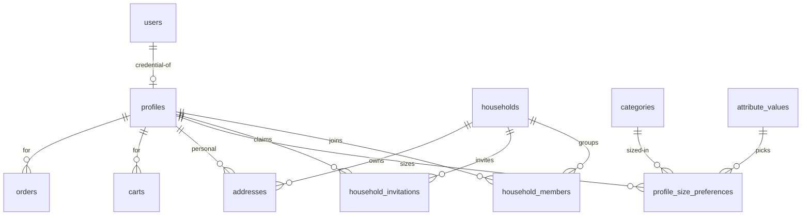

# Household Accounts — Profiles, Family Groups, Proxy Ordering

> Status: Filling | Last Updated: 2026-10-17
> 5 tables here (`households`, `household_members`, `profile_size_preferences`,
> `household_invitations`, `addresses`) + `profiles`, which lives in
> `03-Auth-RBAC.md` §2 because it *is* identity. Conventions:
> `01-Conventions.md`.

## 1. Why this exists (requirements, verbatim-shaped)

1. A father sees his family group and can order for anyone in it — wife,
   children, parents — from his own account.
2. A 10-year-old has **no email**: family members exist without any login
   and without accepting any invite.
3. Each member's sizes autofill at checkout from their saved profile.
4. A size edited during checkout applies to **that order only** — the
   member's saved size never changes as a side effect.
5. Cart/checkout carries an explicit **Edit member** affordance so a stale
   profile can be corrected in context — a deliberate, labeled write,
   never a silent one.

## 2. The three layers (identity model)

| Layer | Table | Meaning | Login? |
|---|---|---|---|
| Credential | `users` (03 §1) | can authenticate | required |
| Person | `profiles` (03 §2) | can be shopped for; owns sizes | **optional** — `user_id` NULL = managed member |
| Group | `households` (here) | shared ordering + visibility | — |

Every signup creates all three in one TX: user + profile + solo household
(creator = `manager`). Staff users get profiles and solo households too —
one uniform path, zero branching. A household starts solo and unnamed; it
becomes a family only as members join.

## 3. Tables

### households

| Column | Type | Constraints | Reason |
|---|---|---|---|
| id | uuid | PK, UUIDv7 | |
| name | varchar(100) | NULL | "Sharma Family" — optional; solo households stay unnamed |
| created_at / updated_at | timestamptz | NOT NULL DEFAULT now() | Convention |

Indexes: PK only — reads always arrive through `household_members`.

### household_members

| Column | Type | Constraints | Reason |
|---|---|---|---|
| household_id | uuid | NOT NULL, FK → households(id) ON DELETE CASCADE, PK (household_id, profile_id) | |
| profile_id | uuid | NOT NULL, FK → profiles(id) ON DELETE CASCADE, **UNIQUE** | **One household per profile (v1 lock)** — a move is leave + join, never dual membership |
| role | varchar(10) | NOT NULL DEFAULT 'member', CHECK IN ('manager','member') | `manager` ≠ RBAC `admin` (staff-only); multiple managers allowed (both parents) |
| joined_at | timestamptz | NOT NULL DEFAULT now() | |

Indexes: composite PK (household → member list) · unique `profile_id`
(my-household lookup + the one-household rule in one constraint).
"Household retains ≥1 manager" is an **app-level guard** — a CHECK cannot
express it.

### profile_size_preferences

| Column | Type | Constraints | Reason |
|---|---|---|---|
| profile_id | uuid | NOT NULL, FK → profiles(id) ON DELETE CASCADE, PK (profile_id, category_id) | Per person, per garment type — "Rohan wears M in T-Shirts" |
| category_id | uuid | NOT NULL, FK → categories(id) ON DELETE RESTRICT | RESTRICT: a category people sized against fails loudly if deleted |
| size_value_id | uuid | NOT NULL, FK → attribute_values(id) ON DELETE RESTRICT | A **reference** to the Size library value — never a copied string; the in-use guard covers it (deleting a sized value fails loudly) |
| created_at / updated_at | timestamptz | NOT NULL DEFAULT now() | Convention |

Indexes: PK · FK indexes `category_id`, `size_value_id` (delete-guard
scans). App validates the value belongs to the Size definition — no single
FK can express definition scope.

Upsert key is (profile_id, category_id) — setting a size is
`INSERT … ON CONFLICT … DO UPDATE`, never read-modify-write. This is the
one table checkout may write, and only through the explicit member panel
(§6); order-scoped line edits never touch it.

### household_invitations

| Column | Type | Constraints | Reason |
|---|---|---|---|
| id | uuid | PK | |
| household_id | uuid | NOT NULL, FK → households(id) ON DELETE CASCADE | |
| email | varchar(255) | NULL | **Join mode** target — existing account's email (lowercased in app) |
| profile_id | uuid | NULL, FK → profiles(id) ON DELETE CASCADE | **Claim mode** target — a managed member gains a login |
| token_hash | varchar(255) | NOT NULL, UNIQUE | Hash only — raw tokens never touch the DB (mirrors `staff_invitations`) |
| status | varchar(20) | NOT NULL DEFAULT 'pending', CHECK IN ('pending','accepted','expired','revoked') | |
| expires_at | timestamptz | NOT NULL | 7-day family window |
| invited_by | uuid | NULL, FK → users(id) ON DELETE SET NULL | The logged-in manager who issued it; SET NULL — invite record survives offboarding |
| created_at | timestamptz | NOT NULL DEFAULT now() | |
| CHECK | — | `(email IS NOT NULL OR profile_id IS NOT NULL)` | An invitation always targets an email or a managed profile |

Indexes: PK · unique `token_hash` (accept lookup) ·
`idx_household_invitations_household_id` (manager's pending list) ·
partial `idx_household_invitations_email` WHERE email IS NOT NULL ·
partial unique `one_pending_join_per_email (household_id, email)
WHERE status = 'pending' AND email IS NOT NULL` · partial unique
`one_pending_claim_per_profile (profile_id) WHERE status = 'pending'
AND profile_id IS NOT NULL`.

### addresses (moved from 03 — reshaped)

| Column | Type | Constraints | Reason |
|---|---|---|---|
| id | uuid | PK | |
| household_id | uuid | NOT NULL, FK → households(id) ON DELETE CASCADE | The book belongs to the home — dependents own no row but receive at it |
| profile_id | uuid | NULL, FK → profiles(id) ON DELETE CASCADE | NULL = family-shared ("Home"); set = personal ("Hostel room") |
| type | varchar(10) | NOT NULL DEFAULT 'shipping', CHECK IN ('shipping','billing') | |
| label | varchar(50) | NULL | "Home", "Office" |
| line1 | varchar(255) | NOT NULL | |
| line2 | varchar(255) | NULL | |
| city | varchar(100) | NOT NULL | |
| state | varchar(100) | NULL | Required for IN pincodes in practice (app validates) |
| postal_code | varchar(20) | NOT NULL | 6-digit pincode validated in app |
| country | varchar(2) | NOT NULL DEFAULT 'IN' | ISO-3166 alpha-2; IN-first per localization decision |
| is_default | boolean | NOT NULL DEFAULT false | |
| created_at / updated_at | timestamptz | NOT NULL DEFAULT now() | |

Indexes: PK · `idx_addresses_household_id` (book load) ·
`idx_addresses_profile_id` · partial unique
`one_default_shipping_per_household (household_id) WHERE is_default
AND type = 'shipping'` · partial unique
`one_default_billing_per_household (household_id) WHERE is_default
AND type = 'billing'`.

The checkout address picker shows household-shared rows + the recipient's
personal rows — any member may ship to the family book.

## 4. Roles, visibility, flows

### Roles

`manager` issues invitations, adds/removes members, edits any member's
profile. `member` can still **order for anyone** — the household's whole
point — but edits saved data only for self. Both may edit **line** sizes
on their own orders (§6).

### Visibility (reads)

Base (every member): orders **I placed** ∪ orders **for me**. Managers
additionally see every order **for anyone in my household**. Anything
wider (per-order privacy toggle) is deferred — §7.

### Gate queries (copy-pasteable)

```sql
-- 1. "Order for" dropdown / family settings ($1 = my profile id)
SELECT p.id, p.first_name, p.last_name, hm.role,
       (p.user_id IS NOT NULL) AS can_log_in
FROM household_members hm
JOIN profiles p ON p.id = hm.profile_id
WHERE hm.household_id = (
  SELECT household_id FROM household_members WHERE profile_id = $1
)
ORDER BY (hm.role = 'manager') DESC, p.first_name;

-- 2. Sizes for checkout autofill ($1 = recipient profile id)
SELECT psp.category_id, av.value AS size_value
FROM profile_size_preferences psp
JOIN attribute_values av ON av.id = psp.size_value_id
WHERE psp.profile_id = $1;

-- 3. Order history — base visibility ($myUserId, $myProfileId)
SELECT * FROM orders
WHERE placed_by_user_id = $myUserId
   OR for_profile_id    = $myProfileId;

-- 3b. Manager addition ($myHouseholdId)
SELECT o.* FROM orders o
JOIN household_members hm ON hm.profile_id = o.for_profile_id
WHERE hm.household_id = $myHouseholdId;

-- 4. May this session edit this member's profile? (self or manager)
SELECT 1
FROM household_members me
JOIN household_members target ON target.household_id = me.household_id
WHERE me.profile_id   = $myProfileId
  AND target.profile_id = $targetProfileId
  AND (me.profile_id = target.profile_id OR me.role = 'manager');
```

### Flows

**Add a managed member (no email).** Manager → `POST /members`
`{firstName, lastName, dateOfBirth?}` → one TX: profile (`user_id` NULL) +
membership (`member`). No email, no invitation, no acceptance — the
member is immediately shoppable-for. Sizes can be set right away via
`PUT /members/:id/sizes`.

**Order for a member.** Cart "Order for" selector →
`PATCH /cart/recipient {profileId}` → line autofill (§5) → address picker
→ checkout TX copies `for_profile_id` onto the order. History rows render
"For: Rohan".

**Claim (managed member gains a login).** Manager issues a claim link
(`POST /invitations {profileId}`) and hands it over out-of-band (copy link
/ QR — the kid may have no email yet). Holder sets email + password → TX:
`users` row created, `profiles.user_id` set, invitation accepted. Order
history, sizes, and household membership stay attached — identity gains a
credential, nothing else moves.

**Join (existing account joins a household).** Manager issues
`POST /invitations {email}` → acceptance requires a session or signup with
that email. The one-household UNIQUE means an existing membership fails
loudly — leave first. Leaving moves the membership to a fresh solo
household (profile, orders, sizes intact); join is atomic replace, never
overlap.

**Remove / leave.**
- Managed member (`user_id` NULL): removal deletes the profile (cascades
  membership + size prefs). **Refused when order history exists** —
  `orders.for_profile_id` is RESTRICT; history wins, the member stays.
- Login member: removal/leave = membership moves to a fresh solo
  household. They keep every order for them and placed by them.
- App guard: a household must retain ≥1 manager — the last manager cannot
  be removed or demoted.

## 5. Checkout recipient block (storefront contract)

The cart/checkout page renders, in order, right before payment:

1. **"Order for"** selector — self first, then household members
   (`GET /api/household/members`). Default: self.
2. **"Edit member"** affordance beside it — the explicit write path (§6).
3. Address picker — household-shared + recipient's personal rows.

### Autofill rule (deterministic)

On member selection, each line whose product offers the member's saved
size for that product's category is set to it. Lines the user edits after
that stay as edited; re-selecting any member re-applies. No saved size, or
the size isn't offered → the line is untouched. Autofill only **reads**
`profile_size_preferences` (query 2) and sets cart line variants — it
never writes anything back.

## 6. Two levels of size — the edit doctrine

| Edit | Where | Scope | Writes profile? |
|---|---|---|---|
| Line size chip | Each cart line | **That order only** | **Never** |
| Edit member panel | Beside "Order for" at checkout | Saved profile | Only via explicit save |

- The order's `options` jsonb owns the truth of what ships; the profile is
  only ever **read** at autofill. There is deliberately no override column
  — isolation is structural, not bookkept.
- The panel edits name, phone, DOB and per-category sizes for the member,
  saved via `PATCH /members/:id` + `PUT /members/:id/sizes`. Copy is
  unambiguous: "These changes update Rohan's saved profile" vs the line
  chip's "for this order only".
- Who may save: self or manager (query 4). A member editing another
  member's saved sizes gets 403; their line edits are unaffected.
- `PUT /sizes` sends the full desired map (upsert + delete-missing in TX)
  so a cleared size actually clears.

## 7. Decisions & deferrals

**Locked (2026-10-17):**

- One household per profile — `UNIQUE(profile_id)`. Multi-membership
  later = a constraint drop, not a shadow column.
- Roles `manager`/`member`; multiple managers allowed; last-manager guard
  is app-level.
- Any member may order for any member; visibility = placed-by ∪ for-me;
  managers add all-for-household.
- Sizes are library references (RESTRICT), per-category, no fallback row.
- Profile writes: self or manager, explicit only. Line edits never write.
- `customer_notes` re-points to `profiles` (admin customer record =
  person — dependents included). `support_tickets.customer_id`,
  `reviews.user_id`, `product_views.user_id` stay user-scoped: they are
  login-attached rows, and a dependent has no login. Closed here.

**Deferred (recorded, not built):**

- "+ Add member" inside checkout (same `POST /members`; UI later).
- Per-order privacy toggle (hiding an order from the household view).
- Size-preference fallback ("default size") — missing pref = no autofill.
- Multi-household membership.
- Gift metadata per member (later, with recommendations).

## 8. Relationship slice


