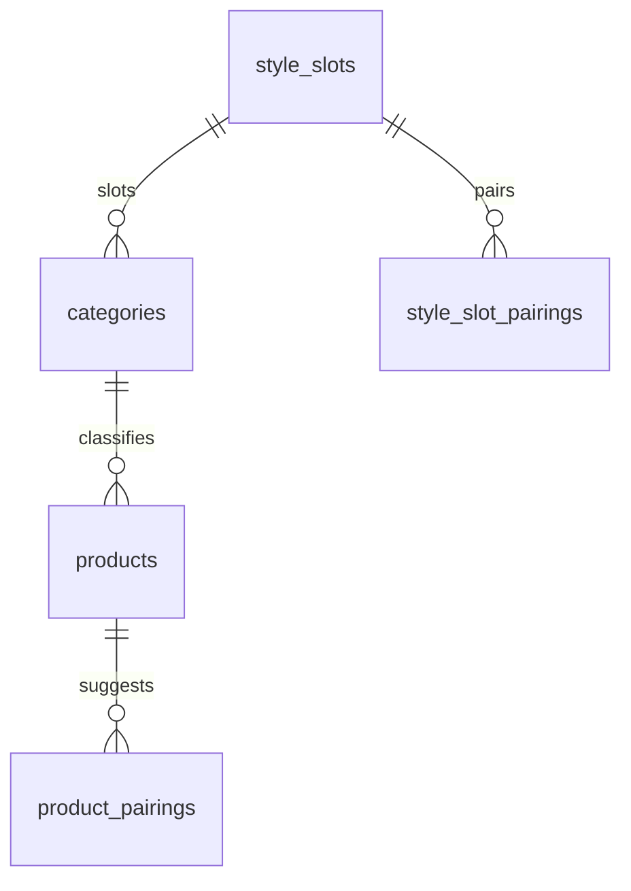

# Recommendations — Complete the Look (Slots, Ranking, Pairings)

> Status: Filling | Last Updated: 2026-10-17
> 3 tables (`style_slots`, `style_slot_pairings`, `product_pairings`) +
> `categories.style_slot_id`; total 71 tables. Surfaces: PDP (v1) → cart
> (v2) → confirmation (later). The promise: **coverage is structural,
> quality is data** — every slotted product suggests look completions from
> day one; curation and purchase history only re-rank. Conventions:
> `01-Conventions.md`.

## 1. What this is (requirements, verbatim-shaped)

1. A user viewing any product — including one added five minutes ago —
   gets "complete the look" suggestions immediately.
2. Types must match: never same-slot (no pants-with-pants); a cap
   suggests tops/bottoms/footwear; pants suggest tops/headwear/footwear.
3. Colors must match well: black pants → light or neutral top; no clashing
   hues; all-black reads as a look, not a mistake.
4. Fast (the rail renders on the PDP hot path), scalable (thousands of
   products), honest in copy.
5. Adding a new product type (socks, bags — anything) must be a **data
   edit, never a schema or code change**.

Delta vs the 68-table map: +3 tables +1 column (this file). Everything
else the engine needs already exists — attribute swatches
(`swatch_hex`), categories, orders, `daily_stats`/`product_views`.

## 2. The model

- **`style_slots`** — a controlled vocabulary stored as **rows, not code
  constants**: `top`, `bottom`, `outerwear`, `headwear`, `footwear`,
  `accessory`. Code only ever sees `slug`.
- **`categories.style_slot_id`** — garment type → slot. A new product in
  an existing category inherits its slot instantly; a brand-new type is
  one field on one category row.
- **`style_slot_pairings`** — directed rows with weights. Direction means
  "when **this** slot is the anchor, promote these": a cap's rail leads
  with tops; a top's rail leads with bottoms. Asymmetry is intentional.
- **`product_pairings`** — the materialized ranking (curated >
  copurchase > heuristic), one row per (anchor, suggestion) pair.

**Coverage invariant.** Any active product whose category has a slot
yields ≥1 suggestion whenever any paired slot has stock — with **zero**
`product_pairings` rows written. Rows re-rank; they never gate.

**Seed matrix** (idempotent app-bootstrap block, `ON CONFLICT DO NOTHING`
— same pattern as the RBAC seeds in file 03). Weights are starting data;
admins tune them freely later:

| Anchor slot | Promotes (higher weight = earlier) |
|---|---|
| headwear | top 100 · bottom 90 · footwear 70 · outerwear 40 |
| top | bottom 100 · footwear 70 · headwear 60 · outerwear 50 |
| bottom | top 100 · footwear 80 · headwear 60 · outerwear 40 |
| outerwear | top 90 · bottom 90 · footwear 60 · headwear 40 |
| footwear | bottom 90 · top 80 · headwear 60 |
| accessory | bottom 70 · top 60 · footwear 50 |

No self-pairs (structural CHECK); the seed is deliberately small — it
covers the launch catalog and grows as rows.

## 3. Tables

### style_slots

| Column | Type | Constraints | Reason |
|---|---|---|---|
| id | uuid | PK, UUIDv7 | |
| name | varchar(50) | NOT NULL | Display: "Top", "Headwear" |
| slug | varchar(50) | NOT NULL, UNIQUE | Code contract — the only names code ever sees |
| position | integer | NOT NULL DEFAULT 0 | Admin display order |
| created_at / updated_at | timestamptz | NOT NULL DEFAULT now() | Convention |

Indexes: PK · unique slug.

### categories.style_slot_id (added by 012)

| Column | Type | Constraints | Reason |
|---|---|---|---|
| style_slot_id | uuid | NULL, FK → style_slots(id) ON DELETE SET NULL | NULL = never suggested (gift cards, non-wearables). Assign per garment type — a new type is one field, not a migration |

Index: `idx_categories_style_slot_id`. The ALTER lives in
`012-recommendations.sql` because `style_slots` is created there —
ordering, not migration debt (the chain is unbuilt).

### style_slot_pairings

| Column | Type | Constraints | Reason |
|---|---|---|---|
| slot_id | uuid | NOT NULL, FK → style_slots(id) ON DELETE CASCADE, composite PK (slot_id, pairs_with_slot_id) | The anchor |
| pairs_with_slot_id | uuid | NOT NULL, FK → style_slots(id) ON DELETE CASCADE | The promoted slot |
| weight | integer | NOT NULL DEFAULT 0 | Ordering within a rail — higher = earlier |
| CHECK | — | `slot_id <> pairs_with_slot_id` | Self-pairs are nonsense — refused structurally |

Indexes: composite PK (anchor → promotes — the rail read) ·
`idx_style_slot_pairings_target (pairs_with_slot_id)` (matrix admin +
delete guard).

### product_pairings

| Column | Type | Constraints | Reason |
|---|---|---|---|
| id | uuid | PK | |
| product_id | uuid | NOT NULL, FK → products(id) ON DELETE CASCADE | Anchor product |
| paired_product_id | uuid | NOT NULL, FK → products(id) ON DELETE CASCADE | Suggested product |
| score | numeric(5,4) | NOT NULL DEFAULT 0, CHECK (0 ≤ score ≤ 1) | Normalized quality — the sort key |
| source | varchar(20) | NOT NULL DEFAULT 'heuristic', CHECK IN ('curated','copurchase','heuristic') | How it was learned; curated > copurchase > heuristic at read time |
| created_at / updated_at | timestamptz | NOT NULL DEFAULT now() | `updated_at` = last recompute |
| UNIQUE (product_id, paired_product_id) | — | | Upsert target — one winning row per pair |
| CHECK | — | `product_id <> paired_product_id` | Products never suggest themselves |

Indexes: PK · `(product_id, score DESC)` (the rail read — leading column,
one scan) · `(paired_product_id)` (reverse admin view + delete guard).

**Storage bound:** the pipeline writes at most ~20 rows per product per
source-pass — the table stays ≈ catalog × 20, kilobytes per thousand
products.

## 4. Ranking (how "best possible" is decided)

### 4.1 Read precedence

Rows compete per pair (UNIQUE — one winner), and the read sorts by
source priority first, score second:

```
curated (3) > copurchase (2) > heuristic (1)  →  score DESC  →  updated_at DESC
```

A curator's pick outranks everything for that pair; copurchase outranks
the heuristic; the heuristic guarantees coverage. Later, better data
**upgrades the row in place** — `source` records why it won.

### 4.2 The color doctrine (deterministic, unit-tested)

Inputs that already exist: each product's Color values
(`product_attribute_link_values` → `attribute_values.swatch_hex`), plus
the PDP-selected swatch passed as context (`?color=`). The doctrine, one
module (`server/recommendations/color`), frozen weights, node-tested:

1. Hex → HSL; read `chroma` and `lightness`.
2. **Neutral rule** — chroma < 0.12 (black/white/grey/ivory/beige) pairs
   with nearly everything: base score.
3. **Contrast rule** — |ΔL| ≥ 0.35 is a strong pairing (the black-pants →
   light-top case); mid contrast scores between.
4. **Hue rule** — hue distance in the 30°–90° band adds a small bonus;
   *chromatic* same-hue pairs (red ↔ red) score below neutral pairs
   (muddy). **Neutrals are exempt** — all-black is a look by design.
5. Product score = **max over its colors × the candidate's colors** — the
   best pair wins, not the average.

### 4.3 Non-color signals (same module, same weights discipline)

- **Slot weight** (matrix) — primary ordering between slots, baked into
  rows at pipeline time.
- **Price-band proximity** — candidates within ~0.5×–2× of the anchor
  price score best (a hero suggestion too far from the anchor reads
  wrong). Never a hard filter.
- **Newness** — a small boost; fresh drops surface (fits the drop model).
- **Same collection/season** — small affinity bonus.
- **Signed-in refinement (v1.1)** — when a household recipient is
  selected (file 17), items whose stock covers the member's saved size
  rank ahead; size-out-of-stock items only backfill when the rail would
  otherwise empty. Never a blank rail, never a bad click on purpose.

### 4.4 Merge (what a `product_pairings` row holds)

The pipeline enumerates candidates from the anchor's promoted slots,
scores each with 4.2 + 4.3, and writes the top ~20 per source-pass.
An upsert keeps the max; a higher-priority source replaces the row and
records itself in `source`.

## 5. Pipeline (who fills `product_pairings`)

- **Event** — product created/updated/published → recompute **that
  product's** rows (bounded: ≤4 slots × 12 candidates). New products are
  covered in seconds, not at the next cron.
- **Nightly** — full refresh rides the analytics-rollup rhythm; prices,
  stock, and new arrivals shift ranks.
- **Copurchase** — with volume, the nightly pass mines shared orders
  (`order_items` self-join per order, different slots, min occurrences),
  normalizes to 0..1, writes `source='copurchase'`. No schema change —
  this is exactly the row shape.
- **Read fallback** — zero rows (brand-new product, event missed) → the
  endpoint runs a bounded live scored query; the event/nightly pass fills
  the rows. Either way the rail is never empty for a slotted product.

Code homes: `server/recommendations/` (doctrine constants, scorer,
pipeline, merge); route handlers stay thin delegators (file 13).

## 6. Endpoints & performance contract

| Method | Path | Auth | Purpose |
|---|---|---|---|
| GET | `/products/:id/complete-the-look?limit=6&color=<valueId>` | – | PDP rail — materialized top-N, PDP passes the selected swatch |
| GET | `/cart/complete-the-look` | cart auth (C or `x-session-id`) | missing-slot fills for the whole cart (v2 surface) |

Curation endpoints ship with the curation UI (§9).

- Steady-state read: `(product_id, score DESC)` index scan → source-
  priority sort of ≤60 rows → product join ≤limit. **Budget: HTTP ~2ms +
  scan ~3ms + join ~2ms ≈ 7ms typical; P99 <50ms** at catalog scale.
- Suggestions always `status='active'`, not soft-deleted, purchasable;
  suggestion colors ride the same join — **no N+1**.
- Fallback path bounded (≤4 slot probes × limit); never unbounded scans.

## 7. Gate queries (copy-pasteable)

```sql
-- Promote matrix for an anchor slot (the rail's slot order)
SELECT ssp.pairs_with_slot_id, ssp.weight
FROM style_slot_pairings ssp
WHERE ssp.slot_id = $anchorSlot
ORDER BY ssp.weight DESC;

-- The rail read: materialized rows, source-priority sort
SELECT pp.paired_product_id, pp.score, pp.source
FROM product_pairings pp
JOIN products p ON p.id = pp.paired_product_id
WHERE pp.product_id = $1
  AND p.status = 'active' AND p.deleted_at IS NULL AND p.stock > 0
ORDER BY CASE pp.source
           WHEN 'curated' THEN 3 WHEN 'copurchase' THEN 2 ELSE 1 END DESC,
         pp.score DESC, pp.updated_at DESC
LIMIT $2;

-- Fallback for cold products (bounded; service scores + trims)
SELECT p.id, c.style_slot_id
FROM products p
JOIN categories c ON c.id = p.category_id
WHERE c.style_slot_id = ANY($targetSlots)
  AND p.status = 'active' AND p.deleted_at IS NULL AND p.stock > 0
ORDER BY p.created_at DESC
LIMIT 48;  -- ~4 slots x 12

-- Cart (v2): which slots are already present
SELECT DISTINCT c.style_slot_id
FROM cart_items ci
JOIN products p ON p.id = ci.product_id
JOIN categories c ON c.id = p.category_id
WHERE ci.cart_id = $1 AND c.style_slot_id IS NOT NULL;
-- targets = promote(present) - present, then rank per §4
```

(Purchasability across variant-level stock is a service check layered on
top of `products.stock`.)

## 8. Surfaces & copy (honesty rules)

- **PDP (v1)** — "Complete the look" rail under the product. Calm
  editorial framing: no urgency, no discount-led copy, no fabricated
  counts. "Pairs well with" is earned copy (heuristic); "Often bought
  together" ONLY once real copurchase rows exist — never before.
- **Cart (v2)** — "Finish the look": missing slots across the cart's
  own union of slots (has pants + tee → suggests headwear/footwear).
- **Confirmation / account (later)** — same engine, post-purchase,
  zero pressure.
- **Demo phase (UI-only)** — a deterministic `recommendations` mock
  adapter: fixtures + the same doctrine semantics over fixture colors,
  seeded, reset-demo aware. Swapping to the API later touches only the
  adapter, never the components.

## 9. Decisions & deferrals

**Locked (2026-10-17):**

- Slots + promote matrix are **rows**; new product types need zero schema
  and zero code — the seed grows as data.
- Directed pairings (asymmetric priority) with weights.
- Coverage is structural (invariant, §2); curated/copurchase rows only
  re-rank. Heuristic rows materialized like the others; sources upgrade
  in place.
- Deterministic color doctrine, unit-tested; neutrals exempt from the
  same-hue penalty (all-black is a look).
- Reads prefer materialized rows; bounded live fallback for cold
  products; never-empty rail for slotted products.
- No counts / "also bought" copy until the data is real.

**Deferred (recorded, not built):**

- Per-product slot override (`products.style_slot_id`) — until a real
  exception product exists; category-level covers every stated case.
- Curated-pairings admin UI (endpoints ship with it; rows can be seeded
  by hand meanwhile).
- Same-slot "similar products" sibling rail (different mechanic).
- Wishlist-informed suggestions (file 05 hinted; later with this rail).
- Embeddings / ML re-rank — additive later; table shape unchanged.

## 10. Relationship slice


