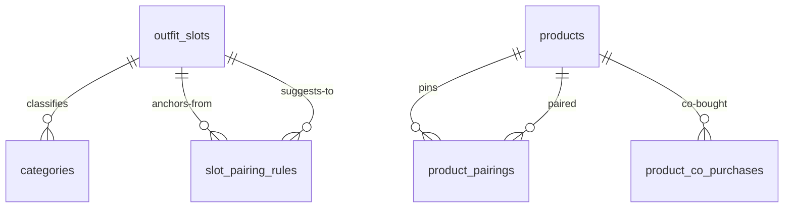

# Recommendations — Complete the Look Engine

> Status: Filling | Last Updated: 2026-10-17
> 3 tables here (`outfit_slots`, `slot_pairing_rules`, `product_pairings`) +
> one column on `categories` (`outfit_slot_id`, file 04). Phase-2
> `product_co_purchases` is designed here and built only when real order
> data exists (§3.5). DDL (`012-recommendations.sql`) is deferred by
> decision (2026-10-17) — this file is the build contract. Conventions:
> `01-Conventions.md`.

## 1. Why & scope

Requirements shaped this design:

1. "Considering a black pant → suggest a white tee, a cap, sneakers" —
   **complementary** items, never more of the same thing.
2. Accuracy first: suggestions respect audience (men/women/kids),
   availability, and look coherent (color, season, price band).
3. Product types will change; adding or renaming types must cause **zero
   code and zero schema changes** — the engine works on outfit *roles*,
   not product names.
4. Scale: thousands of products; no hand-pairing treadmill, while manual
   control stays available where it matters most.
5. v1 surfaces: **PDP section + cart drawer** (decided 2026-10-17).
   Admin management UI follows in a later phase.

Rejected approaches, recorded so they stay rejected:

| Approach | Why not |
|---|---|
| Hand-pair products only | Every new arrival needs manual pairing to appear anywhere — a treadmill that fails silently |
| Rules hardcoded in code ("if pant then tshirt") | Every catalog change becomes a deploy — violates requirement 3 |
| ML / embeddings / vector store | No training data pre-launch, non-deterministic output, and a second datastore violates the one-Postgres monolith |
| Repurposing `collections` as the engine | Collections are editorial curation with manual membership; this engine is computed. Different lifecycles — both coexist (an editorial "look" page stays a collection) |

### Change-impact guarantee (requirement 3, restated as a table)

| Event | Action | Code/schema change |
|---|---|---|
| New product type ("Sarong") | New category + slot assignment (admin) | **None** — participates instantly |
| New role needed ("Bags" split from accessory) | Insert slot row + rule rows (data) | **None** |
| Retire a type | Deactivate category (existing switch) | **None** |
| Import new arrivals | Category already slotted | **None** — suggestions appear automatically |
| New surface (order confirmation) | One thin route reusing the engine | One route only |

## 2. The four layers

```
product → category → outfit slot          (Layer 1: the anchor's role)
slot → slot + count                       (Layer 2: which roles complete which)
candidates → deterministic score          (Layer 3: ranking within every role)
admin pins override everything            (Layer 4: curation)
future: co-purchase rollup boosts         (Phase 2: behavioral data)
```

- **Layer 1 — Outfit slots.** Each category optionally maps to one role:
  `top`, `bottom`, `outerwear`, `footwear`, `headwear`, `accessory`.
  Subcategories inherit the nearest ancestor's value. Categories without
  a resolvable slot simply don't participate (no half-guessed suggestions).
- **Layer 2 — Pairing rules.** Rows: "anchor is a bottom → suggest 2 tops,
  1 footwear, 1 headwear, 1 accessory". Rules are data; a new role is a
  data insert.
- **Layer 3 — Deterministic ranking.** §5: hard filters + weighted score.
  Same inputs always produce the same list — fixture-testable, honest in
  the demo phase, debuggable in production.
- **Layer 4 — Pins.** `product_pairings` hand-picked by staff; rendered
  first in their group, never displaced by scoring.

## 3. Tables

### 3.1 outfit_slots

| Column | Type | Constraints | Reason |
|---|---|---|---|
| id | uuid | PK, UUIDv7 | |
| slug | varchar(30) | NOT NULL, UNIQUE | `top`, `bottom`… — the code contract |
| name | varchar(50) | NOT NULL | Display ("Tops") |
| sort_order | integer | NOT NULL DEFAULT 0 | Group order across surfaces |
| is_active | boolean | NOT NULL DEFAULT true | Kill switch — retire a role without deleting rules |
| created_at / updated_at | timestamptz | NOT NULL DEFAULT now() | Convention |

Indexes: PK · unique slug.

**Why a table and not `CHECK IN (...)`:** our status columns are closed
sets by nature; slots are an **open** set owned by merchandising. A new
slot must be an insert, never a migration — that is the requirement-3
guarantee. (Deliberate, documented exception to the status convention.)

### 3.2 slot_pairing_rules

| Column | Type | Constraints | Reason |
|---|---|---|---|
| id | uuid | PK | |
| from_slot_id | uuid | NOT NULL, FK → outfit_slots(id) ON DELETE RESTRICT | The anchor's role; RESTRICT — a slot still referenced by rules fails loudly (retire via `is_active` first) |
| to_slot_id | uuid | NOT NULL, FK → outfit_slots(id) ON DELETE RESTRICT | The suggested role |
| suggest_count | integer | NOT NULL DEFAULT 1, CHECK (suggest_count BETWEEN 1 AND 4) | How many cards this role contributes |
| sort_order | integer | NOT NULL DEFAULT 0 | Target-group display order |
| is_active | boolean | NOT NULL DEFAULT true | Kill switch — a rule is retired without a delete |
| created_at / updated_at | timestamptz | NOT NULL DEFAULT now() | Convention |
| UNIQUE | — | `(from_slot_id, to_slot_id)` | One rule per direction pair |
| CHECK | — | `from_slot_id <> to_slot_id` | The same-slot law lives in the schema, not in code re-discovery |

Indexes: PK · unique pair (rule load by anchor slot) ·
`idx_slot_pairing_rules_to_slot_id` (reverse FK guard).

### 3.3 product_pairings

| Column | Type | Constraints | Reason |
|---|---|---|---|
| id | uuid | PK | |
| product_id | uuid | NOT NULL, FK → products(id) ON DELETE CASCADE | Anchor product |
| paired_product_id | uuid | NOT NULL, FK → products(id) ON DELETE CASCADE | The hand-pinned suggestion |
| sort_order | integer | NOT NULL DEFAULT 0 | Pin order within its group |
| created_at / updated_at | timestamptz | NOT NULL DEFAULT now() | Convention |
| CHECK | — | `product_id <> paired_product_id` | No self-pins |
| UNIQUE | — | `(product_id, paired_product_id)` | No duplicate pins |

Indexes: PK · unique pair (anchor lookup) ·
`idx_product_pairings_paired_product_id` (reverse).

Pins are directional — A pinned to B does not pin B to A (the admin
decides per product; seed sets are written symmetrically where wanted).

### 3.4 categories.outfit_slot_id (column on file 04's table)

| Column | Type | Constraints | Reason |
|---|---|---|---|
| outfit_slot_id | uuid | NULL, FK → outfit_slots(id) ON DELETE RESTRICT | Outfit role; subcategories inherit the nearest ancestor's value (resolution query §5.6). RESTRICT — a slot still in use fails loudly |

Index: `idx_categories_outfit_slot_id` (delete-guard). The column is set
in the admin category write (`PATCH /api/categories/:id`,
`outfitSlotId`); NULL is a valid state (unmapped categories don't
participate).

### 3.5 product_co_purchases — phase 2, documented not built

| Column | Type | Constraints | Reason |
|---|---|---|---|
| product_id | uuid | NOT NULL, FK → products(id) ON DELETE CASCADE, PK (product_id, paired_product_id) | Anchor |
| paired_product_id | uuid | NOT NULL, FK → products(id) ON DELETE CASCADE | Co-bought candidate |
| co_orders | integer | NOT NULL DEFAULT 0, CHECK (co_orders >= 0) | Orders containing both, 90-day window |
| computed_at | timestamptz | NOT NULL | Weekly job stamp (truncate + rebuild — a derived table, never merged) |

Indexes: PK · `idx_product_co_purchases_paired` (reverse). Built only
when real orders exist; the ranking step reads it **only if rows exist**
(zero redesign — §5.2 adds the boost automatically).

## 4. Seed data (idempotent)

### Slots

| slug | name | sort_order |
|---|---|---|
| top | Tops | 1 |
| bottom | Bottoms | 2 |
| outerwear | Outerwear | 3 |
| footwear | Footwear | 4 |
| headwear | Headwear | 5 |
| accessory | Accessories | 6 |

### Rule matrix (suggest_count per from → to; seeded, editable later)

| from ↓ / suggests → | top | bottom | outerwear | footwear | headwear | accessory |
|---|---|---|---|---|---|---|
| top | — | 2 | 1 | 1 | 1 | 1 |
| bottom | 2 | — | — | 1 | 1 | 1 |
| outerwear | 2 | 2 | — | 1 | 1 | 1 |
| footwear | 1 | 1 | — | — | 1 | 1 |
| headwear | 2 | 2 | — | 1 | — | 1 |
| accessory | 2 | 2 | — | 1 | 1 | — |

`sort_order` = column order (top → accessory). Caps:
`suggest_count` per rule ≤ 4 (DB); surface totals capped in §5.4.

## 5. Matching — the deterministic algorithm

Given anchor product(s) — PDP: the viewed product; cart drawer: the cart's
distinct products:

1. Resolve each anchor's slot (nearest-ancestor walk, §5.6; the service
   caches the resolved tree → slot map, 5-min TTL like the role cache).
2. Load active rules for the anchor's slot, ordered by `sort_order`.
3. Build the candidate pool per target slot: all category ids resolving
   to that slot → `products.category_id = ANY(...)`, then hard filters.
4. Apply hard filters (§5.1) — ALL must pass.
5. Score each candidate (§5.2) — max across anchors when several.
6. Merge pins, dedupe, sort, cap, group (§5.4).

### 5.1 Hard filters

- `status = 'active' AND deleted_at IS NULL`
- `stock > 0` (both surfaces hide OOS by default; badge variant deferred)
- candidate slot ≠ anchor slot (schema CHECK + engine both enforce)
- gender compatible (matrix below)
- not an anchor product; cart surface additionally excludes every in-cart
  product (already chosen = not a suggestion)

Gender compatibility (`products.gender` already exists):

| anchor ↓ / candidate → | Female | Male | Unisex | Kids | NULL |
|---|---|---|---|---|---|
| Female | ✓ | — | ✓ | — | ✓ |
| Male | — | ✓ | ✓ | — | ✓ |
| Unisex | ✓ | ✓ | ✓ | — | ✓ |
| Kids | — | — | — | ✓ | ✓ |
| NULL | ✓ | ✓ | ✓ | ✓ | ✓ |

Kids never mix with adult lines; Unisex bridges Female/Male. NULL is a
wildcard (the import always maps the Gender column — hygiene note, not a
filter failure).

### 5.2 Scoring (named constants, one place, tunable)

| Signal | Source (exists today) | Formula | Range |
|---|---|---|---|
| Tag affinity | `products.tags[]` (GIN) | `min(shared_tags, 3)` | 0…3 |
| Collection affinity | `collection_products` | shared published collection → `+2` | 0…2 |
| Color harmony | `attribute_values.swatch_hex` | best pair score across color values (§5.3) | −1…2 |
| Price proximity | `products.price` | band distance (§ band rule) | 0…2 |
| Freshness | `products.created_at` | ≤ 30 days → `+1` | 0…1 |
| Active discount | `product_discounts` | active window now → `+1` | 0…1 |
| Bestseller (phase 2) | `product_co_purchases.co_orders` | normalized `0…2` (0 today) | 0…2 |

Price bands: **≤ ₹1,499 → 0 · ₹1,500–3,499 → 1 · ≥ ₹3,500 → 2**; same
band `+2`, adjacent `+1`, else 0.

Tie-breakers — a **total order** so output is deterministic:
score ↓ → `created_at` ↓ → `id` ↑.

### 5.3 Color harmony from `swatch_hex`

Convert both hexes to HSL and classify each value:

- **neutral** if `L ≥ 0.88` (ivory/beige/white), or `L ≤ 0.20`
  (black/charcoal), or `S ≤ 0.12` (greys)
- **colored** otherwise (hue = `H`)

Pair score — the **max** across both products' color values (multi-color
products use their best combination):

| Pair | Score |
|---|---|
| neutral × neutral, ΔL ≥ 0.35 (black ↔ white, charcoal ↔ ivory) | **+2** |
| neutral × neutral, smaller ΔL (grey ↔ beige) | **+1** |
| neutral × colored (a pop on a neutral base) | **+1** |
| colored × colored, same family (ΔH ≤ 30°) | **+1** |
| colored × colored, different families | **−1** (clash) |

Products with no color values score **0** — missing data is silent, never
a penalty. Thresholds (`0.88 / 0.20 / 0.12 / 0.35 / 30°`) are named
constants: tunable without redesign.

### 5.4 Pins, merge, order, caps

- Pins load per anchor and render **first** in their resolved slot's
  group; a pinned product with no resolvable slot joins a final
  **"Pairs well with"** group. Pins still obey status/stock filters — an
  OOS pin is hidden like any card (no dead tile).
- A pinned product is never repeated in the computed set (pin wins).
- Group order = slot `sort_order`; within a group: pinned (by pin
  `sort_order`) → computed (score ↓, `created_at` ↓, `id` ↑).
- Caps (service constants): **PDP 8 cards total · cart drawer 4**; take
  up to `suggest_count` per group, then trim whole groups by group order —
  never pad with worse-fitting roles (no noise).
- Cart surface: anchors = distinct cart products; per-slot count = MAX of
  the anchors' rule counts for that slot; every in-cart product excluded.
- Empty result → the surface does not render (no dead section).

### 5.5 Worked example — black pant (Men, in stock)

Anchor color: Black (`#111111` → L ≈ 0.07 → neutral, dark).

| Candidate | Slot | Signals | Score |
|---|---|---|---|
| Oversized tee, white (Men) | top | color +2 (ΔL ≈ 0.93), tags +1, band +2, never-worn fresh +1 | **6** |
| Tee, ivory (Men) | top | color +2, band +1 | **3** |
| Sneakers, black/white (Unisex) | footwear | color +2, tags +1, band +1 | **4** |
| Cap, grey (Unisex) | headwear | color +1 (neutral, ΔL < 0.35), band +2 | **3** |

Result: top group = white tee → ivory tee (score 6 → 3); footwear =
sneakers; headwear = cap. Exactly the "white tee + cap + shoes" behavior
— computed, not hand-paired.

### 5.6 Gate queries (copy-pasteable)

```sql
-- 1. Slot resolution — nearest ancestor with a value wins ($1 = category id)
WITH RECURSIVE walk AS (
  SELECT id, parent_id, outfit_slot_id, 0 AS depth
  FROM categories WHERE id = $1
  UNION ALL
  SELECT c.id, c.parent_id, c.outfit_slot_id, w.depth + 1
  FROM categories c JOIN walk w ON c.id = w.parent_id
  WHERE w.outfit_slot_id IS NULL
)
SELECT outfit_slot_id FROM walk
WHERE outfit_slot_id IS NOT NULL
ORDER BY depth LIMIT 1;
-- The service caches the whole tree → slot map (5-min TTL); per-request
-- work is a map lookup, never this query.

-- 2. Rules for an anchor slot ($1 = anchor slot slug)
SELECT r.to_slot_id, s.slug, s.name, r.suggest_count, r.sort_order
FROM slot_pairing_rules r
JOIN outfit_slots s ON s.id = r.to_slot_id
WHERE r.from_slot_id = (SELECT id FROM outfit_slots WHERE slug = $1)
  AND r.is_active
ORDER BY r.sort_order;

-- 3. Pins for an anchor ($1 = product id)
SELECT pp.paired_product_id, pp.sort_order
FROM product_pairings pp
WHERE pp.product_id = $1
ORDER BY pp.sort_order;

-- 4. Candidates for one target slot ($categoryIds = every category whose
--    nearest-ancestor resolution lands on the slot — from the cached map)
SELECT p.id, p.name, p.slug, p.price, p.gender, p.tags, p.created_at
FROM products p
WHERE p.category_id = ANY($categoryIds)
  AND p.status = 'active' AND p.deleted_at IS NULL AND p.stock > 0
  AND p.id <> ALL($excludeIds);
```

## 6. Surfaces (v1)

### PDP — "Complete the Look"

Renders under the buy box. Groups titled by slot name (`Tops`,
`Footwear`…); cards reuse the storefront card/button primitives. Add-to-cart
opens a compact size picker whenever the product has size options —
**never a silent default size** (wrong-size risk). The card links to its
PDP. Inline skeleton while loading; section hidden when empty.

### Cart drawer — "Style it with"

Above the checkout CTA: up to 4 cards from the union of the cart's
anchors, excluding in-cart items. Adds respect the existing cart merge
rules (same variant → qty increment). Guests work via `x-session-id`.
Hidden when empty or when no anchor resolves to a slot.

### Later surfaces (recorded)

Order confirmation / email cross-sell (same engine, one more route);
admin management (category slot field, rules matrix editor in Settings,
pins in the product drawer); demo phase — the storefront mock adapter
implements §5 verbatim over fixtures so the widget shows deterministic,
same-shaped lists before the backend lands.

## 7. API contracts

| Method | Path | Auth | Purpose |
|---|---|---|---|
| GET | `/api/catalog/products/:slug/look` | – | grouped suggestions for the PDP (`?limit=` optional; server caps) |
| GET | `/api/cart/look` | C / guest `x-session-id` | grouped suggestions from cart anchors |

Response shape (bounded — no pagination needed):

```json
{ "data": [
  { "slot": { "slug": "top", "name": "Tops" },
    "products": [
      { "id": "…", "slug": "oversized-tee-white", "name": "…",
        "price": 1499, "pinned": false, "inCart": false }
    ] }
] }
```

Admin endpoints (reserved — ship with their UI phase, contract fixed
here):

| Method | Path | Auth | Purpose |
|---|---|---|---|
| GET/PUT | `/api/admin/recommendation-rules` | A | rules matrix |
| POST/DELETE | `/api/products/:id/pairs` | A | pin management |
| PATCH | `/api/categories/:id` | A | gains `outfitSlotId` with the existing category write |

## 8. Scale & operations

- **Compute-on-read**: category tree cached (5-min TTL), candidates via
  `idx_products_category_id` + the partial active index, scoring in
  memory — bounded by one slot's pool, not the catalog size.
- **Escape hatch (not built)**: a materialized `product_look_suggestions`
  cache refreshed on stock/status/rule changes, if P99 ever demands it.
- **Freshness**: rule/pin/slot edits take effect on the next request — no
  rebuild step, no stale window.
- **Honesty**: rankings are computed and never dressed as claims — no
  fabricated "trending"/"bestseller" labels before phase-2 data exists.

## 9. Decisions & deferrals

**Locked (2026-10-17):**

- Six slots approved (`top`, `bottom`, `outerwear`, `footwear`,
  `headwear`, `accessory`); slots are a table (open set), not an enum.
- Rules are data; same-slot suggestions impossible (schema CHECK).
- Pins ship in v1; pins render first and override scoring.
- v1 surfaces: PDP + cart drawer. Deterministic scoring; no ML.
- Behavioral rollup is phase 2 (`product_co_purchases`), zero redesign
  when added.
- DDL (`012-recommendations.sql`) deferred by decision — docs first.

**Deferred (recorded, not built):**

- OOS suggestions with a badge (currently hidden).
- Personalized ranking (per-user history boost).
- Embedding/semantic similarity — only if the deterministic engine ever
  shows a real gap.
- Bundle discounts ("buy the look, save X") — pricing concern, not
  recommendations; future `product_discounts` scope.
- Click-through telemetry on suggestion cards (the tuning feedback loop).

## 10. Relationship slice


