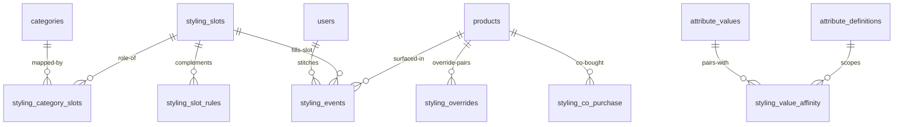

# Styling & Recommendations — Complete the Look

> Status: Draft | Last Updated: 2026-10-17
> **Build order: LAST.** This module ships only after the core e-commerce
> app is complete (storefront + admin + checkout + fulfillment all live).
> It is designed now so nothing before it needs rework; it is built last
> so it launches with real usage discipline, not as a distraction.
> 7 module-owned tables (`styling_*`), **zero edits to any existing
> table**. One-way dependency: styling reads core (categories, products,
> attribute values, users); nothing in core reads styling — the module
> drops cleanly. Conventions: `01-Conventions.md`.

## 1. What this is (requirements)

1. PDP "Complete the Look": a cap suggests a tee, pant, shoes; a black
   pant suggests the *ivory* tee, not another black one.
2. Accurate on **day zero** — zero orders, zero clicks: hand-tuned rules
   plus merchandiser overrides must already produce good strips.
3. Accurate *for real* as data arrives: clicks, orders, and repeat
   visitors refine ranking over time (refinement roadmap, §6).
4. No weird combinations, ever (vivid purple × green class), no empty
   shells, no false claims — fewer honest items beat a padded strip.
5. Stock-honest: unavailable colors/products fall down a defined ladder
   (§5) — never a broken or sold-out card.
6. Individually testable, deployable, removable: own tables, own code,
   own flag; removal touches nothing outside `styling_*` (§7).

**Approach chosen: hybrid layered.** Slots + rules (coverage) +
pin/block overrides (taste) at launch; computed boosts (co-purchase,
clicks, popularity) and personalization later. Rejected as the base:
manual product-pair curation (no scale — every new product needs staff
work), category-pair matrices (configuration explosion; nav restructure
breaks rules), co-purchase-first (cold start — empty until volume),
pure similarity (finds "more of the same", never a complement), and
editorial looks only (tiny coverage, heavy per-look effort).

## 2. The model — slots, rules, overrides

### Slots — the outfit roles

| slug | role | example categories |
|---|---|---|
| top | upper body | tees, hoodies, polos |
| bottom | lower body | pants, shorts, joggers |
| outerwear | layering | jackets, overshirts |
| headwear | head | caps, beanies |
| footwear | feet | sneakers, slides |
| accessory | finish | bags, socks, jewellery |

Seed = 6 rows, done once. Slots are **not** the nav tree — they are an
internal vocabulary; the category tree can be reorganised freely.

### Category map — with inheritance

`styling_category_slots` maps *some* categories; resolution walks up
`parent_id` to the nearest mapped ancestor. Map the tree's grouping nodes
once (~6–10 rows; e.g., tees/hoodies → `top`, pants → `bottom`, jackets
→ `outerwear`, accessories → `accessory`). A new "Polo" under tees
inherits `top` the moment it exists. An unmapped branch (no mapped
ancestor) is simply **not suggestible** and produces no source strip —
surfaced later in the admin coverage report, never a runtime error.

### Rules — the complement matrix

`styling_slot_rules` holds source→target weights (0–100), seeded once.
Initial matrix (tuned later — direction matters, the two directions grow
independently as evidence arrives):

| source ↓ / target → | top | bottom | outerwear | headwear | footwear | accessory |
|---|---|---|---|---|---|---|
| top | — | 20 | 8 | 12 | 10 | 6 |
| bottom | 20 | — | 8 | 12 | 10 | 6 |
| outerwear | 16 | 16 | — | 10 | 10 | 6 |
| headwear | 14 | 14 | 8 | — | 10 | 6 |
| footwear | 10 | 12 | 8 | 4 | — | 6 |
| accessory | 10 | 10 | 8 | 8 | 8 | — |

### Overrides — the merchandiser's two buttons

- **pin** — always include this product in this product's strip
  (e.g., black pant → ivory boxy tee), subject only to stock.
- **block** — never show this pair, even if rules or data say otherwise.
  **Block beats pin** when a pair carries both.

Pins are limited per strip (≤2 recommended) so the strip stays honest;
blocks are absolute. Both are per source→target product rows.

## 3. Matching axes — how taste is scored

| Axis | Facts live in | Scored by |
|---|---|---|
| Slot | `styling_category_slots` | rule weight |
| Color | existing color attribute values + `swatch_hex` | computed HSL harmony + manual overrides |
| Style | "Style" values in the **shared attribute library** | `styling_value_affinity` rows |
| Audience/season (optional) | attribute library again | hard filter (tagged) or small bonus (soft) |
| Behavior | views, clicks, orders | capped boosts (§6) |
| Human | `styling_overrides` | pin / block |

### Color harmony (computed — works day zero)

`swatch_hex` → HSL:

- **Neutral** (saturation < ~15%) pairs broadly; **contrast bonus** — a
  dark bottom prefers a light top and vice versa (black pant → ivory tee
  scores high; black × black flat match gets a penalty).
- **Chromatic**: analogous/complementary hues boosted; near-duplicate
  hues of different shades penalized (two non-matching reds read as an
  accident).
- **Clash band (hard)**: high-saturation pairs ~150–210° apart (the
  vivid purple × green class) are excluded *before ranking* — they can
  never appear, even if the product is otherwise perfect.
- One accent per pairing; everything else neutral.
- Any pair can be rescued by a row in `styling_value_affinity` —
  computed default, explicit override.

### Style (stored — taste is opinion, not physics)

"Style" is a definition in the existing attribute library (admin-only
visibility), with values like Minimal / Streetwear / Formal. Harmony is
rows in `styling_value_affinity`: Minimal↔Minimal high, Minimal↔Streetwear
low-medium, Streetwear↔Formal low/negative. ~20–40 seed rows; edited like
any config. Retuning is a data change — never a migration.

### Graceful degradation

Missing hex / untagged style / unmapped category: the axis contributes 0
or the item is skipped — never an error, never a broken strip. Data
richness improves ordering; it is never required for coverage.

## 4. Selection pipeline

```
0. Source facts        product → slot, color, style(s), audience
1. Target slots        from active rules, weight-ordered (top 2–3)
2. Candidate pool      per slot: active products in mapped categories,
                       purchasable, ≠ source, blocks applied
3. Color pick          per candidate: best-scoring color; if unavailable
                       → substitution gate (§5); no pass → product rejected
4. Scoring             rule weight + color harmony + style affinity +
                       audience + popularity (capped, later) + pins
                       − penalties (near-flat color, price-band outlier)
5. Display threshold   below minimum match quality → not shown.
                       Fewer items > padding — never a padded strip
6. Strip assembly      diversify (≤2 per slot, 1 per category), cap 4–6,
                       pins forced (≤2), strip-coherence pass: no two
                       clashing accents *inside* the strip — drop the
                       lower-ranked, promote the next, else show fewer
7. Serve-time check    stock re-verify; any drop → next in ranked order;
                       empty slot → omitted; nothing anywhere → section
                       hidden (no skeleton, no placeholder)
8. Cache               per-product payload, short TTL, re-verified at
                       render
```

Pins skip ranking but never skip safety: a pinned product that went
out-of-stock or into the clash band **degrades silently** to the next
candidate — never a broken or mismatched card.

## 5. Availability & the fallback ladder

Purchasable = at least one active variant with stock. Qikink POD items
will almost always pass (printed on demand); pre-made items genuinely
gate. v1 judges at the **product level**; size-aware refinement arrives
with personalization (§6, stage 4).

### The substitution gate (same product, different color)

Iterate the product's available colors by closeness to the best-choice
color (weighted HSL distance — hue/saturation/lightness). A substitute
must pass **both** checks:

1. **Near the best-choice color** — ivory → cream ✅; ivory → emerald ✗.
2. **Re-scored against the source**, it still clears the harmony floor —
   near to the best choice but clashing with the source is still out.

Pass → show the product with that color pre-selected. Fail → **reject
the product entirely** and move to the next ranked candidate.

### Edge-case ladder (behavior is defined, never improvised)

| # | Situation | Behavior |
|---|---|---|
| 1 | Best color in stock | Show normally, that color pre-selected |
| 2 | Best color OOS, near color available & still harmonious | Show product in the near color (closest first; ties → higher re-score) |
| 3 | Best color OOS, no substitute passes both checks | Reject product → next candidate |
| 4 | Product fully OOS | Skip → next candidate |
| 5 | Slot's candidates exhausted | Slot contributes nothing |
| 6 | All slots empty | Section hidden — no skeleton, no placeholder |
| 7 | Candidate is a clash pair | Excluded pre-rank (hard filter, permanent) |
| 8 | Candidate passes clash but is mediocre | Below display threshold → not shown. Fewer honest items > padding |
| 9 | Two final-strip items clash with each other | Drop the lower-ranked, promote the next; else show fewer |
| 10 | A pinned product went OOS or clashed | Pin degrades silently to next candidate; clash floor and stock beat pins |
| 11 | Pair carries both pin and block | **Block wins** |
| 12 | Product qualifies via pin *and* rules | Shown once; pin position wins |
| 13 | Two same-category candidates | Kept to 1 (diversity) |
| 14 | Missing hex / untagged style / unmapped category | Axis contributes 0 or item skipped; never an error (coverage report later) |
| 15 | Stock flips after cache write | Serve-time re-verify; the ordered list supplies the instant next pick |
| 16 | Audience conflict (where tagged) | Hard filter; untagged = permissive, lower confidence |
| 17 | User's saved size OOS for a shown item | v1 is product-level; size-aware refinement is stage 4 (uses `profile_size_preferences`) |

Thresholds ("near" distance, clash band, display floor) are **code
constants with golden-test coverage** in v1 — not admin-editable, so the
scoring cannot be broken from a settings screen on day one. A
`styling_settings` table is a deliberate, conditional deferral: only if
tuning proves it needs frequent adjustment.

## 6. Refinement roadmap (v2.1) — quality rises as data arrives

*(v2.1 of this plan added only two columns on `styling_events` —
`variant` and `contributors` — and phase timing; the seven tables stand.
No extra tables are required.)*

**The principle:** launch = hand-tuned v2, fully good on day zero.
Everything after improves it through four kinds of levers, none of which
is a rebuild:

| Lever | What changes | Lives in | Code? |
|---|---|---|---|
| ① Config/taste | rule weights, affinity scores, pins/blocks | `styling_*` data rows | No |
| ② Computed boosts | co-purchase, popularity, click-affinity | nightly jobs → `styling_co_purchase` | Once, then automatic |
| ③ Personalization | per-user filters & boosts | reads existing tables | Once, then automatic |
| ④ Composition | strip size, slot mix, exploration budget | module config | Rarely |

### Data & trust gates (below a gate, a signal contributes exactly zero)

| Source | Signal | Trust gate (tunable) | Improves |
|---|---|---|---|
| `styling_events` — impressions | what was offered, position | immediate (it is the denominator) | measurement baseline |
| `styling_events` — clicks | what interested people | ~300+ impressions per candidate before CTR is trusted | ranking weights, dead-spot detection |
| `styling_events` — add-to-cart | what converts | same gating | strongest soft signal |
| `orders` / `order_items` | co-purchase, attach rate | ≥ ~100 orders store-wide; a pair needs ≥3 distinct orders for any weight | co-purchase boosts |
| `product_views`, wishlists | interest where no click happened | soft, always small | popularity/recency |
| `profiles` + `profile_size_preferences` | the shopper's (or recipient's) size | logged-in only | personalization |

### Stages

- **Stage 0 — Launch:** v2 as designed. Behavioral tables exist but are
  dormant. Nothing depends on data.
- **Stage 1 — Measurement (first weeks):** events live from module
  launch; admin Styling report appears (module CTR, attach rate,
  per-slot/per-candidate tables, fill rates, coverage — categories
  without slot, products without style/hex). Refinement = ①: weights and
  pins tuned **by evidence**, zero code.
- **Stage 2 — Order signal (~50–200 orders):** nightly co-purchase
  build; pairs above support-gate become small capped boosts. "What
  actually sells together" starts correcting where taste guessed wrong.
- **Stage 3 — Click signal + popularity:** click-affinity (pairs people
  click together differ from purchases), popularity/recency boosts with
  decay (30/90-day windows), strip composition tuned per slot,
  **exploration budget** introduced (see guardrails).
- **Stage 4 — Personalization (repeat users):** never suggest what this
  user just bought; size-aware — if ordering for a household member, the
  member's `profile_size_preferences` apply, not the buyer's;
  recently-viewed adjacency; light style-preference inferred from that
  user's own clicks/orders. Logged-out users are unaffected.
- **Stage 5 — Steady hygiene:** seasonal retuning by the merchandiser,
  changelog, gate adjustments. **Deliberately the end of the line** — no
  black-box ML unless store scale ever demands it. All levers stay small,
  readable, and testable.

### How a refinement ships (the safety mechanism)

Bigger-than-data-row changes (new scoring component, reweighting) go
through **shadow mode** first: compute current and candidate logic
side-by-side, **serve the current**, log what the candidate would have
shown (`styling_events.variant`). After N days compare via the same
report (CTR, attach rate, fill rate). Evidence clear → flip the flag.
Not clear → discard. One lever at a time, always reversible, recorded in
a changelog. Real A/B testing is deferred until traffic makes it
statistically meaningful; shadow + before/after gives the same decision
quality without the statistics problem.

### Guardrails — what data may never do

- **Taste safety stays hard:** clash floor and blocks are absolute; data
  cannot resurrect a purple-green pairing — only an explicit human
  override row can.
- **No false claims, ever:** the display threshold never lowers because
  data says "show more items". Fewer honest items > a fuller strip.
- **No single signal dominates:** every behavioral boost is capped;
  rules + style + color always remain the majority of a score.
- **Anti-entrenchment:** exploration budget (~15–20% of strip slots
  reserved for rotation/challengers) + time decay, so yesterday's winners
  don't fossilize the strip.
- **New-arrival fairness:** a product needs zero statistics to appear —
  boosts are bonuses, never entry requirements.
- **Privacy:** first-party only, session-scoped when logged out, raw
  events drop after 30 days — the `10-Analytics.md` lifecycle, unchanged.
- **Removability intact:** every refinement knob lives inside `styling_*`
  tables/config; dropping the module still never touches core.

## 7. Module boundary — isolated by construction

| Aspect | Guarantee |
|---|---|
| **Tables** | All 7 prefixed `styling_*`, owned by the module. **One-way dependency:** styling tables reference core (categories, products, attribute definitions/values, users); nothing in core references styling — dropping them cascades nowhere. Zero edits to any existing table. |
| **Code** | One server folder (`server/styling/` — pure functions + thin DB reads), one route family (`/api/styling/...`), one storefront mount (the existing PDP section), admin screens later under Settings. |
| **Toggle** | One flag (`styling.enabled`). **Off = indistinguishable from "no results"** — the section renders nothing. No half-states, no dead UI. |
| **Testable** | The brain is pure functions: slot resolution, color distance/harmony, substitution gate, ranking, strip assembly. Node test suite with golden cases — e.g., *ivory beats navy beats black* is a test, not an opinion. The storefront demo uses the same scoring contract in its mock layer. |
| **Deployable** | Three independently-revertible layers: ① migration (dormant tables) → ② scoring + API (dark) → ③ UI behind the flag. Any layer rolls back alone. |
| **Removable** | Checklist: drop the 7 `styling_*` tables · delete `server/styling/` · delete the route folder · remove the one component mount · drop the flag · remove the admin nav row. Residual: the "Style" values set in the shared attribute library remain as harmless catalog metadata (useful standalone). Reuse of the library > module-private tags — accepted consciously. |

### Golden test list (the contract)

1. Black pant: ivory top > navy top > black top.
2. Vivid purple × vivid green: excluded pre-rank.
3. Best color OOS + near substitute (ivory→cream): substituted, shown.
4. Best color OOS + far substitute (ivory→emerald): product rejected →
   next candidate.
5. Product fully OOS → next candidate; slot exhausted → omitted; all dry
   → section hidden.
6. Below display threshold → not shown; strip never padded.
7. Strip coherence: two clashing accents → lower dropped, refill or
   fewer.
8. Unmapped category: not suggestible, no error.
9. Pin × OOS → degrades; pin × block → block wins.
10. Slot inheritance: child category resolves via nearest mapped
    ancestor.

## 8. Tables

### styling_slots

| Column | Type | Constraints | Reason |
|---|---|---|---|
| id | uuid | PK | |
| slug | varchar(30) | NOT NULL, UNIQUE | `top` … `accessory` — the stable vocabulary |
| name | varchar(60) | NOT NULL | Display label |
| sort_order | integer | NOT NULL DEFAULT 0 | Strip ordering |
| is_active | boolean | NOT NULL DEFAULT true | Off-switch without delete |
| created_at / updated_at | timestamptz | NOT NULL DEFAULT now() | Convention |

Indexes: PK · unique slug. Six rows in practice.

### styling_category_slots

| Column | Type | Constraints | Reason |
|---|---|---|---|
| category_id | uuid | PK, FK → categories(id) ON DELETE CASCADE | One slot per category; mapping dies with the category |
| slot_id | uuid | NOT NULL, FK → styling_slots(id) ON DELETE RESTRICT | Deleting a slot people mapped to fails loudly |
| created_at / updated_at | timestamptz | NOT NULL DEFAULT now() | Admin-managed config |

Indexes: PK (category) · `idx_styling_category_slots_slot_id` (FK
guards + per-slot coverage reads). Resolution (nearest mapped ancestor)
is app-side over the category tree.

### styling_slot_rules

| Column | Type | Constraints | Reason |
|---|---|---|---|
| id | uuid | PK | |
| source_slot_id | uuid | NOT NULL, FK → styling_slots(id) ON DELETE CASCADE | |
| target_slot_id | uuid | NOT NULL, FK → styling_slots(id) ON DELETE CASCADE | |
| weight | integer | NOT NULL DEFAULT 10, CHECK (0–100) | Complement strength |
| is_active | boolean | NOT NULL DEFAULT true | |
| created_at / updated_at | timestamptz | NOT NULL DEFAULT now() | |
| UNIQUE | — | (source_slot_id, target_slot_id) | One row per pair |
| CHECK | — | source ≠ target | No self-pairs |

Indexes: PK · unique pair · `idx_styling_slot_rules_target_slot_id`.
~20–25 seed rows.

### styling_value_affinity

| Column | Type | Constraints | Reason |
|---|---|---|---|
| id | uuid | PK | |
| definition_id | uuid | NOT NULL, FK → attribute_definitions(id) ON DELETE CASCADE | Axis scope (Style, Color, any future axis) |
| value_a_id | uuid | NOT NULL, FK → attribute_values(id) ON DELETE CASCADE | Value gone → affinity meaningless |
| value_b_id | uuid | NOT NULL, FK → attribute_values(id) ON DELETE CASCADE | |
| score | integer | NOT NULL, CHECK (−100–100) | Harmony; negative = actively avoid |
| note | varchar(255) | NULL | Why (merchandiser context) |
| created_at / updated_at | timestamptz | NOT NULL DEFAULT now() | |
| UNIQUE | — | (definition_id, value_a_id, value_b_id) | One row per pair per axis |
| CHECK | — | value_a ≠ value_b | No self-pairs |

Indexes: PK · unique · `idx_…_value_a_id` · `idx_…_value_b_id` (lookups
from either side; FK guards). App validates both values belong to the
definition — no single FK can express that. Rows are stored with the pair
sorted on write; reads match either order (symmetric by design).

### styling_overrides

| Column | Type | Constraints | Reason |
|---|---|---|---|
| id | uuid | PK | |
| source_product_id | uuid | NOT NULL, FK → products(id) ON DELETE CASCADE | The strip's product |
| target_product_id | uuid | NOT NULL, FK → products(id) ON DELETE CASCADE | The forced/forbidden item |
| kind | varchar(10) | NOT NULL, CHECK IN ('pin','block') | The two buttons |
| priority | integer | NOT NULL DEFAULT 0 | Pin ordering among pins |
| note | varchar(255) | NULL | |
| created_by | uuid | NULL, FK → users(id) ON DELETE SET NULL | Survives staff offboarding |
| created_at / updated_at | timestamptz | NOT NULL DEFAULT now() | |
| UNIQUE | — | (source_product_id, target_product_id) | One verdict per pair |
| CHECK | — | source ≠ target | No self-pairs |

Indexes: PK · unique pair · `idx_styling_overrides_target_product_id` ·
`idx_styling_overrides_created_by`. Block beats pin when both exist.

### styling_co_purchase

| Column | Type | Constraints | Reason |
|---|---|---|---|
| product_a_id | uuid | NOT NULL, FK → products(id) ON DELETE CASCADE, PK (a, b) | Canonical pair order on write |
| product_b_id | uuid | NOT NULL, FK → products(id) ON DELETE CASCADE | |
| score | integer | NOT NULL DEFAULT 0, CHECK (0–100) | Capped boost value |
| orders_count | integer | NOT NULL DEFAULT 0, CHECK (≥ 0) | Support — never trust below 3 |
| created_at / updated_at | timestamptz | NOT NULL DEFAULT now() | `updated_at` = last nightly refresh |
| CHECK | — | a ≠ b | |

Indexes: PK · `idx_styling_co_purchase_product_b_id` (reverse lookups +
FK guard). Nightly job upserts; dormant until refinement stage 2.

### styling_events

| Column | Type | Constraints | Reason |
|---|---|---|---|
| id | uuid | PK | |
| source_product_id | uuid | NOT NULL, FK → products(id) ON DELETE CASCADE | The strip's product |
| related_product_id | uuid | NULL, FK → products(id) ON DELETE CASCADE | The offered/clicked item |
| slot_id | uuid | NULL, FK → styling_slots(id) ON DELETE SET NULL | Which slot it filled (reporting) |
| color_value_id | uuid | NULL, FK → attribute_values(id) ON DELETE SET NULL | Which color was shown (substitution analysis) |
| kind | varchar(20) | NOT NULL, CHECK IN ('impression','click','add_to_cart') | |
| position | smallint | NULL, CHECK (≥ 1) | Rank shown — position-bias analysis |
| variant | varchar(30) | NULL | Shadow-mode tag (`v2` / candidate id) |
| contributors | jsonb | NULL | Score breakdown snapshot — offline "why" analysis |
| user_id | uuid | NULL, FK → users(id) ON DELETE SET NULL | |
| session_id | varchar(64) | NULL | Logged-out stitching |
| ts | timestamptz | NOT NULL DEFAULT now() | Event time / partition key |

Indexes: PK · `(source_product_id, ts DESC)` · `(related_product_id,
kind, ts DESC)`. Analytics lifecycle: append-only, monthly RANGE
partitions on `ts` attach with the analytics build (file 10 conventions),
raw rows drop >30 days. Dormant until the module wires events at launch.

## 9. API contracts

| Method | Path | Auth | Purpose |
|---|---|---|---|
| GET | `/api/styling/complete-the-look` | – | `?product=<slug>&limit=` → `{ data: [{ productId, slug, slot, colorValueId, score, pinned }] }` |
| POST | `/api/styling/events` | – | impression/click/add_to_cart ingest, fire-and-forget (beacon class, 30/s) |

- Disabled flag, stock-dry, or below-threshold results = empty `data[]`
  with 200 — never an error. The storefront hides the section on empty;
  "disabled" and "no results" are indistinguishable by design.
- Response is cacheable while non-personalized (`s-maxage` ~10 min +
  stale-while-revalidate); stage-4 personalization switches that path to
  per-session re-ranking.
- Never writes cart or profile state; availability is re-checked at serve
  time (§4 step 7).
- The storefront mock layer implements the same contract (deterministic
  scorer), so demo behavior matches the future backend.

## 10. Admin surfaces (later phases)

1. **Coverage report** — categories without a slot, products without
   style/hex, dead slots. Never an error, always a to-do list.
2. **Slot mapping screen** — the category tree with a slot select per
   mapped node.
3. **Rules matrix editor** — the 6×6 grid with weights.
4. **Affinity tuner** — style pairs + color overrides.
5. **Pin/block manager** — "Pairs well with" section on the product page.
6. **Styling report** — module CTR, attach rate, per-slot/per-candidate
   performance, substitution stats (the refinement console, §6).

## 11. Decisions (locked 2026-10-17)

- **Hybrid layered model** — rules for coverage, overrides for taste,
  data boosts and personalization later. Alternatives rejected with
  reasons in §1.
- **Build order: LAST** — after the core e-commerce app is complete.
- **Module-owned tables, zero core edits** — `styling_*` prefix, one-way
  FKs, flag-off = empty results.
- **Launch is hand-tuned** — nothing depends on behavioral data; gates
  keep unearned signals at zero.
- **Substitution gate** — near-to-best **and** harmonious-with-source;
  else reject the product, next candidate.
- **No false claims** — clash floor and display threshold are hard;
  fewer honest items over padding; pins lose to safety.
- **Thresholds are code constants** in v1 (golden-tested);
  `styling_settings` is a conditional deferral, not built now.
- **Strip composition** — 4–6 max, ≤2 per slot, 1 per category, ≤2 pins,
  strip-coherence pass.
- **Events** — designed now (7th table), wire at module launch; 30-day
  raw retention, analytics lifecycle.
- **Refinement safety** — capped boosts, trust gates, shadow mode for
  logic changes, one lever per change + changelog, exploration budget at
  stage 3.
- **Style axis reuses the shared attribute library** — the only residual
  after module removal (harmless catalog metadata), accepted consciously.

## 12. Deferrals (recorded, not built)

- `styling_settings` (thresholds → admin-tunable) — only if stages 1–3
  prove frequent tuning is needed.
- Cart-surface strip (fills the slots the cart is missing) — feature
  phase 2.
- "Shop the Look" multi-add bundle — later, if demand shows.
- Post-purchase/email recommendations — separate surface, later.
- Real A/B infrastructure — until traffic makes it meaningful; shadow
  mode covers the interim.
- Per-size styling cuts and audience axes beyond tags — stage 4.
- ML/embedding re-ranking — **not planned**; revisit only if scale
  demands it.

## 13. Phasing (within the feature, once its turn comes)

- **P1 — Core:** seeds (`seed/`, idempotent: 6 slots, ~10 mappings,
  matrix, style pairs) + scoring core + API + PDP module behind the flag
  + events wiring + golden tests. Works day one, zero data.
- **P2 — Console:** admin surfaces (§10) + co-purchase nightly job +
  exploration budget + Styling report + cart-surface strip.
- **P3 — Personalization:** size-aware (via `profile_size_preferences`,
  respecting the household "Order for" recipient), purchased-exclusion,
  recently-viewed, style lean + shadow-mode tuning cadence.

## 14. Relationship slice


